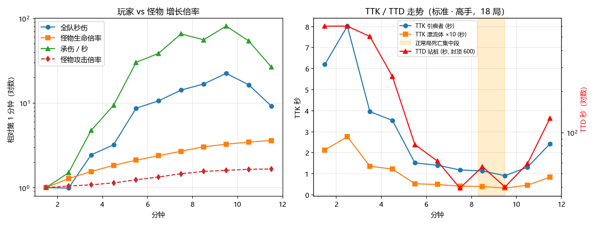

# 116 玩家 / 怪物成长曲线审计（2026-10-21，只出方案不改数）

> 数值会话，分支 `claude/curve-audit`。用户问：怪物血量要不要调？玩家的攻击 / 回血曲线能不能和怪物的生命 / 攻击曲线对上？主流肉鸽怎么做？本文给测量结果和方案，**没改任何数值**，用户看过再改。

## 1. 测量方法

- 云端 cloud-results/curve-1021（main 52e989f9 + 遥测补丁），标准档、高手机器人，6 个固定编队 × seed 1–3：
  维什戴尔 / 塞雷娅 / 铃兰，斯卡蒂 / 凯尔希 / 艾雅法拉，水月 / 星熊 / 流明，逻各斯 / 艾丽妮 / 安洁莉娜，乌尔比安 / 能天使 / 浊心斯卡蒂，归溟幽灵鲨 / 德克萨斯 / 推进之王。
  正常局 18 局 + 不死模式（`--nodeath`，曲线跑满全程）18 局。
- 遥测：`bot.curve` 每 30 秒一个采样点，原有承伤 `taken`、按来源的治疗 `hsrc`、最大生命 `mhp`；本分支新增 `outc`（累计全队输出）、`hpm`（普通怪生命时间倍率 × 难度 × 全局）、`rg`（主控每秒自身回复）（`game/scripts/run/telemetry.gd`，只读，不影响同 seed）。
- 口径：
  - **TTK** = 该分钟一只参考怪的生命 ÷ 全队每秒输出（假设全队打一只，是下限）。参考怪取骨海漂流体（基础 7，代表前期杂兵）和深溟引痕者（基础 204，代表中后期重型普通怪、也是头号死因）。单只生命 = 基础 × `hpm` × (1/0.4)^0.75（密度换算，docs/50 §16.9）。
  - **TTD** = 最大生命 ÷ 每秒承伤（站着不动、按该分钟平均承伤速率，不含回复）。
  - **回复 / 承伤** = 该分钟所有治疗 ÷ 承伤。
  - 怪物攻击倍率按 `balance.json enemy` 段公式算（含前 4 分钟 ×1.3 回落、7:00 起后期项），不含密度的 ×1.58。

## 2. 结果（不死模式，18 局均值；正常局前 8 分钟与之逐分钟相同）



| 分钟 | 全队秒伤 | 怪物生命倍率 | 怪物攻击倍率 | TTK 漂流体 | TTK 引痕者 | 承伤 / 秒 | 最大生命 | TTD 站桩 | 回复 / 承伤 | 自身回复 / 秒 | 等级 |
|---|---|---|---|---|---|---|---|---|---|---|---|
| 1 | 128 | 1.96 | 1.44 | 0.21 s | 6.2 s | 0.1 | 161 | 2177 s | 0.97 | 3.3 | 7 |
| 2 | 127 | 2.50 | 1.51 | 0.28 s | 8.0 s | 0.1 | 174 | 1564 s | 0.99 | 3.3 | 10 |
| 3 | 312 | 3.03 | 1.56 | 0.14 s | 4.0 s | 0.3 | 176 | 504 s | 0.96 | 3.3 | 12 |
| 4 | 411 | 3.58 | 1.64 | 0.12 s | 3.5 s | 0.7 | 179 | 257 s | 0.84 | 3.4 | 15 |
| 5 | 1109 | 4.12 | 1.79 | 0.05 s | 1.5 s | 2.2 | 182 | 82 s | 0.97 | 3.5 | 17 |
| 6 | 1356 | 4.67 | 1.93 | 0.05 s | 1.4 s | 2.9 | 176 | 62 s | 0.82 | 3.5 | 19 |
| 7 | 1818 | 5.26 | 2.10 | 0.04 s | 1.2 s | 4.8 | 190 | 39 s | 0.89 | 3.7 | 21 |
| 8 | 2142 | 5.94 | 2.24 | 0.04 s | 1.1 s | 4.1 | 232 | 56 s | 0.97 | 3.9 | 23 |
| 9 | 2867 | 6.37 | 2.31 | 0.03 s | 0.9 s | 6.0 | 239 | 40 s | 0.84 | 4.1 | 25 |
| 10 | 2100 | 6.74 | 2.38 | 0.05 s | 1.3 s | 4.0 | 237 | 59 s | 0.92 | 4.2 | 26 |

（第 10 分钟起终局 Boss 在场，刷怪变少，秒伤与承伤都回落。）

读法：

1. **输出远远跑赢怪物生命**：第 1 → 9 分钟全队秒伤 ×22，怪物生命倍率只 ×3.2。普通杂兵 TTK 从 0.2 秒降到 0.03 秒，引痕者从 6 秒降到 0.9 秒。各编队第 9 分钟秒伤 1300–3200（水月 / 星熊 / 流明最低），差 2.5 倍，但都能秒杂兵。
2. **承伤增长来自怪的种类和数量，不是攻击倍率**：承伤 / 秒 ×60（0.1 → 6.0），怪物攻击倍率只 ×1.6。5 分钟起深溟引痕者（接触 + 攻击）占承伤 38–46%，滑动者、子弹其次。
3. **平均续航够、死于爆发**：回复 / 承伤全程 0.8–1.0（自身回复占 40–55%，干员治疗 30–45%，拾取 10–20%）；自身回复全程只涨 25%（3.3 → 4.2）。正常局的 6 场败局全部死在 **8:22–9:27**，死前 15 秒里是连续 4–6 下 30–64 点的接触伤害（引痕者 / 奠基者 / 收割者），单下等于最大生命的 15–28%。
4. 对照 docs/27 §4 末尾的判断标准：「所有编队都在 10:00 前把最终 Boss 打到 0 → 太平」不成立（终局 Boss 在第 10–12 分钟才倒）；「集体同时死 → 太陡」**部分成立**：死亡集中在 8:20–9:30 约一分钟里（starts 336 局的死亡也集中在第 6–9 分钟，docs/111 §4），这一段偏陡。标准档总胜率 63.7%，在 50–70 目标内。

## 3. 主流做法（调研笔记，来源见各条）

| 游戏 | 怪物生命 / 攻击怎么长 | 玩家怎么长 | 回血定位 |
|---|---|---|---|
| Brotato | 按波次线性：生命 = 基础 + 每波增量 ×（波次 − 1），每种怪增量不同（Pursuer 每波 +24、第 11 波 250）；伤害同理；难度档整体 +12% / +26% / +40%（D3–D5）。[Enemies](https://brotato.wiki.spellsandguns.com/Enemies)、[Dangers](https://brotato.wiki.spellsandguns.com/Dangers) | 升级 +1 生命 + 商店属性，多数属性加法叠加、无上限。[Stats](https://brotato.wiki.spellsandguns.com/Stats) | 回复线性无上限；吸血每 0.1 秒最多 1 点（封顶 10 / 秒）；护甲收益递减。同上 |
| Vampire Survivors | Curse 乘区（生命 / 速度 / 数量 / 刷新）；部分怪生命 × 玩家等级（社区实测，非官方）。普通怪按分钟换更硬的怪种（经验判断，未核实）。[Curse](https://vampire.survivors.wiki/w/Curse) | 武器 8 级 + 进化（质变）、被动属性乘区 | 固定回复 + 拾取 + 吸血；具体数值未查（经验判断） |
| Halls of Torment | Torment 每阶生命 ×1.11；Agony 按击杀速度升阶（上限 5），加数量 / 生命 / 经验。[Agony](https://primagames.com/gaming/halls-of-torment-what-is-agony-mode) | 等级、特质、神器、装备词条大量乘区；社区反映后期玩家伤害落后（玩家帖） | 拾取为主（经验判断） |
| 20 Minutes Till Dawn | 普通模式按时段换怪种；Endless 每 10 分钟 生命 += 5 × 基础。[Modes](https://20minutestilldawn.wiki.gg/wiki/Modes) | 升级三选一 + 符文 | 未查到（经验判断） |

共性（四作归纳）：

- 怪物增长多为**线性 / 分段**，难度靠整体乘区平移，很少指数。
- 后期压力主要靠**换更硬的怪种和加数量**，不是同种怪逐分钟加血；玩家输出普遍远超怪物生命（割草爽感），最后由 Boss 兜底。
- 回血普遍**限幅**（Brotato 吸血封顶）或让位于减伤，用来补小伤，不用来扛后期爆发。
- **没有查到任何作品公开的 TTK / TTD 目标值**，也没有开发者访谈或 GDC 资料；下面的目标区间是按本作实测和上面的共性定的经验值。

## 4. 建议的目标区间

| 指标 | 建议 | 现状 |
|---|---|---|
| 杂兵 TTK（漂流体类） | 全程 ≤ 0.3 秒（割草感） | 0.03–0.28 秒，达标 |
| 重型普通怪 TTK（引痕者 / 奠基者） | 5–10 分钟 1–2 秒（要打两三下、有存在感） | 0.9–1.5 秒，贴下沿 |
| 站桩 TTD（平均承伤） | 0–4 分钟 ≥ 250 秒；5–10 分钟 45–90 秒 | 0–4 分钟 257 秒以上；7–9 分钟 39–56 秒，贴下沿 |
| 单下接触伤害 | ≤ 最大生命 15–20% | 8–9 分钟重型怪 15–28%，超 |
| 败局死亡时间 | 分散在 5–10 分钟，不集中在某一分钟 | 集中在 8:20–9:30 |

## 5. 方案（未实施，按优先级）

1. **怪物血量：不动全局曲线。** 输出已经 ×22 跑赢生命 ×3.2，败局不是因为打不动；加血只会拉长 Boss 战、多给经验和箱子（close6b / close7 已证「加血反而变易」，docs/27 §4）。若用户想要「重型普通怪更耐打」的手感，可只把引痕者 / 奠基者的基础生命 +20–30%（让中后期 TTK 回到 1.2–2 秒），这是手感项，不影响难度判断。
2. **怪物攻击：压 8–9 分钟的爆发，不压平均。** 承伤增长的主因是重型怪单下伤害（密度换算 ×1.58 是用户定案，不动）。建议二选一，云端 3 份实现配对验证后再定：
   - a. 引痕者 / 奠基者 / 收割者接触伤害 −15%（`enemies.json` dmg 10 / 18 / 13 → 8.5 / 15.3 / 11），预计 8–9 分钟承伤约 −8–10%，单下降到最大生命 13–24%；
   - b. 后期攻击项 `enemy/dmg_late_cap` 0.25 → 0.10（10:45 封顶 ×2.39 → ×2.24），全体后期 −6%，更温和、作用面广。
   预期胜率 +3–6 点（标准 63.7 → 约 67–70，仍在框内）；若超过 70，同步把 `dmg_early` 或中期刷怪率回调抵消。
3. **玩家回血：不加平均回复。** 回复 / 承伤已在 0.8–1.0，再加只会让赢的局更稳，治不了 8–9 分钟的连续爆发。若要从机制上解决爆发，可考虑「单下伤害封顶为最大生命 X%」或「受击后短暂减伤」，这是**新机制**，需另出方案给用户。
4. 判断标准不变（docs/27 §4 末尾）：改后看败局死亡时间是否分散（8:20–9:30 的占比下降）、标准档仍在 50–70。

## 6. 复现

```
python tools/balance_run.py --squad wisadel,saria,suzuran --bot expert --seeds 3 --extra "--tier=0 --nodeath"
```

然后按 §1 口径从 `records[].data.bot.curve` 的 `outc / hpm / rg / taken / hsrc / mhp` 计算；本次分析脚本思路：每 30 秒窗口取 Δoutc / Δt 为秒伤，按分钟分桶求均值。

## 7. 前期压力（claude/early-pressure，10-22，进行中）

用户问「前四分钟太平」。现状（docs/116 §2）：1–4 分钟站桩 TTD 2177 / 1564 / 504 / 257 秒，目标 120–200 秒。首只精英已在 1:00，1:15 / 2:45 各有一波带 3 秒预警、留 70° 缺口的包围大群（密度 0.4 下只有 10 / 13 只，单体伤害 ×0.7）。

加了一组旋钮（`balance.json enemy`，缺省关）：`early_until` 秒之前大群只数 × `early_horde_mult`、单体伤害按 `early_horde_dmg`，同期普通刷怪 × `early_spawn_mult` 抵消经验。

本机小样（维什戴尔 / 塞雷娅 / 铃兰，seed 1–3，不死模式）：

| 设定 | 1 分钟承伤 / 秒 | 2 分钟 | 3 分钟 | 4 分钟 | 大群只数（1:15 / 2:45） |
|---|---|---|---|---|---|
| 现状（高手） | 0.03 | 0.04 | 0.08 | 0.17 | 10 / 13 |
| 大群 ×1.8、伤害不打折、刷怪 ×0.9（高手） | 0.03 | 0.00 | 0.02 | 0.18 | 18 / 24 |
| 大群 ×3.5、前期伤害 1.6（高手） | 0.00 | 0.03 | 0.08 | 0.54 | 36 / 46 |
| 现状（普通机器人） | 0.00 | 0.00 | 0.87 | 0.28 | 10 / 13 |

结论：**加刷怪 / 加伤害压不出前期 TTD**——前 3 分钟的近战杂兵在接触前就被清掉（范围普攻 + 漂流体 7 血），多刷的怪只是多给经验。要在 1:30 前有「必须走位」的压力，得换压力来源，需用户定方向：

1. 前期刷怪池加远程（凿石者 / 浮海飘航者提前到 1:00 前），伤害不靠接触；纯数据改动。
2. 1:15 那波大群改成「收缩包围」：预警后包围圈向内收、只留缺口，站着不动会被夹住；改刷怪位置逻辑，算小机制。
3. 加一个带地面预警的海嗣冲撞 / 喷吐事件（新机制，要先给用户方案）。

## 8. 节奏时间轴（4–10 分钟，mid-pacing 第一步：只量）

数据：cloud-results/tf-t0 改后侧（标准 · 高手，starts 7 × 16 × 3 份实现，336 局）。「可感知事件」按大群、Boss 登场、商人（2:00 / 5:00 / 8:00）计；精英（每 32–50 秒一只）、引航灯标（每 60–75 秒）太频繁、单只，不计入。

| 时段 | 固定事件 | 实测 |
|---|---|---|
| 4:00–5:00 | 4:15 左右大群、5:00 商人 | 无空档 |
| 5:00–7:00 | 5:40 左右大群、7:00 中期 Boss（主教 / 接潮双 Boss） | 6% 的局 5:00–8:00 之间 >90 秒无事件（大群被 Boss 顺延） |
| 7:00–8:00 | Boss 战中大群顺延到 7:30 左右 | 无空档 |
| 8:00–10:00 | 8:00 商人、8:40 左右大群（9:30 后停刷大群）、9:00 骑士结局才有入潮、10:00 终局 | **21% 的局 8:00–10:00 >90 秒无事件**（那一波大群被 Boss 顺延后落到 9:30 之后被跳过） |

- 每局最长空档中位 80 秒，P90 120 秒：按「≤90 秒一个事件」算，多数局已达标，**空档集中在 8:00–10:00**。
- 「5–8 分钟纯刷」的感受更多来自事件同质（每次都是包围大群 + 单只精英），不是间隔太长。
- 下一步（待定）：① 8:00–9:30 若 90 秒内没有大群，补一波精英双出（复用现有精英，不加系统）；② 5:00–7:00 那波大群换成「凿石阵 / 子代壁垒」这类前后排混编，和 4:15 那波区分开。都是数据或刷怪时机调整，改完云端配对验证。

### 7.1 方案 ① + ② 小样（10-22，协调人定 ① 直接做、② 开关原型）

- ① 已改（默认开）：`waves.json` 浅滩（0:00 起）刷怪池加凿石者，暗流（1:15 起）加浮海飘航者。
- ② 原型（默认关）：`enemy/close_ring_until` / `close_ring_r`：该时刻前的大群直接刷在屏内 320 半径、留 70° 缺口；另加 `early_horde_hp`（前期大群单只生命倍率，不加经验）。

本机 starts 7 开局 × seed 1，高手，不死模式：

| 设定 | 0–1 分钟承伤 / 秒（TTD） | 1–2 分钟 | 2–3 分钟 | 1:15 大群只数 / 清掉 80% 用时 / 掉血 |
|---|---|---|---|---|
| ① | 0.11（1120 秒） | 0.20（672） | 0.11（1215） | 10 / 7–17 秒 / 0–5 |
| ① + 收缩包围 + 大群 ×3 | 0.23（525） | 0.27（497） | 0.06 | 31 / 4–7 秒 / 0–7 |
| ① + 收缩包围 + 大群 ×2 + 单只生命 ×4 | 0.23（525） | 0.32（426） | 0.19（714） | 20 / 6–11 秒 / 0–8 |

结论：TTD 能从 600–1200 秒压到 400–500 秒，但到不了 120–200；高手机器人从缺口出去、几秒清掉包围，基本不掉血。「必须走位」在画面上是成立的（包围就在屏内），伤害上体现不出来。是否默认开、开到哪一档，看 gif 由用户定。

### 7.3 压力型大群定稿（10-22，第三档）

缺省：`horde_dmg` 0.7 → 1.0（大群单体接触伤害不再打七折）、`close_ring_arc` 115、`horde_lead_charge` 1（领头第一次逼近带 0.8 秒预警冲撞）、`horde_runner_pct` 0（旋钮保留）。

经验守恒修了三处（第一轮已合入的版本后期少给经验，9 分钟每分钟经验 2377 → 1595）：

- 单只经验折算改为「不乘只数倍率时能刷出的只数 / 本波实际刷出只数」，被同屏上限裁掉时不多折。
- 大群里的狂奔者占用场上同种上限（14 × 密度），常规狂奔者刷不出来，自爆的又不掉经验：换狂奔者比例归 0；换的时候主体仍 ≥ 一半（主控保护测试）。
- 领头精英按「一个名额平时出几只」折算名额（威胁 ≥ 4 一个名额出 2 只），原来一只领头就占一整个名额，每局少约 2 只精英。

本机 starts 7 开局 × seed 2，高手，标准档（14 局）：

| 设定 | 胜 | 总经验 | 9 分钟每分钟经验 | 每次大群掉血 | 大群掉血 > 0 的比例 |
|---|---|---|---|---|---|
| 旧整圈大群 | 10 | 10537 | 2377 | 20.7 | 0.58 |
| 第一轮（已合入） | 9 | 10586 | 1698 | 20.0 | 0.62 |
| 第二轮（狂奔者 25%） | 8 | 9571 | 1595 | 22.0 | 0.66 |
| 定稿（第三档 + 三处修复） | 10 | 10904 | 2159 | 14.8 | 0.67 |

「大群至少让人掉一次血」到 67%，离软目标 80% 还差，剩下的压迫感交给视觉（分股、预警、冲锋）。

## 9. 节拍整理（claude/pacing-night，10-22 夜，协调人：修「前期太平 → 8–9 分钟骤难 → 之后又太平」）

改动（候选 4 定稿 2a33cc41）：

- **重型怪分级入池**（`waves.json`）：原来 4:40「裂隙」一次换池，骨海漂流体全部退场，引痕者 / 收割者 / 奠基者 / 巢 / 子代 / 喷吐者同时进场；第 5 分钟引痕者接触伤害 7 → 54，TTD 320 → 75 是整条曲线上最大的台阶。改为暗流（1:15）加 1/8 引痕者，深潜（2:50）加引痕者、喷吐者，裂隙保留 2 份骨海漂流体稀释。
- **中期 Boss 在场普通刷怪 ×0.85**（`enemy/spawn_boss_mult_mid` 1.0 → 0.85）：7 分钟败局主要死于 Boss 战期间的杂兵（引痕者 / 收割者 / 子弹），不是 Boss 本体。
- **终局护卫波**（`final/escort_*`，新）：最终 Boss 少量补怪期间每 50 秒一波分股小群 16 只（实际只数，不乘密度、不受补怪上限，不带领头精英），登场后 15 秒第一波，Boss 生命 < 50% 后停，避免收尾拖成超时；补怪上限 `final/trickle_cap` 42 → 50；最终 Boss 生命 `boss/hp_final` 2.5 → 2.35，抵消护卫波拖慢的击杀。
- 大群只数 8:20 后不再随时间增长（`enemy/horde_grow_until` 500，新旋钮）。

验证：标准 · 高手 · 无成长 · 潮位 0，starts 7 编队；改前 main 58360631 seed 1–12（84 局），改后 seed 1–24（168 局）；不死模式各 21 局。

| | 改前 | 改后 |
|---|---|---|
| 胜率 | 69.0%（58/84） | 67.9%（114/168） |
| 败局死亡分钟（局数） | 5:2 6:2 7:3 8:5 **9:8** 13:6 | 2:1 4:1 5:2 6:7 7:8 8:8 9:11 10:2 11:1 13:13 |
| 死亡最集中的一分钟占比 | 31%（9 分钟） | 24%（13 分钟 = 超时） |
| 4–10 分钟 > 90 秒无事件的局 | 15% | 5% |

不死模式 TTD（秒，最大生命 ÷ 每秒承伤）：

| 分钟 | 1 | 2 | 3 | 4 | 5 | 6 | 7 | 8 | 9 | 10 | 11 |
|---|---|---|---|---|---|---|---|---|---|---|---|
| 改前 | 373 | 838 | 414 | 320 | **75** | 68 | 59 | 51 | 39 | 56 | 50 |
| 改后 | 181 | 169 | 131 | 113 | 119 | 88 | 77 | 63 | 53 | 67 | 95 |

- 前期 1–3 分钟 TTD 181 / 169 / 131，落进 120–200 目标；4 → 5 分钟的台阶没有了。
- 4–9 分钟单调下降。10 分钟（最终 Boss 战）从 53 回升到 67，比改前的 39 → 56 平。候选 3（护卫波 60 秒 12 只、补怪上限 42）是 84。再加压会让超时变多：候选 1 → 4 的超时是 9 / 9 / 9 / 13 局。剩下这段回升建议接受。
- 超时（13:00 时最终 Boss 还剩 4–35% 生命）是现在最集中的「死亡分钟」，24%，刚好在 25% 线下。下一步如果要再压，应该动最终 Boss 的招式节奏，不要再加杂兵。
- 图：docs/reference/curve_after_1022.png（灰色虚线是改前 TTD）。
- 复现：`python build/pace.py <结果目录>`。脚本在 build/，不进仓库；口径与 §8 相同：事件 = 大群、Boss 登场、商人。
