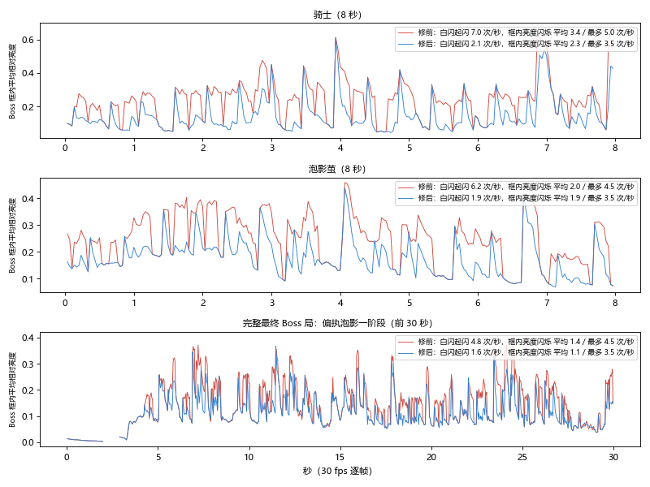

# 137 最终 Boss 战频闪：测量与修复（10-24）

> 用户：「调查一下最终 Boss 闪频的情况」。分支 `claude/boss-flash-5c1f3c`，基线 main d2286053。
> 结论一句话：**主因是 Boss 受击白闪——每一下命中都续白闪，多人围打时 Boss 每秒起闪 6–7 次、六七成时间是白的**；
> 命中三档特效叠在上面是次要来源，其余（全屏闪光、震屏、预警、灯火、阶段转换）都是单发或幅度不够。修后白闪每秒最多 2.5 次（实测 1.6–2.1 次），
> Boss 框内亮度闪烁「超过每秒 3 次」的 1 秒窗口从 18–137 个降到 0–6 个。全屏口径修前修后都合格（Boss 占屏小）。

## 1. 最终 Boss 是谁

- `waves.json` endings：标准结局（第一次探索必定走到）= **偏执泡影 paranoia**；骑士结局 = **knight_boss**；另有 izumik / ishar 两个条件结局。
- 泡影有一阶段（悬浮）→ 致死时结茧（外壳白闪 +「抵抗」）→ 二阶段（落地）。四个场面都量了：p1 / 茧 / p2 / 骑士，另录一段走完整入场流程的真实对局。

## 2. 怎么量

- 录像：`python tools/boss_flash_rec.py <标签> <场景>`（走 `godot_runner`：副屏 / 屏幕外、静音、全机并发上限；本次全程只开 1 个 Godot）。
  - `final`：正常对局，`--bosstimes=20,40,60` 把 Boss 提前，58 秒起录 30 秒（900 帧）——完整的入场、登场演出、一阶段战斗；
  - `p1` / `p2` / `cocoon` / `knight`：第 20 帧在主控旁刷出 Boss（`--flashspawn`，与 `--bosstest` 同法但**时间照常走**、自测不扣血），2 秒起录 8 秒（240 帧）。
  - 编队固定：水月 + `--squad=skadi,saria,texas,exusiai,eyjafjalla`（编队上限内能编进去的几位），`--prog=6`、高手机器人、seed 1、`--fixed-fps 30`、高画质（光学观感开）。
  - 每帧存 480 宽缩小图 + `flashrec.csv`（Boss 白闪剩余秒、阶段、茧、震屏、全屏闪光、顿帧、命中星数、预警数、登场演出、Boss 屏幕位置）。
  - 钩子在 `autotest.gd` 的 `--flashrec` / `--flashspawn`，只在测试参数下生效。
- 统计：`D:/Anaconda/python.exe tools/boss_flash_measure.py <目录> [--plot] [--json]`，三个口径：
  1. **全屏（WCAG 2.3.1 一般闪光）**：sRGB → 相对亮度，逐像素切单调段，段变化 ≥ 0.10 且暗端 < 0.80 记一次跳变（分几帧淡出的也算一次）；
     任意 1/3 屏宽 × 1/3 屏高（≈ 10° 视野）里同向跳变 ≥ 25% 记一次大面积跳变；一对相反跳变 = 一次闪烁；任意 1 秒 > 3 次不合格。
  2. **Boss 身上（逐像素）**：同上，但面积按 Boss 框（碰撞半径 × 1.6，向上 1.6 倍、向下 0.5 倍）算。会把「Boss 精灵在框里移动」也算进去，偏严。
  3. **Boss 框内平均亮度**：框内平均相对亮度曲线切单调段，段变化 ≥ 0.10 记一次跳变。最接近肉眼看到的「Boss 一明一暗」，表里用它判。
- 来源拆分：按 CSV 状态对上跳变帧，并用 `--bal=` 关掉单个来源重录（关 Boss 白闪 `fx/flash_boss=0`、关命中三档 `fx/hit_tiers=0`）。

## 3. 结果

每格：修前 → 修后。「窗口 > 3」= 每秒闪烁超过 3 次的 1 秒滑动窗口数（8 秒片段共 211 个，完整局 871 个）。

| 场面 | Boss 白闪起闪 次/秒 | 白闪亮着的帧占比 | 全屏口径 最多 次/秒 | 框内亮度 平均 / 最多 次/秒 | 框内 窗口 > 3 |
|---|---|---|---|---|---|
| 骑士 | 7.0 → 2.1 | 73% → 21% | 0.5 → 0 | 3.4 / 5.0 → 2.3 / 3.5 | 137 → 5 |
| 泡影一阶段 | 6.5 → 1.9 | 63% → 19% | 0 → 0 | 2.2 / 4.0 → 1.4 / 3.0 | 30 → 0 |
| 泡影茧 | 6.2 → 1.9 | 73% → 19% | 1.0 → 1.0 | 2.0 / 4.5 → 1.9 / 3.5 | 18 → 5 |
| 泡影二阶段 | 6.6 → 1.9 | 68% → 19% | 1.0 → 1.5 | 2.3 / 4.0 → 1.9 / 3.0 | 31 → 0 |
| 完整局（泡影一阶段 30 秒） | 4.8 → 1.6 | 53% → 16% | 1.0 → 1.0 | 1.4 / 4.5 → 1.1 / 3.5 | 45 → 6 |

- 全屏口径修前就合格：最终 Boss 在 1280×720 下约占屏 3–5%，白闪面积不到 10° 视野的 25%。**但在手机小屏或镜头拉近时会越线**，而且肉眼看得到——用户说的「闪」就是 Boss 身上这块。
- 修前 Boss 框内亮度在 0.05 ↔ 0.3–0.6 之间每秒来回 4–7 次（骑士最重：多人近战贴身，几乎每帧都有命中）。



修前 / 修后对照（骑士，1.5 秒，30 fps，Boss 附近裁切）：`reference/boss_flash_knight.gif`。茧 / 二阶段的同款 gif 在 `build/boss_flash/`（不进 git）。

### 3.1 按来源

| 来源 | 结论 | 证据 |
|---|---|---|
| **Boss 受击白闪**（`vfx.hit_react` 每下命中 `e.flash = max(…)` 续时，`world.gd` 画 50% 白剪影） | **主因** | 修前起闪 6–7 次/秒；关白闪（`fx/flash_boss=0`）后骑士框内「窗口 > 3」137 → 0 |
| 白闪期间换单帧受击姿态 `*_wound`（Boss 也换） | 量不出单独贡献；按草稿去掉，让白剪影跟当前动作 | 关白闪时，换姿态 / 不换姿态的骑士逐像素口径 1.38 / 1.44 次/秒，框内「窗口 > 3」都是 0 |
| 命中三档（命中星 hstar、GPU 颗粒、中 / 重档发光） | 次要，叠在白闪上 | 修后再关三档：骑士逐像素「窗口 > 3」98 → 59、二阶段 34 → 19；框内平均口径基本不变 |
| 无攻击帧条时的蓄力 `sin(t×30)` 明暗振荡（约 5 Hz） | 潜在来源；泡影 / 骑士有攻击帧条，本次场面没触发 | 代码审读；一并去掉，保留逐渐提亮 |
| 茧外壳白闪（`absorb_damage` 每下 `e.flash = 0.08`） | 同主因，壳面白环跟着本体一起闪 | 茧场面起闪 6.2 次/秒 |
| 全屏闪光（水月技能 0.12 / 0.25、换幕洋红 0.35 秒、击破白 0.4 秒、升级） | 单发，不构成频闪 | 30 秒完整局里 1 次；换幕 / 击破每场各 1 次 |
| 震屏 | 不改亮度（只位移），完整局 1 次大震 | CSV |
| 发光 / 光学低分辨率层 | 不单独闪；只是把白闪的亮度带到相邻像素 | 关白闪后框内「窗口 > 3」为 0 |
| 预警闪烁（锁定一拍 `lock_flash` 0.15 秒）、灯火 `flicker`（±5%、7–23 rad/s）、破绽标识 | 幅度 < 0.1 或单发，均未触发跳变 | CSV + 跳变帧对照 |
| 阶段转换 | 单发（换幕一闪） | 茧场面 1 次 |

## 4. 改了什么（只改画面）

在 Codex 草稿（`.worktrees/codex-boss-flash`，未提交、未跑过 Godot，说明 `art/incoming/codex_boss_flash_1024_handoff.md`）的 Boss 闪频部分上改；草稿里的溟痕 / 灯火改动没搬。

- `vfx.boss_hit_flash(e, now, dot)`：Boss 白闪两次起点至少隔 **`fx/boss_flash_gap` = 0.4 秒**（草稿 0.30 秒 → 每秒 3.3 次，仍超 3 次，所以放宽到 0.4 = 每秒最多 2.5 次），
  每次持续 `fx/boss_flash_t` = 0.09 秒、线性淡出；间隔内的命中不续时；持续伤害不闪。普通怪 / 精英照旧。
- `vfx.boss_flash_alpha(e, peak)`：Boss 白剪影与茧外壳白环按剩余时间淡出。
- `world.gd`：Boss 不再换 `*_wound` 受击姿态；无攻击帧条的蓄力去掉 `sin(t×30)` 振荡。
- `paranoia.gd absorb_damage`：外壳白闪走同一个限频，零壳伤不闪。
- 0.5 秒间隔也试过（`--bal=fx/boss_flash_gap=0.5`）：茧 / 二阶段再降、骑士反而回升（片段噪声内），不比 0.4 好，留 0.4。
- 回归：`boss_boundary_test.gd` 加 7 条断言（持续伤害不闪、密集命中不续时、间隔内不重启、淡出、过间隔可再闪、每帧挨打 10 秒起闪 ≤ 26 次、不碰生命）。

## 4.1 测试

- `check.py --only boss_boundary`：通过（新增 7 条断言）。
- `check.py --auto --jobs 1`：126 项过 125 项；唯一失败是「积木等价金样过期 14」——分支不重录，合入后在 main 统一 `--rerecord-golden`（docs/132 §1）。
- 同 seed（基线 d2286053）：`trace_base.py 1 mizuki 240 --here` TRACE 241 行逐行相同；为了让 Boss 真的挨打，另跑
  `trace_base.py 1 mizuki 150 --here --extra "--bosstimes=30,60,90 --squad=skadi,saria"`，TRACE 151 行逐行相同。纯画面改动，符合预期。

## 5. 剩下的

- 修后框内仍有 0–6 个窗口刚过 3 次/秒：限频后的白闪（≈ 2 次/秒）叠上 Boss 精灵移动 / 攻击帧条 / 命中星。关掉白闪的底噪就有 1.2–1.4 次/秒（骑士冲锋、攻击帧条自身的明暗）。
  若还要再压：① `fx/flash_boss` 0.5 → 0.3（每次闪的幅度变小）；② 命中星 / 中重档发光在 Boss 身上限频。两者都是旋钮级，未做，等用户看修后效果再说。
- 另一会话 look-nausea 在查「画面恶心、粘腻」，与本项无代码交叉（本项只动 Boss 白闪路径）。

## 6. 复现

```
python tools/boss_flash_rec.py base knight          # 在 main 上
python tools/boss_flash_rec.py fix knight           # 在本分支上
D:/Anaconda/python.exe tools/boss_flash_measure.py build/boss_flash/fix_knight --plot build/boss_flash/fix_knight.png
```
数据、逐帧图、各场面曲线在 `build/boss_flash/`（不进 git）。

## 7. Boss 重影（同一只 Boss 画成好几只，10-24 用户追报）

用户：「Boss 会出现多个同时出现的情况」，追问后确认是**同一只 Boss 有重影、挨打时一直有**。

- **先排除「真的刷了多只」**：`autotest --bossdup` 每秒查场上活着的 Boss；seed 1–4 无头整局（到 12:00）0 次；把 Boss 时刻压到 20 / 25 秒时能抓到中期 Boss 重叠，说明探针有效。
- **抓到的现象**：偏执泡影二阶段同屏画出 **3 只**泡影（并排，形态略有不同），但 `--enemydump` 显示场上只有 1 个泡影敌人；关光学观感照样 3 只。
- **根因**：二阶段本体帧条在代码里叫 `e_paranoia2` / `e_paranoia2_move`，文件和重画表（`enemy_redraw.json` / `enemy_pixels.json`）登记的是别名对应的 `e_paranoia_phase2*`（`art.gd ALIAS`）。
  `A.enemy_frames("e_paranoia2", 2)` 查不到 → 按缺省 2 帧切 6 帧条，一「帧」= 原来 3 帧并排 → 屏幕上 3 只；移动帧条按 4 帧切，切出 1.5 只。锚点、循环时长也一起查不到（锚点退回缺省）。
  二阶段近战贴脸挨打时一直在播这两条帧条，所以用户看到「挨打时一直有」。
- **修**：`art.gd` 的 `enemy_pixel_spec` / `enemy_redraw` 名字查不到时按 `ALIAS` 的文件名再查（`_by_file`）；只影响 `e_paranoia2*` 两条（其余别名 e_bone 等表里本来就登记的是新名）。
  图鉴 `_anim_n` 原来对所有敌人写死 2 帧，重画帧条（泡影一阶段等 6 帧）在图鉴里同样会并排出好几只，改为按重画表取帧数 / 速度。
- 对照图（上：修前一只敌人画成 3 只；下：修后 1 只）：`reference/boss_ghost_p2.png`。
- 回归：`boss_boundary_test.gd` 加断言（`e_paranoia2` / `_move` / `_white` 帧数与 `e_paranoia_phase2*` 一致且 > 2、锚点一致、`e_paranoia` 6 帧）。
- 顺带量过、不是原因的：Boss 朝向翻转（`e.fx` 每帧按主控左右取符号）在这些局里只有 0.25–0.38 次/秒，没改；骑士 / 泡影的 `*_white` 白剪影与本体尺寸一致、受击姿态 `*_wound` 与待机首帧 IoU 0.95 / 0.99，都不会错位。
- 另：别名只指向 1 倍图（`e_paranoia_phase2.png`），二阶段没用上 `@2x`，比一阶段糊一档；尺寸正确，未改，记作后续。
