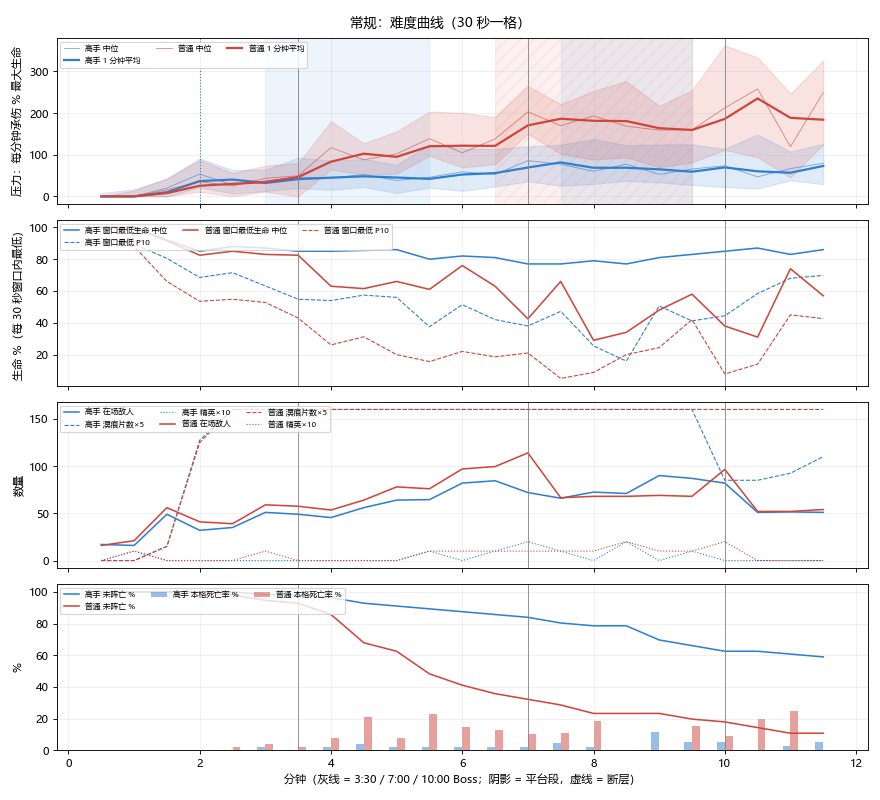
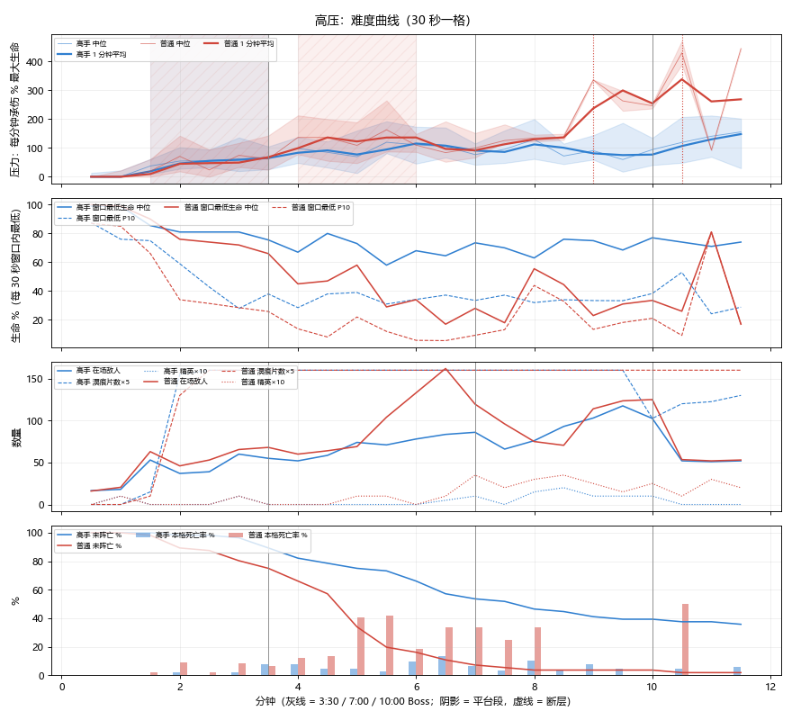
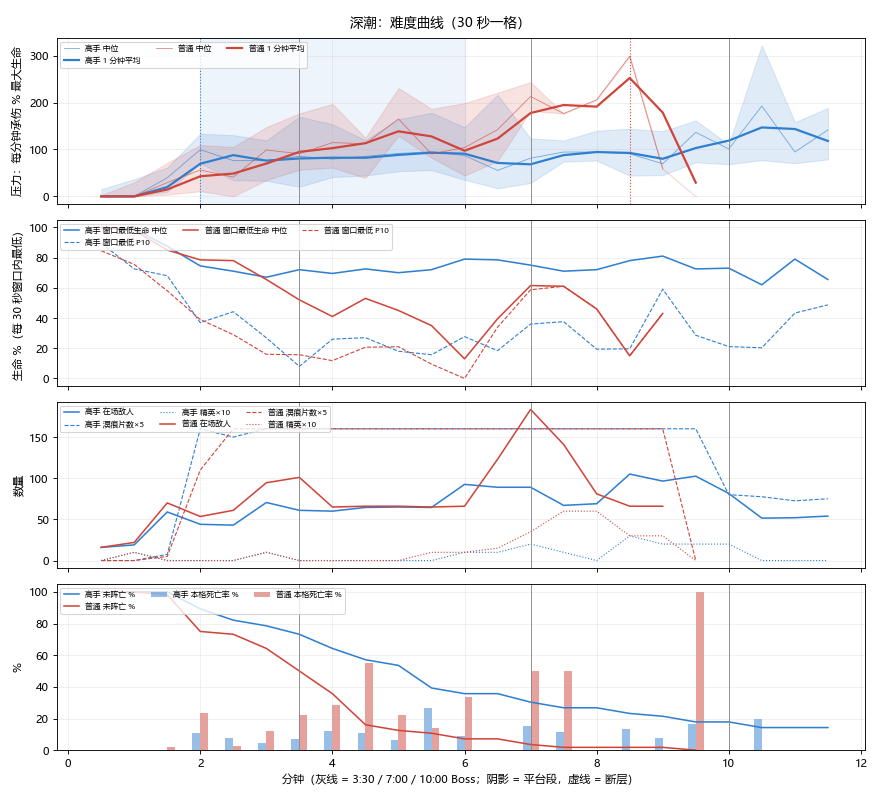

# 146 难度曲线复查（10-25，只量不改数）

> 用户 10-25：「现在游戏难度是否还是很平？前面几分钟和后面几分钟的难度曲线是否不一致，是否可以上云端测。」
> 10-22 修过一轮「太平 → 骤难 → 太平」（docs/116 §9），之后又改了溟痕常驻、补给箱回血、最终 Boss −15%、怪物攻击范围、维什戴尔范围、拉普兰德领主、德克萨斯方案 A 等。本页重测，**只出数据和方案，不改数值**。

## 1. 怎么测

- 代码：origin/main **1be86c55** + 分支 `claude/difficulty-curve` **93b1c375b**（只给 `telemetry.curve` 补只读字段：窗口最低生命、站溟痕秒数、溟痕片数、在场精英、敌弹数）。云端同 seed TRACE 对 1be86c55 **241 行逐行相同**，不影响模拟。
- 云端一次性例行任务三份（`cloud-results/curve-t0 / t5 / t10`）：常规 / 高压 / 深潮（`--tide=0/5/10`，含深潮 enemy_scale），无局外成长，starts 7 开局 × 8 seed × 高手 / 普通机器人，每档 112 局。
- 统计：`D:/Anaconda/python.exe tools/difficulty_curve.py 常规=curve-t0 高压=curve-t5 深潮=curve-t10 --out build/curve146`（逐格表在 `build/curve146/curve.md`）。
  - **压力** = 每分钟承伤 ÷ 最大生命（%）。100 = 一分钟挨掉一整条血（≈ docs/116 的 TTD 60 秒）。每 30 秒一格，只算这一格开始时还活着的局，看 1 分钟滑动平均。
  - **平台段**：压力连续 ≥ 2 分钟每格变化 < 全程跨度 8%；**断层**：相邻两格涨幅 > 跨度 22%。
- 注意：最后一击记成「创伤」（`wound`，侵蚀创口持续伤害）的局，真正的杀手是叠创口的近身怪，按近身算。

## 2. 结果

| 档 · 机器人 | 胜率 | 压力均值 0–2 分 | 2–3:30 | 3:30–7 | 7–10 | 10–11:30 | 阵亡分布 0–2 / 2–3:30 / 3:30–7 / 7–10 / 10+ / 超时 |
|---|---|---|---|---|---|---|---|
| 常规 · 高手 | 48.2% | 18 | 37 | 54 | 68 | 64 | 0 / 1 / 8 / 12 / 2 / 6 |
| 常规 · 普通 | 7.1% | 13 | 39 | 127 | 177 | 209 | 0 / 4 / 34 / 8 / 4 / 2 |
| 高压 · 高手 | 23.2% | 23 | 62 | 95 | 90 | 139 | 1 / 5 / 20 / 8 / 2 / 7 |
| 高压 · 普通 | 0% | 22 | 53 | 120 | 208 | 323 | 6 / 8 / 38 / 2 / 1 / 1 |
| 深潮 · 高手 | 8.9% | 35 | 79 | 82 | 98 | 143 | 6 / 9 / 24 / 7 / 2 / 3 |
| 深潮 · 普通 | 0% | 21 | 77 | 135 | 185 | - | 14 / 14 / 26 / 2 / 0 / 0 |

曲线图（上 → 下：压力中位 + 四分位带、窗口最低生命中位 / P10、在场敌人 / 溟痕片数 / 精英、未阵亡比例与每格死亡率；灰线 = 3:30 / 7:00 / 10:00 Boss；阴影 = 平台段）：

### 2.1 常规（参照档）

- **前 1:30 几乎没有压力**（中位 0，P75 不到 20）：1:00 的第一波大群 15 只在接触前就被清掉。
- **0–2 分钟陡**：2:30 第二波大群（20 只）+ 引痕者入池，压力从 0 跳到 ~50。
- **3:00–5:30 是平台段**（高手压力稳定在 40–50，约 2.5 分钟不涨）：这段敌人伤害按时间还在涨（×1.57 → ×1.79），但同期击杀 / 分从 170 涨到 233，玩家成长（升级、招募、精一）把敌人成长吃掉了；大群在 4:00 / 4:30 / 5:30 之间随机落位，有的局这 3 分钟一波都没有。
- **7:00 中期 Boss 是一个台阶**（压力 ~50 → ~80），之后 **7:30–9:30 又是平台段**（60–77）：普通怪伤害时间曲线 8:00 封顶（`dmg_knee` 480）、大群只数 8:20 后不再长（`horde_grow_until` 500），都在这段停涨。
- **最终 Boss 段（10:00 起）压力不升反降**（68 → 64）：最终场地清杂、只剩补怪和护卫波。超时 6 局（占败局 21%），死于 Boss 本体的为 0。
- 高手的阵亡分布还算散（3:30–10 分钟占 20/29），没有 10-22 那种「9 分钟集中」；**但阵亡的直接原因 80% 以上是近身怪**（引痕者、收割者、滑行者叠创口），溟痕片数 2:30 起就顶在上限 32、站溟痕时间每 30 秒 < 0.5 秒，溟痕在这版里几乎不构成威胁。

### 2.2 高压 / 深潮：前后不一致更明显

- 难度倍率从第 0 秒就全额生效，玩家前几分钟还没成型：**深潮高手 0–3:30 就死了 15/56 局（27%）**，普通机器人 28/56；高压高手 3:30–7 死了 20 局（占败局 47%）。
- 深潮高手压力 2–3:30 已经到 79，跟 3:30–7（82）几乎一样高——**深潮的难度是「一上来就顶满、中段平」**，跟常规「前面平、7 分钟一级台阶」形状不同。
- 高压 / 深潮的头号杀手同样是近身（引痕者接触 `contact_tracer`、`contact_path` 塑路者），3:30 中期 Boss 段的死亡也大多是 Boss 在场时的杂兵。

### 2.3 Boss 段（高手）

| 档 | 3:30 出场 / 击破 / 用时中位 / 段内压力 | 7:00 出场 / 击破 / 用时中位 / 段内压力 | 10:00 出场 / 胜 |
|---|---|---|---|
| 常规 | 55 / 53 / 36 秒 / 31 | 83 / 74 / 40 秒 / 46 | 35 / 27 |
| 高压 | 50 / 43 / 49 秒 / 66 | 38 / 32 / 31 秒 / 63 | 22 / 13 |
| 深潮 | 41 / 28 / 60 秒 / 58 | 26 / 16 / 46 秒 / 80 | 10 / 5 |

（7:00 出场数含双 Boss 组合，按只计。10:00 段的「击破」以胜局计。）

## 3. 结论（三句话）

1. **常规还是「前 1:30 很平 → 2 分钟陡升 → 3:00–5:30 平 → 7:00 一级台阶 → 7:30–9:30 平 → 最终 Boss 段不升反降」**，比 10-22 好（没有骤难点、阵亡分散），但中段和后段各有一段 2–2.5 分钟压力不涨的平台。
2. **前后不一致主要在高难度档**：高压 / 深潮的倍率开局就全额生效，深潮 0–3:30 就死 27%（高手），压力曲线是「开局顶满、之后平」；常规则是开局太松。
3. 压力几乎全部来自**近身杂兵**（引痕者 / 收割者 / 滑行者 + 侵蚀创口）；溟痕 2:30 就顶到 32 片上限、几乎没人踩，最终 Boss 本体没有直接击杀过一局。

## 4. 修曲线方案（只用不给奖励的旋钮，未实施，等用户看图）

原则同 docs/109 / 111：不加经验 / 掉落 / 源石锭，只动「怪更凶、更会包」这类旋钮。预期是对常规 · 高手的估计，实施后按本页办法云端复测。

| # | 针对 | 做法（旋钮） | 预期 |
|---|---|---|---|
| A | 常规 3:00–5:30 平台 | 中段大群改为**固定节拍**：3:45、5:00、6:15 各一波（现在 4:00 / 4:30 / 5:30 随机落位、有的局整段没有）；大群总经验按现规则恒定（`horde_xp_mult` −1），不多给奖励。并对这段大群开分股包围（`close_ring_until` 0 → 420，原型见 docs/116 §7.2） | 3:00–7:00 压力 45 → 60–70，平台消失；胜率约 −3～−6 点 |
| B | 7:30–9:30 平台 + 最终段回落 | 让敌人伤害曲线继续涨到最终 Boss：`dmg_late_cap` 0.1 → 0.25（8:00 后每分钟约 +6.7%，到 10:00 封顶）；`horde_grow_until` 500 → 570 | 7:30–11:00 压力 65 → 75–85，最终段不再低于 7–10 分钟；超时局可能 +1～2 |
| C | 高压 / 深潮开局顶满 | **难度倍率渐入**：档位的敌人伤害 / 生命加成在前 `tide_ramp_t` 秒（建议 240）从 30% 线性涨到 100%（新旋钮，只缩开局，不改 4 分钟后的数值） | 深潮高手 0–3:30 阵亡 27% → 约 12%；高压 / 深潮胜率各 +5～+8 点，中后段形状与常规一致 |
| D | 前 1:30 太松（可选） | 1:00 那波大群改为分股包围（`close_ring_until` 覆盖到 60 秒），只数不变 | 1:00–1:30 有一次「必须走位」的瞬间；docs/116 §7 实测这类改动对承伤影响小，主要是观感 |
| E | 溟痕几乎无威胁（可选，属玩法定位） | 不改数；若希望溟痕重新成为压力来源，需要用户定方向（常驻上限 32 现在 2:30 就满） | — |

建议先做 A + B + C 一轮云端复测（三档各 112 局），D / E 看用户意见。

## 5. 复现

- 遥测：`claude/difficulty-curve` 93b1c375b（曲线只读字段）+ 52ac39f8b（灯火只读统计），可合入，不改模拟（云端同 seed TRACE 241 行相同，两批胜率逐局一致）。
- 批跑：例行任务提示词见 §1；结果分支 `cloud-results/curve-t0 / t5 / t10`。
- 统计与图：`tools/difficulty_curve.py`（读 cloud-results 或本地 balance_run 输出），图存 `docs/reference/curve146_t0 / t5 / t10.png`。

## 6. 灯火（10-25 协调人转用户：先看数据再决定灯火怎么改）

数据：分支再加一组只读灯火统计（52ac39f8b：各档停留秒数、按来源的回补 / 损失、各档承伤、窗口最低灯火、阵亡时灯火），云端三档重跑（`cloud-results/lamp-t0 / t5 / t10`），胜率与上一批逐局一致（常规高手仍 27/56），TRACE 对 1be86c55 仍 241 行相同。统计在 `tools/difficulty_curve.py` 的「灯火」一节。

### 6.1 三档 · 高手

| | 常规 | 高压 | 深潮 |
|---|---|---|---|
| 停留时间 通明 ≥70 / 摇曳 30–69 / 暗淡 <30 / 寂灭 0 | 75.9 / 18.0 / 4.6 / 1.6% | 71.3 / 18.8 / 6.2 / 3.7% | 55.4 / 23.1 / 11.1 / 10.4% |
| 出现过熄灯的局 / 熄灯秒数中位 | 20/56 · 14 秒 | 25/56 · 31 秒 | 30/56 · 40 秒 |
| 回补（每分钟）：精英灯油 / 灯标 / 灯油 / 其他 / 围猎 / 商人 | 18.9 / 4.8 / 2.2 / 1.5 / 1.0 / 0.3 | 19.1 / 7.1 / 3.0 / 2.5 / 1.4 / 0.2 | 15.7 / 7.8 / 3.1 / 2.6 / 2.0 / 0.8 |
| 精英灯油占回补 | 66% | 57% | 49% |
| 损失（每分钟）：受击 / 冲撞吸灯 / 其他 | 22.1 / 6.6 / 4.4 | 31.6 / 4.7 / 4.7 | 37.9 / 3.8 / 3.7 |
| 各档压力（每分钟承伤 % 最大生命）≥70 / 30–69 / <30 / 0 | 37 / 96 / 143 / 211 | 55 / 141 / 164 / 206 | 43 / 122 / 134 / 198 |
| 阵亡时所在档 ≥70 / 30–69 / <30 / 0 | 13 / 43 / 13 / 30% | 6 / 31 / 25 / 39% | 2 / 23 / 21 / 54% |

普通机器人同方向、更极端：常规阵亡时 50% 在寂灭，深潮 79%。各时段中位见 `build/curve146b/curve.md`。

### 6.2 读法

1. **常规里灯火基本是满的**：高手 3/4 时间在 ≥70，暗淡 + 寂灭只占 6%。中位从 7:00 起停在正好 70，是机器人在 7 分钟左右的事件里拿了「深蓝之心」类藏品（规则 `deep_sea`，灯火上限改 70），不是灯火被打下来。
2. **回补几乎全靠精英灯油**（常规 66%）：普通灯油只占 8%，灯标 17%，围猎 / 商人可以忽略。也就是说灯火平衡 ≈ 精英掉落节奏 vs 受击损失；精英少的时段（3:30 / 7:00 Boss 期间精英减半）灯火就往下走。
3. **损失主要是受击**（67–83%），其次是滑行者的冲撞吸灯（常规 20%，「其他」主要是灯火档位的被动变化）。圈外几乎为 0。
4. **灯火低时承伤明显更高、死得更多**：常规高手 ≥70 时压力 37，<30 时 143、寂灭 211；阵亡时处在寂灭的占 30%（停留时间只占 1.6%）。但这里**因果是双向的**：挨打多 → 灯火掉（灯火只在受击时扣），灯火低 → 怪伤害加成（寂灭每秒 −3 血，暗淡档敌人移速 / 接触伤害 +10%），所以「低灯 = 高压力」一部分是「本来就在挨打」。能看出的净效应是：寂灭阶段占阵亡 30–54%，远高于停留时间占比，**熄灯是终结手段而不是长期状态**。
5. **高难度档灯火才真正成为压力**：深潮高手只有 55% 时间在 ≥70，熄灯局 30/56，受击掉灯每分钟 37.9（常规 22.1，深潮档受击灯火损失 +60%）；阵亡时 54% 已寂灭。

### 6.3 给灯火改动的参考（不改数，等用户定方向）

- 想让常规里灯火「有存在感」：现在 3/4 时间满灯，回补又集中在精英灯油，调受击损失（`lamp/hit_base` 4、`hit_scale` 30）或精英灯油量（`lamp/elite_oil_amount` 25）最直接；后者属于奖励侧，按 docs/109 原则优先动前者。
- 想让深潮 / 高压别那么快熄灯：受击灯火损失的档位加成（深潮 +60%）可以跟 §4 方案 C 一起做「前 4 分钟渐入」。
- 「深蓝之心」把上限压到 70 后，常规后半局中位就是 70，若希望后段灯火也有波动，要看这件藏品的定位，需用户定。
