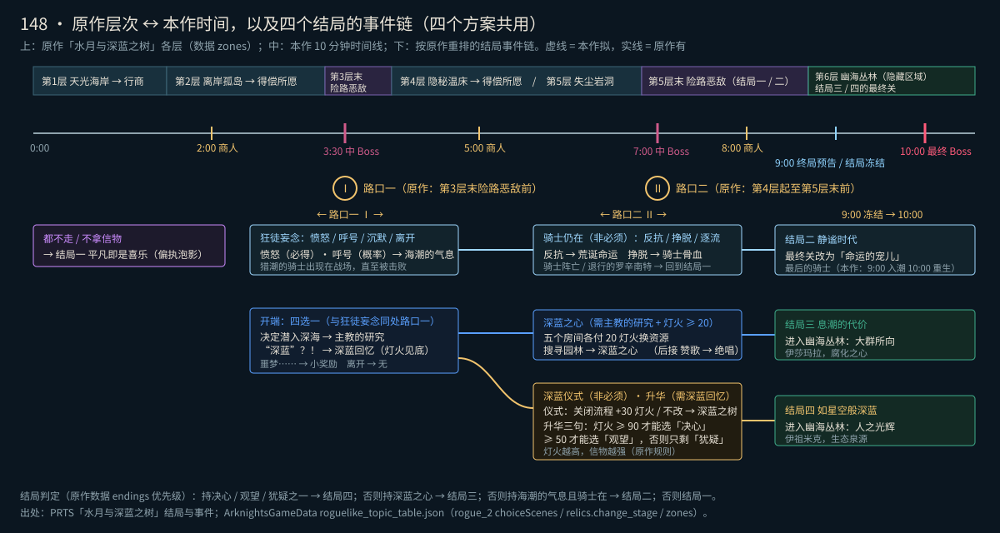

# 148 · 结局走向：替代「海嗣祭坛」的选路方案（10-25，待用户挑）

> 用户 10-25：「海嗣祭坛这种根据实际肉鸽里面选择路线的方法再出几个方案，祭坛其实不太符合原作。」
> 本稿只出方案、不改代码。基线 origin/main bee2cf96。原作资料按 docs/76 §4 查证：PRTS 为主，解包数据（ArknightsGameData `roguelike_topic_table.json`，10-25 取，副本在 `build/route_research/`，不进 git）补数字与内部规则。原作没有的写「本作拟」。
> 编号口径：任务里的 #2 / #3 / #4 指傀影 / 水月 / 银凇（数据 `rogue_1` / `rogue_2` / `rogue_3`）。
> 示意图：`docs/reference/148_route_overview.svg`（原作层次对时间线 + 事件链）、`docs/reference/148_route_options.svg`（四个方案的画面示意）。都是程序画的示意，不是游戏截图。

---

## 0. 结论

- **推荐方案 A「深入海洋 · 航路图」**：3:30、7:00 两场中 Boss 打完后各停一次，给一小张原作样式的节点图，选下一段走哪条航路；结局事件就是航路上的「不期而遇」节点，到点直接弹面板，不用再走去开祭坛。
- 四个方案共用一套**按原作重排的事件链**（§3）：开端 / 狂徒妄念 二选一 → 深蓝之心 / 升华 / 骑士仍在 → 持有信物决定最终关。现在自创的「抉择 ×3」「深蓝的低语」退役。
- 「海嗣祭坛」这个物件和名字整体去掉；事件面板（C 版式）保留，左侧插画里的祭坛换成节点图标。

| 方案 | 一句话 | 选路感 | 打断战斗 | 实现量 | 新美术 |
|---|---|---|---|---|---|
| **A 航路图（推荐）** | Boss 后暂停一次，在小节点图上选下一段航路 | 强，最像原作 | 2 次暂停，各约 5 秒，接在 Boss 战后 | 约 4 人日 | 节点图标 9 枚（界面用） |
| B 岔路航标 | 场上同时出现两三座航标，往哪边走就选哪条 | 中，有空间感 | 要绕路 | 约 2.5 人日 | 航标 1 种 + 图标叠层 |
| C 战利品 + 行商 | 信物混进 Boss 战利品和商人货架 | 弱 | 不加 | 约 1.5 人日 | 几乎没有 |
| D 溟痕石碑 | 石碑立在溟痕里，点灯读或踩溟痕读，读法不同选项不同 | 中，主题最贴 | 要绕路 + 点灯 | 约 3.5 人日 | 石碑 1 种（两态） |

---

## 1. 现状：海嗣祭坛

代码 `game/scripts/endings.gd`，数据 `game/data/waves.json` 的 `events` / `endings`，规格 docs/19。

| 项 | 现在怎么做 |
|---|---|
| 解锁 | 通关过结局一（`Cfg.endings_cleared` 有 standard）才出现；`--allend` 无视 |
| 出现 | 按时间窗口必刷：狂徒妄念 2:30–3:30、抉择·其一 4:00–5:00、深蓝的低语 6:00–6:40、骑士仍在 7:20–7:50、抉择·其二 7:25–8:00、抉择·其三 8:00–8:30、深蓝回忆 8:40–9:05；刷在队长 520–650 外；同时最多 2 座，相邻至少隔 20 秒 |
| 打开 | 不吃伤害，只在队长本人走近时打开（P2-10）；90 秒没开沉入海底；离太远（1500）挪到前方 600；最终 Boss 前 10 秒还有没开的，屏边指示金红快闪 |
| 选项 | 弹 C 版式事件面板（`choice_panel.gd`），选项给藏品 / 灯火 / 源石锭 / 藏品三选一 |
| 走向 | 由持有的结局藏品重算，**后做的覆盖先做的**；骑士线 sticky；9:00 预告；最终 Boss 登场即冻结 |
| 结局 → 最终 Boss | 结局一 偏执泡影（paranoia）／结局二 最后的骑士（knight_boss，需 222 海潮的气息 + 骑士在）／结局三 伊莎玛拉（ishar，需 221 深蓝之心）／结局四 伊祖米克（izumik，需 238 决心 2 级 = 两次选「决心」） |
| 其他影响 | 场地：伊莎玛拉 / 伊祖米克有各自 Boss 场地规则（docs/95、142b）；骑士线 9:00 入潮、10:00 中心重生（docs/18）；中 Boss 池（3:30 / 7:00）不受结局影响；结局线给的藏品占槽（`ROUTE_RELICS` 预留 4 槽） |
| 别处引用 | 开局指南第 4 页「海嗣祭坛与结局」（`guide.json`、`intro.gd` 的 `altar` 图）；作战记录「海嗣祭坛」计数（`run_stats.gd`、`telemetry.altars`）；HUD 祭坛方位指示（`hud_banners.gd`）；机器人与自动测试走祭坛（`bot.gd:247`、`autotest.gd:844,1406`）；图鉴结局提示（`waves.json` endings.gallery.hint） |

**和原作不符的地方**：

1. 原作没有「祭坛」这个物件。决定结局的是地图上的**不期而遇节点**（选这一格就是选这条路）和**持有的藏品**。
2. 「抉择 ×3、两次决心才算」是自创。原作是一次「升华」，三句台词三选一，**持有决心 / 观望 / 犹疑任意一件**就走结局四，灯火决定能选哪句。
3. 「深蓝的低语」是自创。原作的深蓝之心来自「开端 → 主教的研究 → 深蓝之心」这条链，而且开端里「深蓝」那一项通向的是结局四，不是结局三。
4. 原作同一层段的两件结局事件是**互斥的路线**（狂徒妄念和开端都在第 3 层末险路恶敌前，走了一个就走不到另一个）；本作是按时间轮流都刷，等于每条线都能沾。

---

## 2. 原作怎么「选路线」

### 2.1 水月与深蓝之树（主参照）

**层次**（数据 `zones`；PRTS「水月与深蓝之树」）：第 1 层天光海岸（末尾诡意行商）→ 第 2 层离岸孤岛（末尾得偿所愿）→ 第 3 层波涛略地（末尾险路恶敌）→ 第 4 层隐秘温床（末尾得偿所愿）→ 第 5 层失尘岩洞（末尾险路恶敌）→ 第 6 层**幽海丛林**（隐藏区域，节点只有「诡意行商 → 安全的角落 → 战斗 → 险路恶敌」）。另有绀碧摇篮：经罕见节点「误入奇境」→ 事件「瞥视」进入的额外区域（数据 `gameConst.portalZones` = zone_7），Boss 是客串的荒地群猎 / 寒灾之咒 / 险路勿近，打完回原层。

> **订正 docs/49a §3.1**：49a 写「第 7 层（隐藏）绀碧摇篮 = 人之光辉」不对。按 PRTS 与数据，大群所向（伊莎玛拉）与人之光辉（伊祖米克）都在第 6 层幽海丛林；决心 / 观望 / 犹疑带 `change_stage ro2_b_6 → ro2_b_7`，即把第 6 层的最终关从大群所向换成人之光辉。绀碧摇篮与结局无关。

**层次对本作时间**：原作第 3 层险路恶敌的 Boss 池（圣徒 / 接潮主教 / 塑路者）正好是本作 3:30 中 Boss 池；第 1 层末尾的诡意行商对应本作 2:00 商人（`game.gd` `MERCHANT_TIMES` = 2:00 / 5:00 / 8:00；49a 写的 1:40 / 5:30 / 8:40 已过时）。所以原作「第 3 层末」≈ 本作 3:30 前后，原作「第 4–5 层」≈ 本作 3:30–10:00，原作「第 6 层」≈ 本作结局三 / 四的最终段。

**结局与事件链**（PRTS 结局条件 + 数据 `choiceScenes`）：

| 结局 | 条件（PRTS） | 链 |
|---|---|---|
| 一 平凡即是喜乐 | 不持有深蓝之心、决心、观望、犹疑，打完第 5 层「认知即重担」 | 默认 |
| 二 静谧时代 | 同上，打完「“命运的宠儿”」 | **狂徒妄念**（第 3 层末险路恶敌前）：愤怒（付 2 希望及等量上限，得藏品）／呼号（付 1 次掷骰，可能得到骑士帮助）／沉默（+2 希望）／离开 → 得到**海潮的气息**：猎潮的骑士出现在战场，直至被击败；数据里它带 `change_stage ro2_b_4 → ro2_b_5`（第 5 层最终关换成命运的宠儿）。→ **骑士仍在**（第 5 层前，非必须）：反抗（付 2 目标生命，得荒诞命运）／挣脱（得骑士骨血）／逐流。打倒战场上的骑士会得到**退行的罗辛南特**（数据 `trapRewardRelicId`），最终关改回认知即重担 |
| 三 息潮的代价 | 持有深蓝之心通过第 5 层 → 第 6 层，打完「大群所向」（伊莎玛拉） | **开端**（第 3 层末险路恶敌前）选「决定潜入深海」得**主教的研究**（每战灯火额外 −5）→ **深蓝之心**（持主教的研究且灯火 ≥ 20，第 5 层末前）：办公室 / 科研区 / 储藏室 / 生活区 / 食堂各付 20 灯火换希望、随机藏品、源石锭、掷骰次数、目标生命上限；「搜寻园林」得**深蓝之心**（灯火 −50，一名干员排异）→ **赞歌**（持深蓝之心，非必须）得“绝唱”（2 个启示） |
| 四 如星空般深蓝 | 持有决心 / 观望 / 犹疑之一通过第 5 层 → 第 6 层，打完「人之光辉」（伊祖米克） | **开端**选「“深蓝”？！」得**深蓝回忆**（灯火 −100，一名干员排异）→ **升华**（持深蓝回忆，第 4 层起至第 5 层末前）：三句台词各给决心 / 观望 / 犹疑；**灯火 ≥ 50 才能选观望，≥ 90 才能选决心** → **深蓝仪式**（持深蓝回忆，非必须）：关闭危险流程 +30 灯火／不做任何改动得深蓝之树 |

数据里结局优先级：结局四 > 结局三（`endings.priority`）。三件抉择信物强弱分明：决心 = 阻挡 +2、防御生命 +120%、法抗 +20；观望 = 阻挡 +1；犹疑 = 阻挡 −1。即**灯火越高，拿到的信物越强**。深蓝回忆把灯火打到底，玩家得在第 4–5 层把灯火养回来才拿得到决心，深蓝仪式的 +30 灯火就是为这个准备的。

**和选路有关的其他规则**：
- 节点地图：每层若干列，每列 1–3 格，从左往右选一条路；同一列走了一格，其他格就走不到。结局事件是放在**某一层末尾那几列**的不期而遇。
- 灯火「摇曳」（50–99）能看到隐藏道路的节点与路线，箭头是空心的；灯火降到 50 才能踏上（PRTS）。
- 钥匙可以开锁住的通路（数据 `unlockRouteItemId` = 钥匙）；本作 10-22 已删钥匙，不用。
- 进新层时「深入海洋」检定：按灯火给启示（满灯火）或排异（低灯火）（PRTS）。

### 2.2 傀影与猩红孤钻（#2，可借鉴）

PRTS：结局二「滑稽喜剧」= 第 4 层末「解脱？」事件拿残破的玩偶，第 5 层险路恶敌改成「别无所求」；结局三 / 四要在第 3 层末遇到「赴宴」或「别打扰他们」，**拿到前置藏品后，后面的事件才会出现**（替罪领巾 → 打第 3 层险路恶敌时可选额外藏品替补演员 → 第 5 层「追随者集会」得恍悟），持有恍悟 / 初幕通过第 5 层进第 6 层渴欲大厅。

可借：**Boss 战利品里夹一件结局前置藏品**（替补演员）——这是方案 C 的原作依据；**前置藏品解锁后续事件**——四个方案都用。

### 2.3 探索者的银凇止境（#4，可借鉴）

PRTS：结局二要在第 5 层倒数第 3 个节点前**宣告「空无 + 伤痕」密文板组合**，把右侧节点改成「木裂前兆」；结局三要在「先行一步」拿路网后，**下一层最下方通路被画出一段专属路线，必须走过去，否则永久失去本结局**；「抗干扰指数」决定能看清几格节点，付 1 点可以走侧路。

可借：「**专属路线画在图上，不走就没了**」→ 方案 A 的暗航路 / 结局航路；「**花资源看清前路**」→ 灯火决定能看见哪条航路。

### 2.4 小结：原作选路的四个要素

1. **同一处只能走一格**（互斥）；2. **前置藏品解锁后续事件**（链）；3. **持有物改写最终关**（`change_stage`）；4. **灯火决定看得见什么、能选什么**。现在的祭坛只做到了 2 和 3。

---

## 3. 四个方案共用：按原作重排的事件链

示意图见文首。时间都按本作。

**路口一（3:30 前后，对应原作第 3 层末）**——开端与狂徒妄念**二选一**（互斥），也可以都不走。

| 事件 | 选项（原作 → 本作折算） |
|---|---|
| 狂徒妄念 | 愤怒：原作付 2 希望及上限 → 本作灯火 −40（最低 10），必得海潮的气息；呼号：原作付 1 次掷骰 → 本作 60% 得海潮的气息；沉默：原作 +2 希望 → 本作源石锭 +N；离开 |
| 开端 | 决定潜入深海 → 主教的研究（已有 220；原作「每战灯火 −5」→ 本作拟：每 60 秒灯火 −5 或受击灯火损失 +X%，数值会话定）；“深蓝”？！ → 深蓝回忆（已有 242；灯火降到 10，一次排异 = 本作「技能海嗣化」）；噩梦…… → 原作 +3 希望 → 本作源石锭 +N；离开 |

**路口二（7:00 前后，对应原作第 4–5 层）**——只出现持有前置藏品的那条线的事件：

| 前置 | 事件 | 选项 |
|---|---|---|
| 海潮的气息 + 骑士在 | 骑士仍在（非必须） | 反抗：原作付 2 目标生命 → 本作队长最大生命 −X，得荒诞命运（**新藏品**，原作效果待查后再定）；挣脱：得骑士骨血（已有 225）；逐流 |
| 主教的研究 + 灯火 ≥ 20 | 深蓝之心 | 五个房间各付 20 灯火：办公室（原作希望 → 本作入队招募一次）、科研区（随机藏品）、储藏室（源石锭 +13）、生活区（原作掷骰次数 → 本作升级三选一一次）、食堂（原作目标生命上限 → 本作队长最大生命 +X）；**可以连选**直到灯火不够；「搜寻园林」得深蓝之心（已有 221）。一屏多代价，正是 49a 记下想借的版式 |
| 深蓝之心 | 赞歌（非必须） | 取走遗物 → “绝唱”（已有 226，「需新机制·启示」；启示没做之前先给两次藏品三选一） |
| 深蓝回忆 | 深蓝仪式（非必须，先于升华） | 关闭危险流程 +30 灯火；不做任何改动 → 深蓝之树（已有 243） |
| 深蓝回忆 | 升华 | 三句台词（原作文本较长，本作转述成一句）：决心（灯火 ≥ 90）／观望（≥ 50）／犹疑（任意）。灯火不够的选项灰掉并写「需要灯火 90」 |

**结局判定**：按原作优先级，不再「后覆盖先」——持决心 / 观望 / 犹疑之一 → 结局四；否则持深蓝之心 → 结局三；否则持海潮的气息且骑士在（未阵亡、未拿罗辛南特）→ 结局二；否则结局一。两条深蓝线在路口一就分开了，不会同时持有，所以不需要「后覆盖先」；9:00 冻结照旧。

**数值口径**（交数值会话）：决心 / 观望 / 犹疑三件藏品的强弱要拉开（原作是 +120% / +1 阻挡 / −1 阻挡）；现在 238 的「叠两次」规则取消。路口二的灯火门槛在 docs/147 精英灯油 25 → 15 之后会更难达到，深蓝回忆后从 10 养到 90 需要实测，必要时把门槛按比例降（标「本作拟」）。

**结局表达**（四个方案相同）：
- 最终 Boss 不变（偏执泡影 / 最后的骑士 / 伊莎玛拉 / 伊祖米克），Boss 玩法按 docs/142b。
- 结局三 / 四：9:00 终局预告时「进入幽海丛林」——地面和光照换成原作隐藏区域的意象（荧光植物、星河倒悬，按数据 zone_6 描述转述），只改地面色调与少量程序生成的发光植物，不加新敌人。
- 走向提示沿用右上角「当前走向」，提示句改用原作 `changeEndingDesc` 的写法（一句话预告），文字本作重写，不照抄。

---

## 4. 方案 A · 深入海洋 · 航路图（推荐）

**原作依据**：节点地图选路（每列只能走一格）；隐藏道路在灯火摇曳时可见（PRTS）；进新层时的「深入海洋」（PRTS）；结局事件是层末尾的不期而遇节点。

**玩家看到什么、做什么**：

1. 3:30 与 7:00 的中 Boss 战结束（击败或撤离）后 1 秒，暂停，弹「深入海洋」面板（同升级面板的层级）。标题是下一段的原作区域名：3:30 后「隐秘温床」，7:00 后「失尘岩洞」（结局三 / 四线是「幽海丛林」）。
2. 面板上是一小张节点图：左边是当前位置，右边 2–3 条航路，每条 2 个节点，用原作节点图标（作战、紧急作战、不期而遇、安全的角落、得偿所愿、诡意行商）。选一条，确认，继续战斗。整个停顿目标 ≤ 5 秒，手柄 / 键盘左右选、手机点卡片。
3. 节点在下一段里**按时刻兑现**，不需要走过去：每段两个时刻（段内约 40 秒、约 130 秒处）。
   - 作战：无事，正常刷怪。
   - 紧急作战：提前刷一只精英，掉落多一份。
   - 不期而遇：到点直接弹事件面板（C 版式），结局事件都在这里。
   - 安全的角落：在队长身边 150 内刷一个补给箱。
   - 得偿所愿：一次藏品三选一，代价灯火 −10（本作拟，防止白给）。
   - 诡意行商：本段的那位商人（5:00 / 8:00）货架 +1 格。不新增商人，不改商人时间。
4. **暗航路**：灯火处于中档时，第三条航路显示为空心箭头、虚线节点（原作「摇曳」可见，本作灯火档位不同，按本作中档 30–69 换算，标本作拟）。暗航路上放一个得偿所愿或一件结局线的非必须事件（深蓝仪式 / 赞歌）。灯火满或低都看不见。
5. 结局航路：路口一的航路图上，开端和狂徒妄念**放在不同航路**（互斥，合原作）；路口二只给持有前置藏品的那条线。首通结局一之前，航路上没有结局事件，只有普通节点（照旧用 `requires_cleared`）。

**和现有系统怎么接**：
- 藏品：结局信物照旧走 `gain_relic`；结局藏品预留槽从「按未来事件估」改成「按已选航路估」，更准。
- 商人：不加商人、不改时间；「诡意行商」节点只给下一位商人加一格。
- 灯火 / 灯标：暗航路看灯火；深蓝之心房间、升华门槛都看灯火；灯标点燃 +20 灯火因此有了明确用途（为升华攒灯火）。
- 溟痕：不变。
- 局外成长 / 寻访：可加一个「认知塑造」式节点（原作在认知塑造里解锁风雨际会、紧急运输、误入奇境等节点）：例如解锁「暗航路在灯火满时也可见」或「航路多一条」。不给纯数值，合 docs/109 口径。寻访不涉及。
- 可选加项「深入海洋检定」：面板左栏按灯火给结果——满灯火给一次小增益、低灯火给一次排异（本作技能海嗣化）。这是 49a §5 小结第 2 条想做的「灯火 → 判定 → 启示 / 排异」，需要另立启示系统，**本稿不含**，挑 A 后可单独排。

**4 个结局怎么分**：路口一选哪条航路决定线（骑士 / 深蓝之心 / 深蓝回忆 / 都不走）；路口二在线内补齐信物，深蓝回忆线靠灯火决定拿到哪件抉择信物；9:00 冻结，按 §3 判定。

**实现量**（约 4 人日）：
- `endings.gd` 改成「航路调度」：航路表（`waves.json` 新增 `routes` 段）、两次弹面板、按时刻兑现节点、互斥与前置；删掉祭坛实体、沉没、挪位、`urgent` 闪烁（约 1.5 天）。
- 航路图面板：新界面，复用 C 版式面板框和卡片选择逻辑，节点图用 `UI` 绘制（约 1.5 天）。
- 事件数据按 §3 重写；结局判定改优先级（0.5 天）。
- 机器人：按固定规则选航路（例如按 seed 轮换），自动测试 `--evignore` 改为 `--route=<编号>` 强制航路（0.5 天）。
- 同步：开局指南第 4 页、图鉴结局提示、作战记录「海嗣祭坛」计数改「不期而遇」、HUD 祭坛指示删除、docs/19 标作废（见 §9）。

**美术**：节点图标 9 枚（作战、紧急作战、险路恶敌、不期而遇、安全的角落、得偿所愿、诡意行商、暗航路空心、当前位置），界面尺寸 16×16 像素 @2x。来源：照原作节点图标的**形状语义**自画（PRTS 图标只作内部参照，放 `build/`），线条与配色按 docs/37 水月风格；不需要世界层美术。事件面板左侧插画里那座彩色祭坛换成对应节点图标（`choice_panel.gd:405` 那一处）。

**风险**：
- 非结局航路（紧急作战 / 安全的角落 / 得偿所愿）会动首通前的胜率：要求每条航路「同价值、不同形状」，上云 56 局配对验证；不过线就先只在解锁结局后出现航路图。
- 两次暂停：落在 Boss 战后，本来就是节奏低点；若嫌多，3:30 那次可以和 Boss 战利品合成一屏。

---

## 5. 方案 B · 不期而遇 · 岔路航标

**原作依据**：同一列节点只能走一格；结局事件是不期而遇节点；摇曳可见隐藏道路。

**玩家看到什么、做什么**：
- 路口一（约 2:30–3:20，原作「第 3 层末险路恶敌前」）：场上同时出现两座航标，方向相差 120° 以上，距离 380–480，都在黑潮安全圈里。航标是浮在水面的节点标（菱形底座 + 不期而遇「?」图标），头上写事件名：「开端」「狂徒妄念」。
- 走到一座就弹事件面板；**另一座立刻隐入海雾**（横幅小字「另一条航路隐入海雾」）。都不去 = 60 秒后沉没 = 结局一。
- 路口二（约 6:00–8:30）：按前置出现 1–2 座（例如深蓝回忆线是「深蓝仪式」+「升华」两座，可以都去）。
- 暗航标：灯火中档时多出一座空心描边的航标（得偿所愿或非必须事件），满灯火 / 低灯火看不到。

**和现有系统怎么接**：基本沿用现在的事件箱代码（只在队长本人走近时打开、屏外方位指示、最终 Boss 前沉没），新加「同组互斥」和「暗航标看灯火」；距离从 520–650 拉近到 380–480、寿命 90 → 60 秒，减轻现在「晾着不开」的问题。商人、溟痕、局外成长不动。

**4 个结局怎么分**：同 §3，路口一走向哪座航标决定线。

**实现量**（约 2.5 人日）：`endings.gd` 加航标组与互斥（0.5 天）、暗航标（0.5 天）、事件数据重写（0.5 天）、机器人选一座去（按 seed 轮换，0.5 天）、同步文字（0.5 天）。

**美术**：航标 1 种（菱形浮标底座，2 帧浮动，32×32 世界像素），上面叠界面用的节点图标（与 A 共用）；自画。现有 `e_event`（祭坛）退役。

**风险**：本质仍是「走过去打开」，用户可能觉得只是换皮；绕路时间和黑潮缩圈冲突仍在，机器人要会去（现状已会，见 `bot.gd:247`）。

---

## 6. 方案 C · 险路恶敌的战利品 + 诡意行商

**原作依据**：傀影里「持有替罪领巾通过第 3 层险路恶敌时，可选额外收藏品替补演员」（PRTS）——Boss 战利品里夹结局前置藏品；水月的结局信物本身就是藏品，「让探索走向不同的结局」写在藏品说明里，最终关由持有物改写（数据 `change_stage`）；水月的遭诅古物在行商有售（49a §3.6、本作深蓝线商店已有遭诅栏）。

**玩家看到什么、做什么**：
- 3:30 中 Boss 倒下掉的宝箱（藏品三选一，`combat.gd` Boss 必掉 chest）里，固定多出一行「结局信物」：海潮的气息（狂徒妄念·愤怒的折算）／主教的研究（开端·潜入深海）／深蓝回忆（开端·深蓝）。三件只能拿一件，也可以拿普通藏品。卡上写「让探索走向不同的结局」和代价。
- 5:00 商人：持主教的研究时货架多一格「深蓝之心」（价格 = 灯火 −50，不收源石锭）；持深蓝回忆时多「深蓝之树」。
- 7:00 中 Boss 的宝箱：按前置给第二环（骑士骨血 / 升华三句按灯火门槛 / 赞歌的“绝唱”）。

**和现有系统怎么接**：宝箱三选一界面、商人货架、藏品说明全是现成的；结局判定按 §3。中 Boss 撤离（`spawner.gd:148`）时没有宝箱，要补发一次结局信物选择，否则会丢线。

**4 个结局怎么分**：3:30 战利品拿哪件 = 走哪条线；7:00 战利品补齐信物。

**实现量**（约 1.5 人日）：战利品插卡与互斥（0.5 天）、商人条件货架（0.5 天）、数据与同步文字（0.5 天）。

**美术**：没有新世界层美术；荒诞命运要一枚藏品图标（自画，同现有藏品图标规格）。

**风险**：选路感最弱——「选路线」变成「挑卡」，和普通藏品挤在一起容易被忽略；原作「不期而遇」的叙事文本没地方放（只能写在卡片说明里）。

---

## 7. 方案 D · 瞥视 · 溟痕石碑

**原作依据**：水月事件「瞥视」：被溟痕同化的碑林碎片，碑文不断变化，显示各种可能的未来；选「试图清除溟痕」（付 1 钥匙）后进入另一段时空，替海嗣们做出抉择（数据 `scene_ro2_teleport_*`，此处是转述）。原作里它通向的是绀碧摇篮，不是结局；本方案借它的**物件与意象**（溟痕石碑、清除溟痕才能读），用途改成结局选路，属「取材、用途本作拟」。

**玩家看到什么、做什么**：
- 路口一 / 路口二时，场上一片较浓的溟痕中心立一座溟痕石碑，旁边 120 处立一座引航灯标（用现有灯标规则）。
- **点燃灯标** → 净化这片溟痕 → 走到石碑前读：给「人」这边的选项（狂徒妄念 / 开端·潜入深海 / 关闭危险流程 / 升华）。
- **不点灯，直接走进溟痕读碑**：灯火 −20，给「深蓝」这边的选项（开端·“深蓝”？！ / 深蓝之心园林 / 不做任何改动）。
- 同一时刻只立一座石碑；读过即碎。都不去 = 结局一。

**和现有系统怎么接**：
- 灯标：现在 63% 的灯标没人进圈（docs/56 §1），石碑给了「为什么要去点灯」的理由。
- 溟痕 / 灯火：docs/147 方案 B（灯火低时溟痕向你长、灯火高时褪）正好配：灯火高的玩家走近石碑，溟痕自己褪开，读到「人」的选项；灯火低的玩家被溟痕包住，读到「深蓝」的选项。
- 商人、局外成长不动。

**4 个结局怎么分**：「点灯 / 踩溟痕」× 路口一 / 路口二 决定线；结局判定同 §3。

**实现量**（约 3.5 人日）：石碑实体（不进索敌网格，同现祭坛处理）与两种读法（1 天）、灯标绑定石碑（0.5 天）、溟痕包围生成（0.5 天）、事件数据与选项按读法过滤（0.5 天）、机器人会点灯后读碑（0.5 天）、同步文字（0.5 天）。

**美术**：溟痕石碑 1 种两态（被溟痕覆盖 / 净化后露出碑文），约 32×56 世界像素；碑面用颗粒程序生成（docs/136 模板），溟痕脉络沿用现溟痕贴图；自画。

**风险**：最费时间（绕路 + 2.5 秒读条），和黑潮缩圈、最终 Boss 前冻结都会撞；机器人点灯本来就弱，测试成本高；「踩溟痕读」要求停留，和 docs/142b「玩家一直在跑」的原则冲突，只能做成「经过石碑 80 内即读」。

---

## 8. 对比

| | A 航路图 | B 岔路航标 | C 战利品 + 行商 | D 溟痕石碑 |
|---|---|---|---|---|
| 像原作的程度 | 节点图 + 互斥 + 灯火可见暗路，四要素全有 | 互斥 + 暗路，有空间感 | 持有物改写，有原作先例（傀影） | 取材瞥视，用途本作拟 |
| 打断战斗 | Boss 后 2 次短暂停 | 绕路 380–480 | 无新增 | 绕路 + 点灯 |
| 解决「祭坛晾着不开」 | 彻底（不用走过去） | 减轻 | 彻底 | 不解决，可能更重 |
| 手机 / 网页 | 好（点卡片） | 中 | 好 | 中 |
| 机器人 / 测试 | 简单（按规则选） | 现成 | 简单 | 难 |
| 动平衡 | 普通航路要配平 | 小 | 小 | 中（灯标点燃率变化） |
| 实现 | 约 4 人日 | 约 2.5 人日 | 约 1.5 人日 | 约 3.5 人日 |
| 新美术 | 界面节点图标 9 枚 | 航标 1 种 + 图标 | 藏品图标 1 枚 | 石碑 1 种两态 |

---

## 9. 推荐 A 的理由与落地顺序

**理由**：用户要的是「按实际肉鸽里怎么选路」。原作的选路就是**在节点图上挑一格**，A 是唯一真正给出节点图的方案；同时 A 把结局事件从「去场上找祭坛」改成「到点弹出」，顺手解决了 EA 以来祭坛的三个老问题（晾着不开 P0-1、远处挪位 P2-8、机器人走不到）。停顿放在中 Boss 战后，是一局里最不打断节奏的时刻。

**落地顺序**（用户挑定后）：
1. 事件链按 §3 重写、结局判定改优先级——四个方案都要，先做；可以先在现有祭坛上跑一轮，确认文案与门槛。
2. 航路图面板 + 航路调度（只放结局事件和「作战」，不放其他节点）→ 合入。
3. 再加紧急作战 / 安全的角落 / 得偿所愿 / 诡意行商节点和暗航路，上云 56 局配对（常规档），胜率差 < 10 点才合。
4. 幽海丛林地面换色（结局三 / 四），美术会话做。

**要改的文字与引用**（实施时一并改，按 docs/76）：
- `guide.json` 第 4 页「海嗣祭坛与结局」→「航路与结局」：lines 只留一条「首次通关后，Boss 战后可以选择航路；航路上的不期而遇决定结局。」，more 写互斥、暗航路看灯火、四结局各有最终 Boss；`intro.gd` 的 `altar` 图改画小节点图。
- `waves.json` endings.gallery.hint 四条按 §3 重写（例如结局四：「在开端选择『“深蓝”？！』，并在升华中作出回答。」）。
- 作战记录「海嗣祭坛」→「不期而遇」；`telemetry.altars` 改名。
- `choice_panel.gd` 事件插画里的「海嗣祭坛」字样与彩色祭坛。
- `hud_banners.gd` 祭坛方位指示删除（方案 B / D 保留并改名）。
- docs/19 标「祭坛部分已被 148 取代」；docs/49a §3.1 第 6 / 7 层订正（见 §2.1）。

**待用户定**：
1. 选哪个方案（推荐 A）。
2. 首通结局一之前要不要也给航路图（只放普通节点）。
3. 深蓝回忆后灯火 10 → 90 才能选决心，门槛是否按本作灯火节奏下调。
4. 「荒诞命运」要做成新藏品，还是先删掉「反抗」选项。

---

## 附录 · 出处

- PRTS「水月与深蓝之树」：结局条件、事件出现层段与选项、灯火摇曳可见隐藏道路、深入海洋检定、误入奇境 / 瞥视 / 紧急运输 / 风雨际会规则、各层节点结构。<https://prts.wiki/w/水月与深蓝之树>
- PRTS「傀影与猩红孤钻」：四结局条件与事件链（解脱？、赴宴、替补演员、追随者集会、别打扰他们、复仇剧）。<https://prts.wiki/w/傀影与猩红孤钻>
- PRTS「探索者的银凇止境」：密文板改节点、抗干扰指数、先行一步 / 路网专属路线、远见之构 / 永恒之尘进入条件。<https://prts.wiki/w/探索者的银凇止境>
- ArknightsGameData `zh_CN/gamedata/excel/roguelike_topic_table.json`（10-25 取）：`rogue_2.zones`（幽海丛林 / 绀碧摇篮 `isHiddenZone`、`gameConst.portalZones`）、`rogue_2.stages`（ro2_b_4…b_7 关名）、`rogue_2.choiceScenes` / `choices`（开端、深蓝之心、升华、深蓝仪式、赞歌、狂徒妄念、骑士仍在、瞥视）、`rogue_2.relics.*.buffs`（`change_stage`、`default_boss_set`、`immediate_cost`）、`rogue_2.endings.priority` / `changeEndingDesc`；`rogue_1` / `rogue_3` / `rogue_4` 的 `change_stage` 类机制物品。
- 本作：`game/scripts/endings.gd`、`game/data/waves.json`、`game/data/relics.json`（220–243）、`game/data/guide.json`、docs/18、19、49a、56、142b、147。
