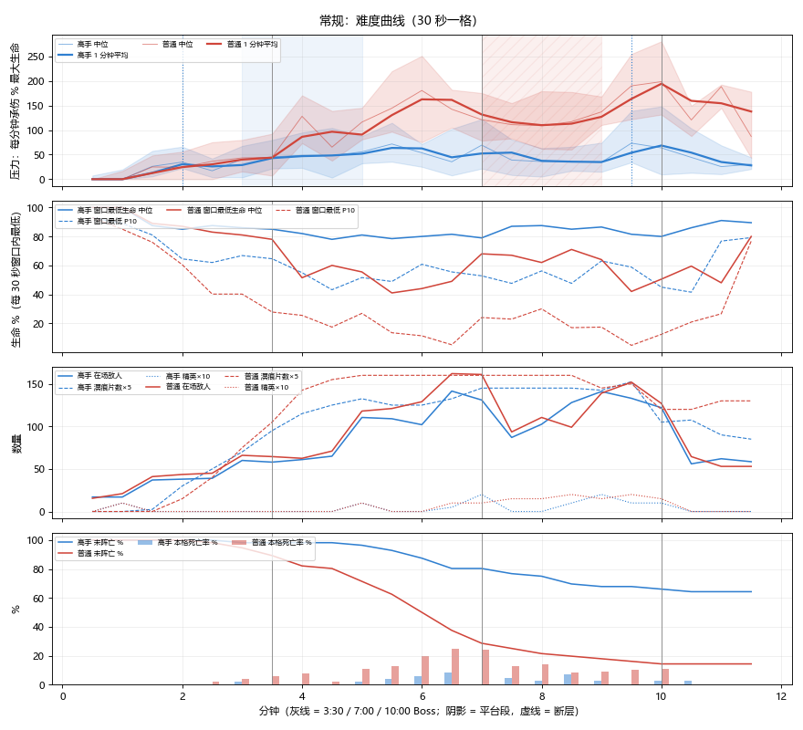
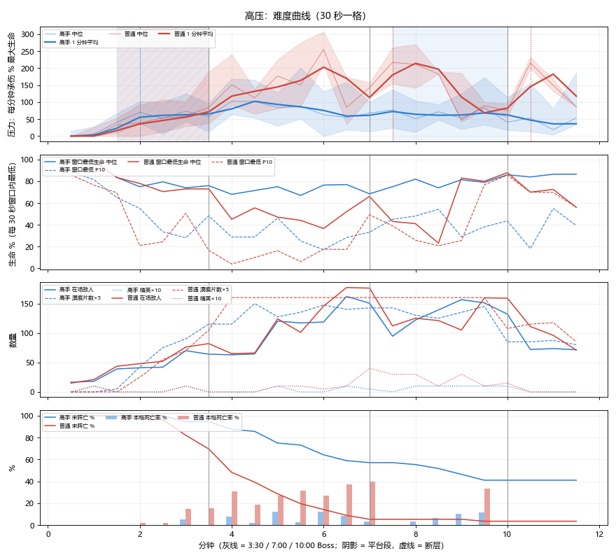
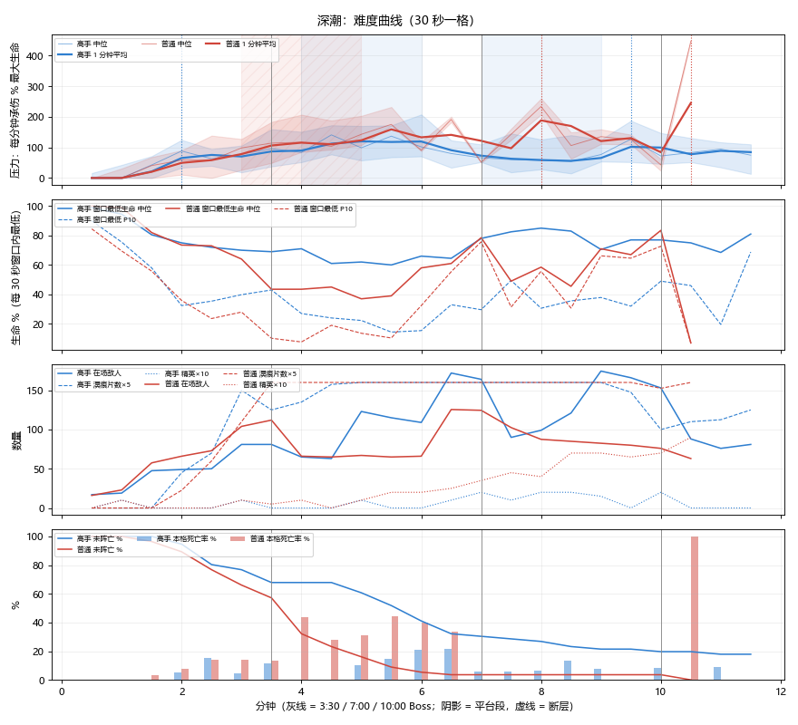

# 150 围猎并入大群 + 难度曲线 A / B（10-25）

> 用户 10-25：「把围猎和大群合并吧，然后怪物还是从远处围圈过来，但是不要太明显像是平移飘过来的，要那种慢慢来的。」又批 docs/146 方案 B（「难度曲线 B 没问题」）。
> 落地分支 `claude/combined-difficulty`（与数值会话 `claude/trim-pocket-dash` 合并，见 docs/149）。最终提交 **230f4fcea**。

## 1. 改了什么

**围猎并入大群（docs/146 方案 A）**

- 独立围猎事件关掉（`hunt/enabled` 0；`run/hunt.gd` 保留，置 1 可恢复；快检 `hunt_approach` 停用）。
- 中段固定节拍大群：3:45 / 5:00 / 6:15（`enemy/horde_fixed_1..3`），不占随机大群的计时。
- 其中 5:00、6:15 两波是**围猎型**（`horde_fixed_hunt_N` = 1）：
  - 从画面外合拢：出生半径 = 画面半对角线 × 1.15，夹在 650–1000。
  - 缺口小：半角 16°。
  - 只数 × 1.5，经验按只数折算守恒；入场速度 × 0.9。
  - 不画圈，HUD 只在缺口方向屏边画一个小箭头。
- 「慢慢来」对所有大群生效（`spawner._horde_loose`、`enemies.gd`）：
  - 每只速度 ±15%。
  - 分批出发：普通大群 2 批、间隔 0.5 秒；围猎型 3 批、间隔 0.8 秒。另加每只 0–0.4 秒随机延迟。
  - 走动时左右摆 ±22°（频率 1.6），离队长 260 内摆幅收到 0，到身边才收成圈。
  - 随机数只用 `g.rng` 系。
- 1/3 速录像：`python tools/horde_rec.py 296 260 hunt500`，输出到 `build/horde_rec/`（5:00 围猎型那波）。

**方案 B（后期伤害继续涨）**

- `enemy/dmg_late_cap` 0.1 → 0.25，`horde_grow_until` 500 → 570。
- 更正 docs/146：后期增伤是 7:00 起每 900 秒 +1.0，0.25 要到 **10:45** 才封顶，不是 10:00。所以 0.25 和 0.45 在 11 分钟前几乎没差（tune-v1 / v2 逐项相同），这个旋钮对胜率影响很小。

**收紧（合并后常规高手 76.8%，按授权用不给奖励的旋钮）**

- `enemy/dmg_div` 420 → 340：普通怪伤害按时间涨得更快，8:00 封顶时 ×2.41（原 ×2.14）。
- `enemy/horde_dmg` 1.0 → 1.4：大群单只接触伤害。
- 另加 `enemy/horde_hunt_dmg`（只乘围猎型，缺省 1.0，未启用），留作后续单独调围猎型。

## 2. 结果（云端，starts 7 开局 × 8 seed，每档每种机器人 56 局）

压力 = 每分钟承伤 ÷ 最大生命（%），口径同 docs/146 §1，各段取 30 秒格中位的平均。

| 版本 · 常规档 | 高手胜率 | 普通胜率 | 压力 0–2 / 2–3:30 / 3:30–7 / 7–10 / 10–11:30（高手） |
|---|---|---|---|
| docs/146 基线（1be86c55，curve-t0） | 48.2% | 7.1% | 18 / 37 / 54 / 68 / 64 |
| A 第一轮（2207674d4，merge-t0） | 58.9% | 7.1% | 16 / 37 / 48 / 48 / 46 |
| A 第二轮 + B（6fccc2110，merge2-t0） | 69.6% | 17.9% | 14 / 43 / 47 / 56 / 34 |
| 合并 trim（085af2db1，comb-t0） | 76.8% | 19.6% | 15 / 32 / 49 / 49 / 35 |
| **收紧后（230f4fcea 同值，tune-w2）** | **58.9%** | **12.5%** | **15 / 34 / 55 / 47 / 34** |

| 档 · 高手 | docs/146 基线 | 合并 trim | **收紧后** |
|---|---|---|---|
| 常规 | 48.2% | 76.8% | **58.9%** |
| 高压 | 23.2% | 39.3% | **35.7%** |
| 深潮 | 8.9% | 17.9% | **14.3%** |

协调人给的现行 main（022ad6166）常规高手基线是 60.7%。收紧后在 45–60 目标内。

调参扫描（只跑常规档，085af2db1 + `--bal`）：

| 变体 | 改动 | 常规高手胜率 |
|---|---|---|
| v1 | horde_dmg 1.4 | 73.2% |
| v2 | v1 + dmg_late_cap 0.45 | 73.2%（与 v1 逐项相同） |
| v3 | horde_dmg 1.8 + dmg_late_cap 0.45 | 71.4% |
| w1 | dmg_div 360 | 57.1% |
| w2 | dmg_div 340 + horde_dmg 1.4 | 58.9% ← 采用 |
| w3 | 后期增伤 6:00 起、600 秒涨 1.0、上限 0.4，加 horde_dmg 1.4 | 69.6% |

结论：大群伤害对高手几乎不动。有效的是普通怪伤害的时间斜率 `dmg_div`。

固定节拍大群（常规 · 高手，tune-w2 中位）：

| 时刻 | 只数 | 清掉八成用时 | 本波掉血 |
|---|---|---|---|
| 3:45–4:00（普通分股） | 24 | 144–170 秒 | 19–26 |
| 5:00（围猎型） | 41 | 157 秒 | 20 |
| 6:15（围猎型） | 46 | 152 秒 | 14 |

对照：docs/146 基线同时段随机大群 25–30 只、10–13 点。

## 3. 还没解决的

- **常规 7:00 以后压力回落**：7–10 分 47、最终段 34，基线是 68 / 64。原因是 trim 后期普通怪生命 −8%，加上活到后期的多是强局（只统计还活着的局）。中段平台填上了（3:30–7:00 从 49 回到 55），但后段又变平。要补的话，下一步可以考虑后期增伤起点提前，或给最终段单独加压。w3 那种提前方式会让胜率回升，不可取。
- **围猎型分批慢来，机器人能逐个清**：围猎型每波掉血 14–20，只比普通大群略高。`horde_hunt_dmg` 已留好，没启用。
- 云端 `tools/check.py` 在 art_lint 崩（系统自带 PIL 缺 `_imaging`，pip 装不过它），是环境问题，与本改动无关。A+B 那次（6fccc2110）云端快检 122 项 0 失败。
