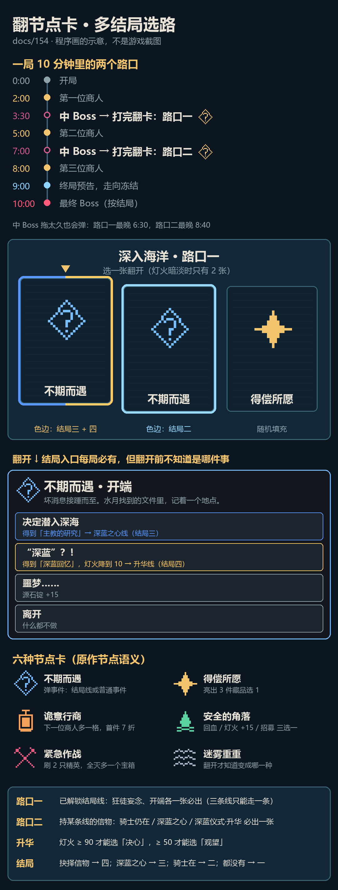

# 154 · 翻节点卡：多结局选路正式方案（10-25，用户已定方向，待审细节）

> 来源：协调人转用户决定（10-25）。docs/148 的 A 航路图用户嫌「太刻意、没随机性」，漂流物又「不符合原作」，最终定为**翻节点卡**：
> - 3:30、7:00 两场中 Boss 打完（相当于原作走完一层）暂停，翻出 2–3 张背面朝上的节点卡，只露类型图标（原作节点语义），选一张翻开即兑现；
> - 卡组每次随机抽，按持有信物和灯火加权；
> - 每条已解锁结局线的入口卡**每局 100% 出现**（路口一必有它的不期而遇卡，卡背后是哪个事件仍要翻开才知道）；达成过的结局，其入口卡背有该结局专属色边；
> - 路口二：持有某线信物时，该线后续事件必出一张；
> - 事件链按 docs/148 §3 原作重排；结局四升华台词按灯火开放；海嗣祭坛整体去掉。
>
> 本稿只写方案、不改代码。代码按 bee2cf96 核对（origin/main 已到 477b2946，实施时复核行号）。原作资料的出处与查证见 docs/148 §2 与附录（PRTS 为主，解包数据补数字），本稿每个事件标「原作」或「本作拟」。
> 示意图（手机竖屏）：`docs/reference/154_node_cards.png`，生成脚本 `tools/probes/node_cards_sheet.py`。

---

## 0. 一句话

**每过一场中 Boss 翻一次牌**：桌上 2–3 张背面朝上的节点卡，只看得到「不期而遇 / 得偿所愿 / 诡意行商 / 安全的角落 / 紧急作战 / 迷雾重重」图标；选一张翻开就兑现。结局线的入口藏在「不期而遇」卡里，每局必有，但翻开前不知道是哪件事。

---

## 1. 流程

### 1.1 时间线

| 时刻 | 发生什么 |
|---|---|
| 0:00–3:30 | 照常。2:00 第一位商人 |
| 3:30 中 Boss | 照常打。Boss 倒下照常掉宝箱 |
| **路口一** | 3:30 这一批中 Boss 全部倒下后 2 秒（让击杀慢放、宝箱落地走完）弹出；最晚 6:30，到点还有中 Boss 没打完也弹（同升级面板，暂停战斗） |
| 5:00 | 第二位商人 |
| 7:00 中 Boss | 照常打（7:00 可能两只共存，等两只都倒下） |
| **路口二** | 7:00 这一批全部倒下后 2 秒弹出；最晚 8:40 |
| 8:00 | 第三位商人 |
| 9:00 | 终局预告，走向冻结（同现在） |
| 10:00 | 最终 Boss，按结局（§4） |

两个路口各只翻一次。中 Boss 在 10:00 前撤离（现规则：最终 Boss 登场时撤）不影响，因为最晚时刻已经到了。

### 1.2 玩家看到什么

1. **摊牌**（约 0.6 秒）：画面压暗，标题「深入海洋 · 路口一」（路口二同理），2–3 张卡从底部翻上来，背面朝上。卡背只有一个节点图标和名字，结局入口卡背有结局色边（§2.3）。
2. **选牌**：键盘左右 / 手柄十字键 / 鼠标悬停 / 手机点按，选中的那张抬起一点；确认后这张翻面（约 0.4 秒），其余两张沉下去淡出。没有「都不选」——每张卡都有收益，不想走结局线就选别的。
3. **兑现**：
   - 不期而遇：直接切到 C 版式事件面板（现 `choice_panel` 的 event 版式），选项见 §3；
   - 其他类型：翻面后卡面写清效果，确认即生效（得偿所愿再弹一次藏品三选一）。
4. 回到战斗。整个停顿目标：不含事件阅读 ≤ 5 秒。

### 1.3 和其他面板的先后

路口卡排在「升级 / 宝箱 / 商人」之后：到点时若有别的面板开着，等它关掉再弹（`progression` 现有的待开面板顺序，新加一个 `crossroad_pending`）。路口卡打开期间不计时、不刷怪（同升级面板）。

---

## 2. 卡组

### 2.1 六种卡（原作节点语义）

节点名与一句话说明取自原作数据 `nodeTypeData`（docs/148 附录），兑现方式是本作折算。

| 卡 | 原作节点 | 本作兑现 | 出处 |
|---|---|---|---|
| **不期而遇** | INCIDENT 不期而遇 | 弹事件面板：结局事件（§3.1）或普通事件（§3.2） | 原作 |
| **得偿所愿** | WISH 得偿所愿 | 「消失的习俗」：亮出 3 件藏品，选一件拿走（稀有 / 核心权重 ×1.5） | 原作节点 + 事件名；权重本作拟 |
| **诡意行商** | BATTLE_SHOP 诡意行商 | 下一位商人货架 +1 格，且第一件商品 7 折；之后已没有商人时这张卡不进卡组 | 节点原作；效果本作拟（不改商人时间） |
| **安全的角落** | REST 安全的角落 | 「安全屋」三选一：稍事休息（回复 40% 最大生命，最大生命 +5%）／添加燃料（灯火 +15）／重整编制（立即一次招募） | 原作事件「安全屋」的选项（目标生命上限 +3 / 灯火 +15 / 可携带干员 +1）折算 |
| **紧急作战** | BATTLE_ELITE 紧急作战 | 3 秒后在队长 400 外刷一支精英小队（2 只），全灭后额外掉一个宝箱 + 源石锭 10 | 节点原作；内容本作拟 |
| **迷雾重重** | UNKNOWN 迷雾重重 | 翻开时才决定变成其余五种之一（按 §2.4 权重，但不会变成结局事件） | 原作「雾里有东西，但你看不见」 |

二期可加（原作在认知塑造里解锁）：**风雨际会**（原作事件「守望相助」：拿一件藏品换一件随机藏品，结局相关藏品不可换；不换则回复生命），挂到局外成长 v5 的一个节点上解锁，本期不做。

### 2.2 张数

- 基础 3 张。
- **灯火 < 30（暗淡）时只有 2 张**：灯光弱，看得清的路少（取原作「灯火决定看得见什么」的意思，本作拟）。
- 不少于必出卡数（必出卡永远在）。
- 局外成长可以给「路口多一张」（认知塑造式节点，二期）。

### 2.3 必出卡（用户定）

| 路口 | 条件 | 必出 | 卡背 |
|---|---|---|---|
| 一 | 已解锁结局线（现规则：通关过结局一，`Cfg.endings_cleared` 有 `standard`；`--allend` 无视） | **狂徒妄念**（骑士线入口）和**开端**（深蓝线入口，通向结局三、四）各一张 | 都是「不期而遇」背，和普通不期而遇卡长得一样 |
| 二 | 持海潮的气息（222）且骑士在场（未阵亡、未入潮前、没拿退行的罗辛南特 223） | **骑士仍在** | 同上 |
| 二 | 持主教的研究（220） | **深蓝之心**（含后续「赞歌」） | 同上 |
| 二 | 持深蓝回忆（242） | **深蓝仪式 · 升华**（两段式，§3.1） | 同上 |

三条线在路口一就互斥（只能翻一张），所以路口二最多只有一张必出卡。

**结局色边**：达成过的结局，其入口卡背描一圈该结局的颜色（`waves.json` endings.col）：狂徒妄念 = 结局二色；开端 = 结局三色与结局四色（两个都达成过就左右各半，只达成一个就只描那一色）；路口二的后续卡同样按它通向的结局描边。没达成过的线是普通卡背，所以第一次走某条线时，三张「不期而遇」长得一样，只能翻开看。

### 2.4 随机填充与权重

必出卡放完后，剩下的位置从下表抽（带权、不放回）：

| 卡 | 基础权重 | 加权（相乘） |
|---|---|---|
| 得偿所愿 | 25 | 6:00 后 ×0.8（后期藏品边际低，同 relic late_weight 的思路） |
| 安全的角落 | 20 | 队长生命 < 50% ×2；灯火 < 30 ×1.5 |
| 紧急作战 | 20 | 灯火 ≥ 70 ×1.5（照亮圈大，好打）；队长生命 < 35% ×0.5 |
| 诡意行商 | 15 | 之后没有商人 ×0；源石锭 ≥ 30 ×1.5；持遭诅藏品 ×1.3 |
| 不期而遇（普通事件） | 15 | 桌上已有 2 张不期而遇 ×0.5 |
| 迷雾重重 | 10 | 灯火 < 30 ×2 |

规则：
- 同一路口同类型最多 1 张（不期而遇除外，最多 3 张）；
- 上一个路口选过的类型 ×0.5（路口二才有）；
- 首通结局一之前：没有必出卡，3 张全是随机填充（教玩家读卡）——见 §8 待定 1；
- 抽法用 `g.rng`，写法同藏品三选一（`progression.gd` 的 `-log(u)/w` 排序）；摆放顺序用 `g.rng` 做 Fisher–Yates，**不用 `Array.shuffle()`**（同 seed 必须复现，docs/132 §1）；
- 普通不期而遇抽哪件事：§3.2 的池子里等权抽，本局抽过的不再出。

---

## 3. 事件清单

折算口径（原作 → 本作）：目标生命 → 队长生命（按最大生命的百分比）；目标生命上限 → 队长最大生命 +%；希望 → 源石锭；掷骰次数 → 概率或源石锭；护盾值 → 护盾层数；钥匙 → 本作已删（10-22），折成源石锭。数值是起点，数值会话按实测改。

### 3.1 结局事件

| 事件 | 路口 | 触发条件 | 选项（效果） | 出处 |
|---|---|---|---|---|
| **狂徒妄念** | 一 | 已解锁结局线（必出） | 愤怒：灯火 −40（最低 10），得海潮的气息（222）→ 猎潮的骑士加入编队／呼号：60% 得海潮的气息，失败无事／沉默：源石锭 +10／离开 | 原作：愤怒付 2 希望及上限必得、呼号付 1 次掷骰「可能」、沉默 +2 希望、离开；代价与概率本作折算 |
| **开端** | 一 | 已解锁结局线（必出） | 决定潜入深海：得主教的研究（220）→ 深蓝之心线／“深蓝”？！：得深蓝回忆（242）→ 升华线／噩梦……：源石锭 +15／离开 | 原作四个选项与去向；数值本作折算 |
| **骑士仍在** | 二 | 持 222 且骑士在场（必出） | 反抗：队长生命 −15%，得荒诞命运（新藏品，原作「源石锭 +10，钥匙 +1」→ 本作源石锭 +20）／挣脱：得骑士骨血（225）／逐流：无 | 原作三项；反抗代价本作折算 |
| **深蓝之心** | 二 | 持 220（必出） | 五个房间各付灯火 20、**可以连选**直到灯火不够：办公室（原作 5 希望 → 源石锭 +15）／科研区（随机藏品）／储藏室（源石锭 +13）／生活区（原作 5 掷骰次数 → 升级三选一一次）／食堂（原作目标生命上限 +6 → 最大生命 +8%）；**搜寻园林**：得深蓝之心（221）；离开。选园林后接「赞歌」 | 原作；原作这件事要求灯火 ≥ 20 才出现，本作改成「房间要付 20、园林不付」，因为用户定必出（本作拟） |
| 赞歌 | 二（深蓝之心第二段） | 刚拿到 221 | 亲吻猎人们的额头并取走遗物：得“绝唱”（226；原作给 2 个启示，本作启示未做，先给两次藏品三选一）／离开 | 原作；合并成第二段是本作拟 |
| **深蓝仪式** | 二（第一段） | 持 242（必出） | 关闭危险流程：灯火 +30／不做任何改动：得深蓝之树（243） | 原作 |
| **升华** | 二（第二段，仪式之后） | 持 242 | 三句回答（台词按 docs/76 转述成短句，原作文本较长）：「我是水月……」→ 决心（238，**灯火 ≥ 90**）／「让时间来解答」→ 观望（239，**灯火 ≥ 50**）／「大群非我……」→ 犹疑（240，任意灯火）。灯火不够的选项灰掉，卡上写「需要灯火 90」 | 原作三句与灯火门槛（PRTS）；仪式与升华合成一张卡是本作拟（原作两件事都在第 4–5 层，本作路口二只能翻一张） |

**升华放在仪式之后**：仪式的 +30 灯火能把玩家推过 50 / 90 的门槛，所以「关闭危险流程」= 稳拿更强的抉择信物，「不做改动」= 拿深蓝之树但信物可能只剩犹疑。这是原作里两件事的关系，合成一张卡后反而更清楚。

### 3.2 普通不期而遇池（填充用，全部取自原作水月事件）

| 事件 | 选项（本作折算） | 原作选项 |
|---|---|---|
| 继承 | 取出海嗣保护的东西：随机藏品一件／离开 | 随机收藏品 / 离开 |
| 残存微光 | 送上提灯：灯火 +40／悄悄接近：队长生命 −10%，灯火 +15／上前攀谈：源石锭 +10 | +40 灯火 / −2 目标生命 +15 灯火 / +2 希望 |
| 点滴星火 | 冒险去取：队长生命 −15%，随机藏品一件／拾取安全区域的物资：源石锭 +5 | −3 目标生命得藏品 / +5 源石锭 |
| 海边的歌者 | 驻足倾听：源石锭 −3，随机藏品一件／转身离开 | 同 |
| 最后的观潮者 | 冒险帮他回收装备：队长生命 −5%，随机藏品一件／打听观潮的结果：最大生命 +3%／离开 | −1 目标生命得神秘藏品 / +1 目标生命上限 / 离开 |
| 相逢 | 查看它的情况：队长生命 −15%，源石锭 +8／尝试救助它：队长生命 −30%，最大生命 +10%／默默离开 | −3 目标生命 +8 源石锭 / −6 目标生命 +4 上限 / 离开 |
| 大海的遗产 | 拿了再说：随机藏品一件 + 随机遭诅藏品一件／安全第一：随机藏品一件 | 同（遭诅古物 → 本作【遭诅】藏品） |
| 为了生存 | 加入他们：源石锭 +2／工作很简单：源石锭 −3，70% 得 +8／继续工作：源石锭 −10，50% 得 +25／离开 | 同 |
| 引火之木 | 放心地睡去：立即一次招募／坚持轮流守夜：灯火 −10，招募时多一个候选 | 招募一名干员 / −10 灯火得招募券 |

事件文字（C 版式左侧那段叙述）按 docs/76 转述原作，不照抄。事件插画：现在 `choice_panel.gd:405` 画的是灰阶墨色 + 彩色祭坛，改成灰阶墨色 + 彩色的「不期而遇」节点图标。

### 3.3 退役

`waves.json` 里的 `resolve1–3`（抉择 ×3）、`whisper`（深蓝的低语）、`memory`（深蓝回忆事件）、`madness` / `knight_stay` 的旧版删除；结局四的「238 两级」规则取消。

---

## 4. 结局判定与表达

- **判定**（原作数据 `endings.priority`，不再「后覆盖先」）：持决心 / 观望 / 犹疑之一 → 结局四；否则持深蓝之心 → 结局三；否则持海潮的气息且骑士在 → 结局二；否则结局一。三条线在路口一已互斥，不会冲突。
- **9:00 冻结、预告**：同现在（`tick_final_warning`、`frozen`）。走向改变时的横幅照旧，但现在只会在路口一 / 路口二之后变，不会在 8 分多突然变。
- **最终 Boss**：不变（偏执泡影 / 最后的骑士 / 伊莎玛拉 / 伊祖米克），玩法按 docs/142b。
- **可选（不在本期）**：结局三 / 四 9:00 后地面换成「幽海丛林」色调（docs/148 §3）。

---

## 5. 和现有系统的接口

| 系统 | 现在 | 要改的 |
|---|---|---|
| `endings.gd` | 事件箱按窗口刷、走近打开、沉没、挪位、`urgent` 闪烁、后覆盖先重算 | **重写**：删祭坛的刷新 / 打开 / 沉没 / 挪位 / `urgent`；新增路口状态机（`cross_idx`、`cross_pending`、最晚时刻）、`deal()` 生成卡组（§2）、`flip(i)` 兑现、多段事件（深蓝之心 → 赞歌、仪式 → 升华）、按优先级 `recalc()`；`reserved_relic_slots()` 改成「已翻开的线还差几件信物」，最多 2 槽 |
| `waves.json` | `events`（带 window）/ `endings` | `events` 去掉 window，加 `cross`（1 / 2）、`must`（必出条件）、`line`（knight / heart / memory）、多段 `next`；新加 `cross_deck` 段：卡种、基础权重、加权规则、张数；`endings` 的 `requires` 改成 §4 判定，`relic_lv 238 2` 删除 |
| `relics.json` / `relic_effects.json` | 220 主教的研究、243 深蓝之树是普通负面藏品，可能在藏品池 / 商人遭诅栏出现 | 220、242 改为只能从开端得到（从藏品池和商人货架剔除，否则买到就开线）；220 效果：原作「每战灯火 −5」→ 本作每 60 秒灯火 −5（最低 10，本作拟）；242：灯火降到 10 + 一次技能海嗣化；238 取消两级；新增荒诞命运（一次性源石锭 +20） |
| `choice_panel.gd` | `show_choices(title, opts, kind)`，event 版式（C 版式）、卡片版式 | 新增 `kind = "cross"`：背面朝上的卡、选中抬起、翻面动画、结局色边；event 版式加「灰掉的选项 + 原因」（升华门槛）和多段切换；插画里的祭坛换节点图标 |
| `progression.gd` | 升级 / 宝箱 / 商人待开顺序 | 加 `crossroad_pending`，排在它们之后 |
| `spawner.gd` / `combat.gd` | 中 Boss 倒下掉宝箱；`spawn_chest(pos, event_id)` 有事件分支 | 中 Boss 全部倒下时通知 `endings`；删 `spawn_chest` 的事件分支（`e_event`、名字「海嗣祭坛」） |
| `enemies.gd` | 事件箱不进索敌网格、离太远挪位 | 删这两段 |
| 商人 | `MERCHANT_TIMES` 2:00 / 5:00 / 8:00，货架与涨价在 `balance.json` | 「诡意行商」卡：下一位商人货架 +1、首件 7 折（新旋钮 `cross/shop_extra`、`cross/shop_disc`）；不改时间 |
| 灯火 | `g.lamp` / `g.lamp_cap` | 读：张数、权重、升华门槛；写：各事件的灯火增减（付灯火最低 10 的规则沿用 `pick()` 里的写法） |
| 作战记录 | `telemetry.altars` →「海嗣祭坛」 | 改为 `cross_picks`（每路口翻的卡种）与「不期而遇」次数；局终统计行「海嗣祭坛」改「节点卡」 |
| 开局指南 | `guide.json` 第 4 页「海嗣祭坛与结局」，`intro.gd` 的 `altar` 图 | 改为「节点卡与结局」：lines 一条——「中 Boss 打完后翻一张节点卡；结局线藏在『不期而遇』里。」；more：两次路口时间、灯火暗淡少一张、色边含义、四结局各有最终 Boss；`intro.gd` 改画三张卡背 |
| 图鉴 | 结局页 `gallery.hint`（写着「在祭坛上…」「三次抉择…」） | 四条按 §3.1 重写，例如结局四：「在开端选择『“深蓝”？！』，并在升华中作出回答。」结局一：「不翻开任何一条结局线。」 |
| HUD | `hud_banners.draw_altar_pointers`、`endg.urgent` | 删除 |
| 骑士 | `allies/knight.gd`、docs/18：现由 2:30–3:30 的狂徒妄念触发 | 改由路口一触发（约 4:00–5:00 入队）；9:00 入潮、10:00 重生不变 |

---

## 6. 机器人与测试

- **机器人选卡**（`core/bot.gd`）：缺省按 seed 轮换「走哪条线」（knight / heart / memory / none 四种，`seed % 4`），批跑时四个结局都有样本；路口二按线拿信物；升华按当前灯火选能选的最强一句；非结局卡按「生命 < 50% 选安全的角落，否则得偿所愿 > 紧急作战 > 其他」。
- **开发参数**：删 `--evignore`（祭坛晾着不开）；新加 `--route=knight|heart|memory|none|rand` 强制路线，`--deck=<卡种,…>` 强制路口卡面（复现问题用）。`--allend` 保留。
- **自动测试**（`run/autotest.gd`）：删「走去祭坛」那段（`autotest.gd:1406`）；路口面板打开时按机器人规则立即选。
- **新测试**（`tests/`，进 `check.py --auto`）：
  1. 同 seed 两次卡组完全相同；
  2. 已解锁时路口一 1000 个 seed 都含狂徒妄念与开端；路口二持信物 1000 个 seed 都含对应后续卡；
  3. 暗淡时张数 = max(2, 必出数)；
  4. 互斥：路口一选了开端，路口二不会出骑士仍在；
  5. 判定优先级：手动给藏品组合，结局符合 §4；
  6. 升华门槛：灯火 49 / 50 / 89 / 90 时可选项正确；
  7. 最晚时刻：中 Boss 不死时 6:30 / 8:40 照样弹；
  8. 面板顺序：升级面板开着时到点，路口卡等它关掉再弹。
- **金样**：玩法改动，积木等价金样必过期；分支不提交，合入后 main 统一重录（docs/132 §1）。
- **云端**：常规 / 高压各 56 局配对（`--route=rand`），看胜率（差 < 10 点才合）和四结局分布；再单独跑一组首通前（无结局线）看填充卡对胜率的影响。

---

## 7. 工作量与美术

| 项 | 估计 |
|---|---|
| `endings.gd` 重写 + `waves.json` 改结构 | 1.5 天 |
| 路口卡界面（卡背、翻面、色边、手机布局）+ event 版式灰选项 / 多段 | 1.5 天 |
| 六种卡的兑现（商人加格、安全屋、紧急作战、得偿所愿）| 0.5 天 |
| 藏品改动（220 / 242 / 238 / 荒诞命运，剔出池子）| 0.5 天 |
| 文字：指南、图鉴、作战记录、事件转述 | 0.5 天 |
| 机器人、开发参数、8 条测试 | 1 天 |
| 云端验证与微调 | 0.5 天 |
| **合计** | **约 6 人日** |

**美术**（不需要世界层美术）：
- 节点图标 6 枚（不期而遇、得偿所愿、诡意行商、安全的角落、紧急作战、迷雾重重），界面用 16×16 像素 @2x。按原作节点的**图形语义**自画（PRTS 图标只作内部参照，放 `build/`，不进 git / 包），线宽与配色按 docs/37 水月风格。
- 卡背 / 卡面框：程序绘制（同现有卡片版式），结局色边读 `endings.col`。
- 事件插画：沿用 C 版式灰阶墨色底，彩色物件换成节点图标；现有 `e_event`（祭坛）贴图退役。

---

## 8. 待定

1. **首通前要不要翻卡**：建议翻（只有填充卡，教读卡），但会给首通多两次奖励，需云端看常规档胜率是否越过 60；越过就把填充卡的收益打折，或首通前不翻。
2. 升华门槛 90 / 50 在 docs/147（精英灯油 25 → 15）之后能不能达到：深蓝回忆把灯火打到 10，到路口二（约 7:30–8:30）要涨到 60 再靠仪式 +30。实测后可能按比例降，降了要标「本作拟」。
3. 主教的研究「每 60 秒灯火 −5」是否太重（3:30–10:00 共约 −30）。
4. 诡意行商卡在路口二（约 7:30 后）只剩 8:00 一位商人；若路口二晚于 8:00 弹出则不进卡组，是否另给一个「立即源石锭」替代。
