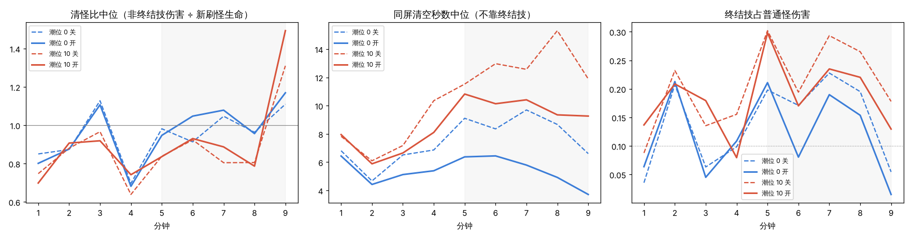
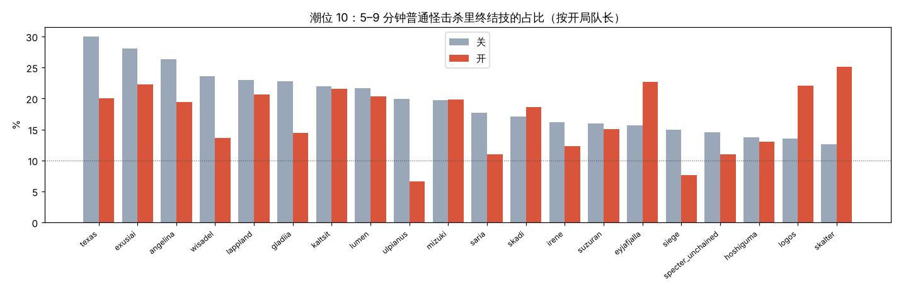

# 244 后期打得动：形状随成长 + 形状卡 数值原型与云端 A/B（11-05）

**结论（5 行）**
1. 形状原型有效、但只到目标的一半：5–9 分钟终结技占普通怪击杀，潮位 0 从 14% 降到 11%（目标 10% 左右，达到），潮位 10 从 19% 降到 16%（未达到）；不靠终结技清掉同屏怪群的秒数 8.6 → 5.8（潮位 0）、12.8 → 10.0（潮位 10）。
2. 清怪比（非终结技伤害 ÷ 新刷怪生命）潮位 0 中位 0.99 → 1.05（≥ 1，达到），潮位 10 0.90 → 0.92（未达到）。这个指标被「伤害打不出超过已刷出的血量」封顶在 1 附近，对改动不敏感，判断以终结技占比和同屏清空秒数为主（§3.1）。
3. 不加补偿时胜率冲出窗口：安慰剂 0 上 m0 54 → 86%、m18 71 → 96%，多出来的胜局主要在最终 Boss 段。加了只在开关开时生效的补偿（4–7 分钟起普通怪伤害 ×1.5、Boss 生命 ×1.4、Boss 伤害 ×1.3、形状额外伤害打 Boss ×0.5）后，三份实现均值：m18 65 → 68%（窗口 65–75 内）；**m0 55 → 63%，高出窗口 8 点**。两档差都 < 10 点，按口径不下「变强 / 变弱」结论；第二轮补偿（C5）对 m18 的压低比 m0 还多，没有采用，m0 是否单独加旋钮留给用户定（§4.4）。
4. 精英化现在是一次可见的跃升：精一 1 档、精二 1.5 档（另有 Lv14 / Lv20 各 0.5 档），近战多范围和剑气、多弹多射、召唤扩范围和伤害、控场扩范围和时长；卡面写出这一档的形状加成。新形状来源（剑气 / 散射 / 扩散 / 连锁）中位占全队伤害 7%（最高 26%）。
5. 建议：P3（终结技小怪部分改成清一圈）建议做，用来补潮位 10 剩下的 6 个点（未验证，要再跑一轮）；P4（小怪生命后段放缓）暂不做：形状原型已经在潮位 0 达标，同时降怪血会让胜率再往上冲，需要的补偿会更大（§5）。

基准：`claude/late-game-diag` 283879227（docs/243 的只读遥测分支）。分支 `claude/late-power-ab`。所有改动挂在 `growth/late_shape`（缺省 0）后面；**开关关时同种子 TRACE 逐行相同**（§6）。云端本机（4 核容器，没有 GCP 凭据），批跑全部在同一台机器上跑完。

---

## 1. 做了什么

### 1.1 P1 形状随成长（`game/scripts/characters/blocks/late_shape.gd`）

每名干员按「档」拿形状加成。档 = 达到的门槛权重之和，参数全在 `balance.json` 的 `shape_lv` 段：

| 门槛 | 权重 | 说明 |
|---|---|---|
| 精一 | `w_e1` 1.0 | 精英化节点本身原来不加属性，现在是第一次形状跃升 |
| 精二 | `w_e2` 1.5 | 第二次、更大的跃升 |
| 队伍等级 ≥ `lv1` 14 | `w_lv1` 0.5 | 约 4:00（机器人 normal 中位） |
| 队伍等级 ≥ `lv2` 20 | `w_lv2` 0.5 | 约 6:30 |

满档 3.5。每档的加成按形状流派（lane）四条共用：

| 流派 | 每档 | 走哪条现有机制 |
|---|---|---|
| 近战扩域 melee | 攻击范围 +15%；每次普攻多放 1.0 道剑气（60% 普攻伤害，穿 4 名） | `op_range`（作用域 op:<id>）；剑气复用可见成长（docs/163）的 `_fire_qi` |
| 多弹火力 multi | 每次普攻多射 1.0 发（60% 普攻伤害，射向另一名敌人）；攻击范围 +8%；能穿透的普攻子弹每档 +0.8 穿透（取整） | 额外弹复用可见成长 `_fire_shots`；`op_pierce` |
| 召唤驻场 summon | 攻击范围 +18%（含召唤物攻击覆盖）；追击与召唤物伤害 +30% | `op_range`、`followup_dmg` |
| 控场引爆 control | 攻击范围 +25%；控制时长 +12% | `op_range`、`control_dur` |

- 流派取干员 `lanes` 里第一个属于这四条的（德克萨斯、艾丽妮 → 近战；维什戴尔 → 多弹；归溟幽灵鲨 → 近战）。
- **例外表** `shape_lv/x_lane`：不在四条里的 4 人——逻各斯、流明 → 多弹（普攻是远程弹体），塞雷娅 → 近战，浊心斯卡蒂 → 控场。写 `"none"` 可以让某人不吃形状加成。
- 小数档的「多 1 道 / 1 发」按次数累加（同可见成长的累加器，不抽随机数）。
- 档位每帧比对，变了才重挂属性来源 `lshape:<id>`。
- 精英化卡面末尾多一行「形状：……」，写出这一档的加成（如「攻击范围 +15%，每 1 次普攻多放 1 道剑气（60% 普攻伤害）」）。

### 1.2 P2 形状卡（`data/cards.json`，`pool_flag: growth/late_shape`）

| 卡 | 类别 | 出卡条件 | 效果 | 层数 |
|---|---|---|---|---|
| 协同·广（放回卡池） | 协同 | — | 全队干员攻击范围 +8% | 4 |
| 扩散（新） | 流派 | 编队里有近战扩域 / 召唤驻场 / 控场引爆干员 | 这些干员的普攻命中时，目标周围 60 范围内的其他敌人受到该次伤害的 25% | 2 |
| 连锁（新） | 流派 | 编队里有多弹火力干员 | 多弹火力干员的普攻命中后弹向 170 范围内的另 1 名敌人，造成该次伤害的 50% | 2（每层多弹 1 次） |

- 扩散 / 连锁只吃普攻（来源 origin = core），不吃额外弹 / 剑气 / 自己；同一干员同一帧只触发一次（范围普攻一下打中十几名时不按人头翻倍）。
- 机器人权重（`bot/growth_weights`）：扩散、连锁各 2.0，协同·广沿用 1.5。80 局诊断里扩散被选 52 局、连锁 28 局、协同·广 52 局。
- 卡面文案按 docs/76：写数值和范围，不写程度词；「该次伤害」写明基数。卡面预览：「溅射伤害 0% → 25%」「弹射次数 0 → 1」。

### 1.3 补偿（只在开关开时生效）

| 旋钮 | 值 | 作用点 |
|---|---|---|
| `shape_lv/comp_dmg` | 1.5 | 普通怪伤害曲线（`dmg_curve.target`）在 `comp_from` 240 → `comp_to` 420 秒内平滑升到 ×1.5，之后保持 |
| `shape_lv/comp_boss_hp` | 1.4 | 所有 Boss 生命（spawner） |
| `shape_lv/comp_boss_dmg` | 1.3 | 所有 Boss 伤害（spawner） |
| `shape_lv/boss_k` | 0.5 | 额外弹 / 剑气 / 扩散 / 连锁打 Boss 的伤害倍率 |

为什么是这几个：不补偿时多出来的胜局几乎都在最终 Boss 段（§4.2），所以先压 Boss 段；4–7 分钟的普通怪伤害用来对冲精一提前到来的那部分（精一 1 档在 1–3 分钟就到）。没有动小怪生命：小怪生命正是这次要「打得动」的对象，动它等于把改动收回去。

## 2. A/B 方法

- **诊断批跑**（`tools/late_game_diag.py run`，加了 `--extra` 透传开关）：20 名干员各当一次队长 × 种子 11 / 23 × 潮位 0 / 10，机器人 normal、`--nodeath --diagbins`，开关 0 / 1 各 80 局，按 (队长, 种子, 潮位) 配对。
- **胜率批跑**（`tools/balance_run.py`，docs/36 §7.5.1 / docs/216 §10 口径）：expert，`--preset starts` 7 编队 × 4 seed × 安慰剂 0 / 1 / 2，每组 84 局；m0 = `--tier=0 --tide=0`，m18 = `--tide=0 --meta=18`。按 (编队, seed, 安慰剂) 配对，配对给「负转胜 / 胜转负」和符号检验 p。
- 汇总脚本 `tools/late_power_ab.py`；表与图在 `docs/assets/late_power_ab/`。
- 关的一侧：诊断用基准提交 283879227，胜率安慰剂 0 用 e2e393830、1 / 2 用 12c2db9de（开关关时这三个提交同种子 TRACE 逐行相同，§6）。

## 3. 打得动：诊断 80 对

| 潮位 | 开关 | 5–9 分钟清怪比 中位 | 清怪比 < 1 的局·分钟 | 终结技占普通怪伤害 | 终结技占普通怪击杀 | 同屏清空秒数 中位 | 打掉最终 Boss | 局长 中位 |
|---|---|---|---|---|---|---|---|---|
| 0 | 0（关） | 0.99 | 52% | 16% | 14% | 8.6 | 57% | 759.0 |
| 0 | 1（开） | 1.05 | 40% | 11% | 11% | 5.8 | 60% | 759.0 |
| 10 | 0（关） | 0.90 | 62% | 24% | 19% | 12.8 | 32% | 780.0 |
| 10 | 1（开） | 0.92 | 60% | 20% | 16% | 10.0 | 25% | 780.0 |

#### 逐分钟清怪比中位（关 → 开）

| 分钟 | 潮位 0 | 潮位 10 |
|---|---|---|
| 1 | 0.85 → 0.80 | 0.75 → 0.70 |
| 2 | 0.87 → 0.88 | 0.88 → 0.91 |
| 3 | 1.13 → 1.11 | 0.97 → 0.92 |
| 4 | 0.70 → 0.68 | 0.64 → 0.74 |
| 5 | 0.98 → 0.95 | 0.84 → 0.84 |
| 6 | 0.91 → 1.05 | 0.92 → 0.93 |
| 7 | 1.05 → 1.08 | 0.80 → 0.89 |
| 8 | 0.96 → 0.96 | 0.81 → 0.79 |
| 9 | 1.11 → 1.17 | 1.31 → 1.49 |
| 10 | 0.00 → 0.00 | 0.00 → 0.00 |

#### 按队长（5–9 分钟清怪比中位 / 终结技击杀占比，关 → 开）

| 队长 | 潮位 0 清怪比 | 潮位 0 终结技击杀 | 潮位 10 清怪比 | 潮位 10 终结技击杀 |
|---|---|---|---|---|
| angelina | 0.91 → 1.11 | 21% → 10% | 0.81 → 0.81 | 26% → 19% |
| exusiai | 0.95 → 0.93 | 18% → 18% | 0.73 → 0.81 | 28% → 22% |
| eyjafjalla | 1.10 → 0.98 | 14% → 11% | 0.96 → 0.78 | 16% → 23% |
| gladiia | 1.02 → 1.07 | 11% → 8% | 0.80 → 0.85 | 23% → 14% |
| hoshiguma | 1.02 → 1.09 | 13% → 8% | 0.99 → 1.04 | 14% → 13% |
| irene | 1.00 → 1.06 | 11% → 8% | 0.90 → 0.95 | 16% → 12% |
| kaltsit | 1.01 → 1.05 | 11% → 15% | 0.79 → 0.98 | 22% → 22% |
| lappland | 0.83 → 1.12 | 18% → 6% | 0.91 → 0.82 | 23% → 21% |
| logos | 0.95 → 1.02 | 11% → 15% | 0.92 → 0.92 | 13% → 22% |
| lumen | 0.99 → 1.02 | 21% → 13% | 0.88 → 0.87 | 22% → 20% |
| mizuki | 0.72 → 0.92 | 27% → 18% | 0.99 → 0.79 | 20% → 20% |
| saria | 0.98 → 1.04 | 11% → 14% | 1.04 → 0.95 | 18% → 11% |
| siege | 1.07 → 0.91 | 9% → 15% | 1.08 → 1.05 | 15% → 8% |
| skadi | 0.89 → 1.07 | 20% → 8% | 0.95 → 0.83 | 17% → 19% |
| skalter | 1.04 → 1.03 | 15% → 6% | 0.91 → 0.75 | 13% → 25% |
| specter_unchained | 1.09 → 1.05 | 10% → 9% | 1.02 → 0.94 | 15% → 11% |
| suzuran | 0.96 → 1.05 | 19% → 10% | 0.89 → 1.00 | 16% → 15% |
| texas | 1.00 → 1.05 | 9% → 9% | 0.75 → 0.90 | 30% → 20% |
| ulpianus | 1.03 → 1.03 | 11% → 8% | 0.87 → 1.06 | 20% → 7% |
| wisadel | 0.96 → 1.08 | 9% → 7% | 0.73 → 0.90 | 24% → 14% |

图：`clear_ratio_ab.png`（逐分钟清怪比 / 同屏清空秒数 / 终结技占普通怪伤害，虚线关、实线开）、`ult_kill_ab.png`（潮位 10 按队长的终结技击杀占比）。

### 3.1 为什么清怪比几乎不动
清怪比的分子是「对普通怪的有效伤害」，打死就停（不算溢出），分母是同一分钟新刷出的生命。只要大致跟得上，比值就贴着 1；终结技每清一次场，下一段的非终结技伤害就少了可打的对象。所以它只能区分「明显跟不上」和「跟得上」，看不出「跟得多轻松」。改动的效果主要体现在：
- **同屏清空秒数**（同屏怪群总血 ÷ 非终结技秒伤）：潮位 0 的 5–9 分钟从 8–10 秒降到约 5 秒，潮位 10 从 12–15 秒降到 8–10 秒；
- **终结技占比**：潮位 0 终结技击杀 14% → 11%，伤害 16% → 11%；潮位 10 击杀 19% → 16%，伤害 24% → 20%。

### 3.2 不补偿的 v3（同一套形状参数、没有 §1.3 的补偿）
| 潮位 | 开关 | 5–9 分钟清怪比 中位 | 清怪比 < 1 的局·分钟 | 终结技占普通怪伤害 | 终结技占普通怪击杀 | 同屏清空秒数 中位 | 打掉最终 Boss | 局长 中位 |
|---|---|---|---|---|---|---|---|---|
| 0 | 0（关） | 0.99 | 52% | 16% | 14% | 8.6 | 57% | 759.0 |
| 0 | 1（开） | 1.02 | 43% | 11% | 10% | 4.8 | 90% | 697.0 |
| 10 | 0（关） | 0.90 | 62% | 24% | 19% | 12.8 | 32% | 780.0 |
| 10 | 1（开） | 0.92 | 64% | 19% | 16% | 9.1 | 55% | 769.5 |

补偿只改 Boss 和普通怪对队长的伤害，对清怪的影响很小（同屏清空秒数 4.8 → 5.8 / 9.1 → 10.0 是 Boss 段吃了 `boss_k`、机器人多躲的结果）；打掉最终 Boss 的比例从 90% / 55% 回到 60% / 25%，与关的一侧（57% / 32%）持平。

### 3.3 参数是怎么定的
- v1（精一 0.5、精二 1、Lv16 / Lv22 各 0.5，每档加成约为现值的 2/3）：前 10 局新形状来源只占总伤害 2–8%，指标不动，停掉。机器人 normal 下队友多数局末只到精一（终局时精零 12%、精一 43%、精二 45%），所以权重要前移、加大。
- v2（探针 5 局，潮位 10）：5–9 分钟清怪比 0.64–0.92 → 0.82–0.99，终结技击杀降 0–11 个点。
- v3（现值）：在 v2 上精二 1.5、加成再上调一档。

## 4. 胜率

最终配置（v3 形状 + C3 补偿）。关的一侧安慰剂 0 用 e2e393830、1 / 2 用 12c2db9de，开的一侧安慰剂 0 是 C3 校准组（88eaade50 + `--bal` 覆盖，与 12c2db9de 缺省值相同）、1 / 2 用 12c2db9de。

| 档 | 开关 | 胜率 | 安慰剂 0 / 1 / 2 | 局长 中位 | 胜局用时 中位 | 死亡 / 超时 | 死亡时刻 中位 | 死亡 0–4 / 4–7 / 7–10 / 10+ 分钟 | 配对 负转胜 / 胜转负（p） | 窗口 |
|---|---|---|---|---|---|---|---|---|---|---|
| m0 | 关 | **55%** | 53.6 / 67.9 / 42.9 | 696.5 | 701.0 | 27 / 11 | 429 | 1 / 12 / 4 / 10 |  | 45–55 |
| m0 | 开 | **63%** | 60.7 / 60.7 / 67.9 | 690.5 | 702 | 27 / 4 | 431 | 3 / 10 / 5 / 9 | 26 / 19（0.371） | 45–55 |
| m18 | 关 | **65%** | 71.4 / 60.7 / 64.3 | 693.5 | 695 | 19 / 10 | 443 | 1 / 8 / 6 / 4 |  | 65–75 |
| m18 | 开 | **68%** | 60.7 / 71.4 / 71.4 | 689.5 | 695 | 23 / 4 | 617 | 1 / 6 / 4 / 12 | 18 / 16（0.864） | 65–75 |

### 4.1 判定
- 胜率差 < 10 个百分点不下结论（docs/80）。
- 难度窗口：m0 45–55、m18 65–75，按三份实现均值。

### 4.2 不补偿时（安慰剂 0，28 局）
| 档 | 关 | 开（v3，不补偿） |
|---|---|---|
| m0 | 53.6% | 85.7% |
| m18 | 71.4% | 96.4% |

m0 开的 4 局失败：1 局在 4 分钟前、2 局在 4–7 分钟、最终 Boss 段只输 1 局；关的一侧 13 局失败里 8 局在最终 Boss 段（其中 3 局超时）。也就是说形状加成在最终 Boss 段的作用最大：怪群清得快、Boss 战里挨打少、Boss 打得也快。

### 4.3 补偿校准（m0、安慰剂 0，各 28 局）
| 候选 | 普通怪伤害 | Boss 生命 | Boss 伤害 | 形状打 Boss | m0 胜率 |
|---|---|---|---|---|---|
| 不补偿 | 1 | 1 | 1 | 1 | 85.7% |
| C1 | 1.3 | 1.25 | 1 | 1 | 71.4% |
| C2 | 1.5 | 1.4 | 1 | 1 | 75.0% |
| **C3（缺省）** | 1.5 | 1.4 | 1.3 | 0.5 | 60.7% |
| C4 | 1.7 | 1.5 | 1.6 | 0.3 | 60.7% |

C4 比 C3 狠得多却没再降：多出来的失败都变成中期 Boss（卡门 / 塑路者）战里的死亡（C4 11 局失败里 6 局在 3:48–5:05）。

### 4.4 第二轮补偿 C5（未采用）与 m0 超窗
C5 = C3 但普通怪伤害补偿从 180 秒起、升到 ×1.8（想法：m0 没有局外生命 / 护甲，应比 m18 更吃普通怪伤害）。只跑了两份实现就停了：

| 档 | C3（安慰剂 0 / 1） | C5（安慰剂 0 / 1） |
|---|---|---|
| m0 | 60.7 / 60.7 | 60.7 / 57.1 |
| m18 | 60.7 / 71.4 | 53.6 / 60.7 |

方向和预想相反：m18 掉得比 m0 多。原因和 docs/201 10-31 的结论一样——全局旋钮对两档几乎同幅移动，而基准本身就贴在两个窗口的边上（关：m0 55%、m18 65%，只差 10 点）；形状加成对无成长档帮助更大（m0 +8、m18 +3），把两档差缩到 5 点，任何全局补偿都无法同时把 m0 压进 55、又让 m18 留在 65 以上。

可选（待用户定）：
- ① 接受 m0 63%（窗口上沿 +8，三份实现 60.7 / 60.7 / 67.9，组间标准差约 3.4）；
- ② 加一个按档的差异化旋钮：形状档位按局外成长缩放（例如无成长档的精一权重 1.0 → 0.5），只压 m0；
- ③ 先做 P3（终结技小怪部分改成清一圈），它本身是削弱，可以和 ② 一起再跑一轮。

## 5. 对 P3 / P4 的建议

- **P3 终结技重新定位：建议做，和本原型一起上。** 补偿后潮位 10 的终结技击杀占比仍有 16%，离 10% 差 6 点；形状原型把「不靠终结技清场」从 12.8 秒压到 10.0 秒，已经有余量承接终结技让出的部分。把终结技的小怪部分改成清一圈（半径约 300，现约 550–700），对 Boss / 精英的爆发不动。它也是一次削弱，可以替换掉一部分 §1.3 的补偿（尤其 Boss 生命 ×1.4 这种玩家看不见的补偿），胜率要再跑一轮。
- **P4 小怪生命后段放缓：暂不做。** 潮位 0 下形状原型已经达到「清怪比 ≥ 1、终结技击杀 ≈ 10%」；降怪血会再推高胜率（不补偿时形状本身已 +30 点），需要更多补偿压回来，等于用难度换难度。若 P3 之后潮位 10 仍不够，再考虑只对高潮位（≥ 7）做「数量 ↑ 单体 ↓」。
- 不建议用小怪生命做补偿：它正是要「打得动」的对象。本轮补偿全部放在「打队长的伤害」和 Boss 上。

## 6. 开关关时同种子一致

- `--balance --bot=expert --trace=1 --maxt=780`，基准 283879227 对 a7fa03b0b（德克萨斯、能天使、凯尔希、安洁莉娜，seed 1）、对 12c2db9de（德克萨斯、艾雅法拉、水月，seed 2，`--tier=0`）：7 局 TRACE 全部逐行相同（715–781 行）；BALANCE 除 `bot.peak` / `bot.peak_min` 的特效数与飘字数（画面计数，docs/36 §7.7 记过同提交两次跑也差几个）外逐字段相同。
- 新增的属性 `op_splash` / `op_chain`、卡表里的三张卡、`shape_lv` 段在开关关时都不进任何结算：卡被 `pool_flag` 挡在出卡循环里随机数之前；`dmg_curve.target` / spawner / vis_growth 的分支先判开关。
- `check.py --auto`：12c2db9de 上分支全量精简版 170 项，169 项通过；失败 1 项是「说明对账」：扩散 / 连锁卡面的 60 / 170 / 50 没有对应参数，已在卡表里加 `r_bal` / `mult_bal` 指向 `shape_lv`，复核通过（新增未解释 0 条）。

## 7. 附带与遗留
- `late_shape.gd.uid`、`diag_bins.gd.uid` 是云端导入生成的，按 docs/36 §7.1 不提交，回本机打开一次编辑器后补交。
- 卡面「扩散」「连锁」的 60 / 170 / 50% 写在 cards.json 文字里，`r_bal` / `mult_bal` 让说明对账（text_reconcile）在 `shape_lv/splash_r`、`chain_r`、`chain_mult` 改了而文字没跟上时报错。
- 按队长的终结技击杀占比（§3 表）每格只有 2 局，个别队长变高（潮位 10 浊心斯卡蒂 13 → 25%、逻各斯 13 → 22%）属于这个样本量的波动范围，不单独下结论。
- docs/243 §8 的艾丽妮 `combat.gd:469` 越界报错在关的一侧诊断批跑里又出现 1 次（艾丽妮、seed 23、潮位 0），开的一侧 80 局没有出现，与本改动无关。
- 原始数据（每局 BALANCE 记录）在云端容器 `build/ab/`，未入库；汇总进 `docs/assets/late_power_ab/ab.json`。
