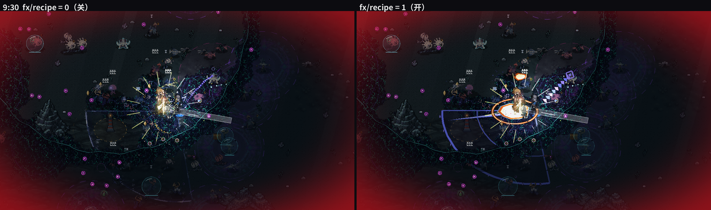
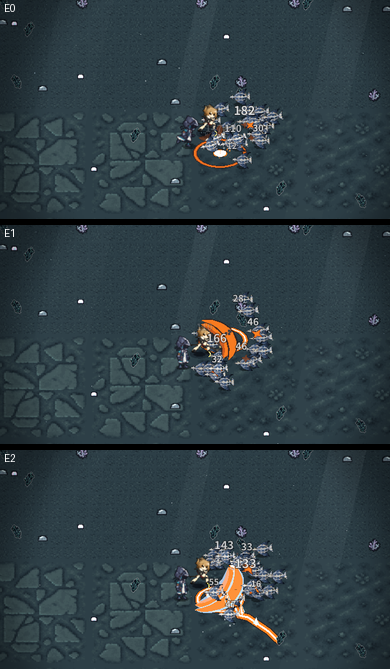
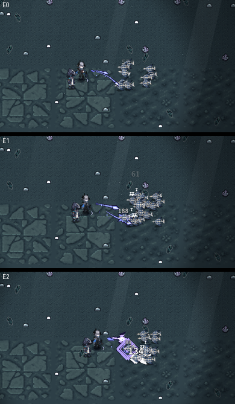
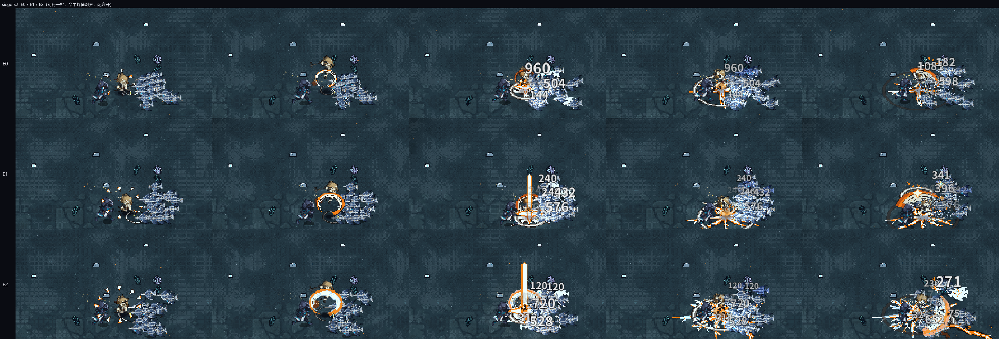
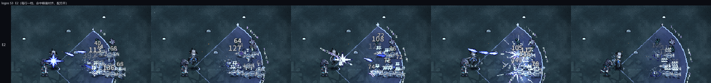
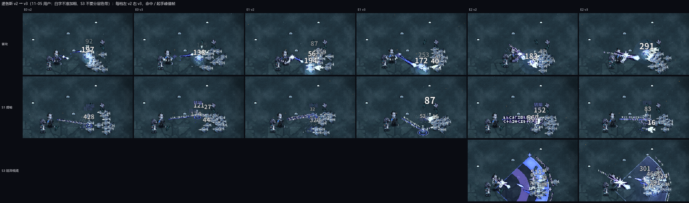
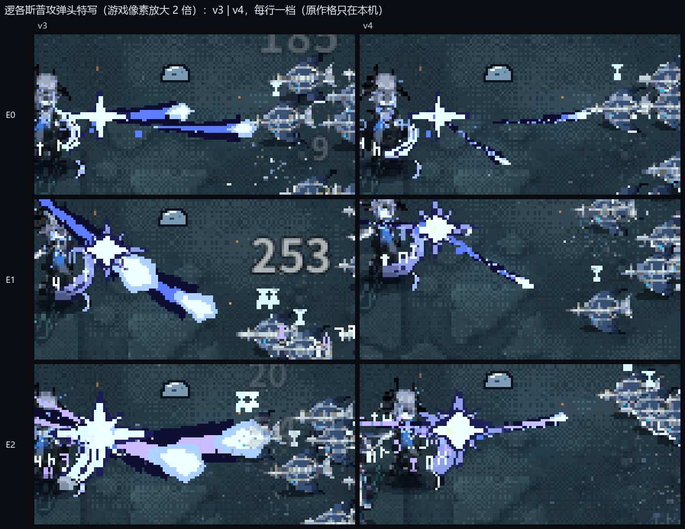
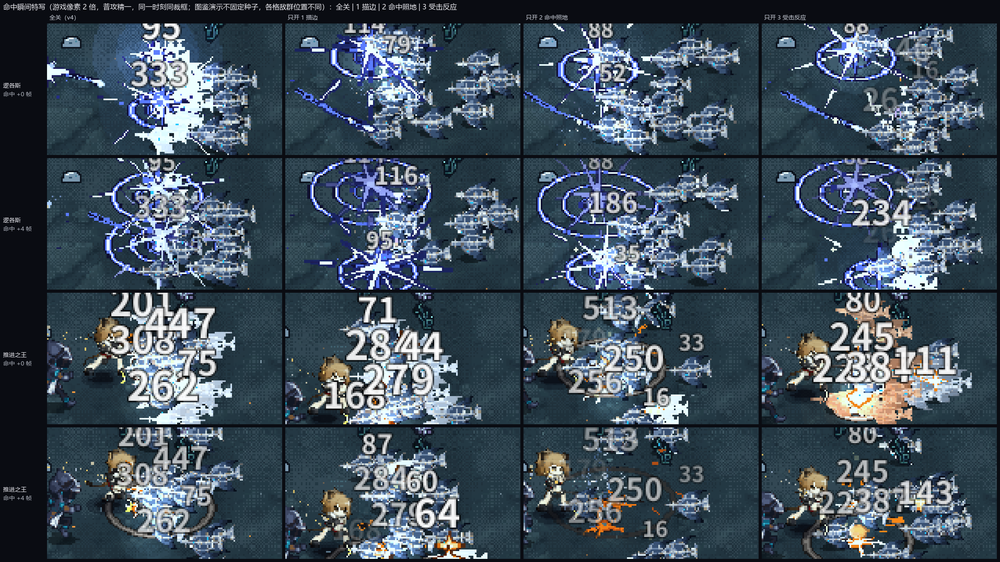
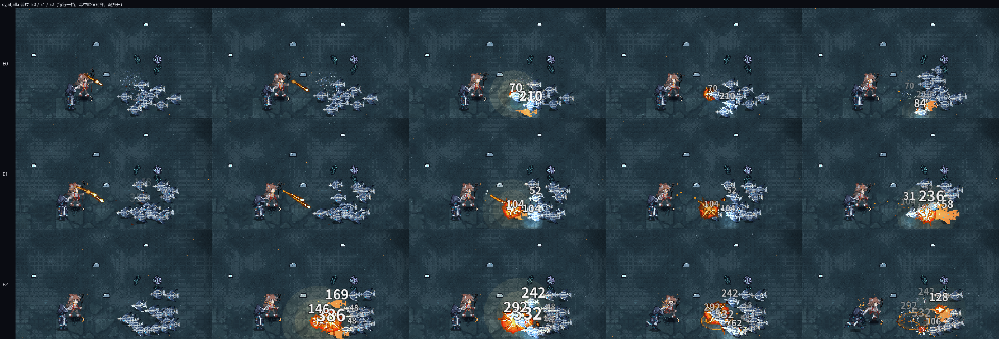
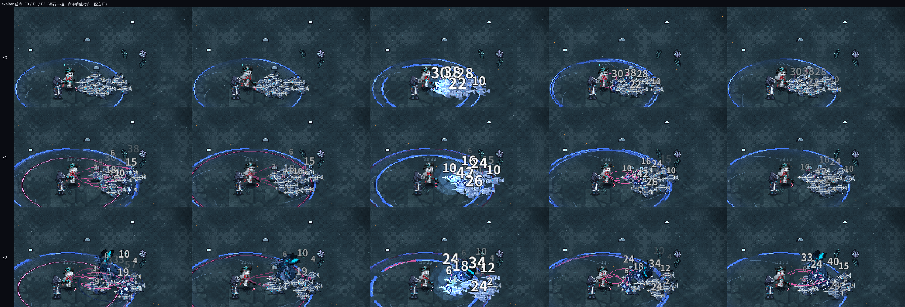

# 245 运行时攻击特效配方 · 逻各斯 / 推进之王试点（11-05）

**结论摘要**
1. **工具和两人配方已做完，挂在 `fx/recipe` 后面（缺省 0 = 关）**：运行时生成的实心硬边 2–3 阶主形 + 少量大颗粒（墨滴 / 火星 / 碎石）+ 照地光（有盏数与强度总和上限），逻各斯、推进之王的普攻与 S1–S3 全部覆盖，终结技未动。没有新帧条。
2. **只改画面**：同种子开 / 关两局 TRACE 逐行一致（逻各斯队长 + 推进之王，种子 11，576 行；推进之王队长 + 逻各斯、精二 + 技力常满，种子 23，301 行）。BALANCE 只有 `bot.peak / peak_min` 里「同屏特效数 / 飘字数」两项计数差 1–6，属画面计数，玩法字段全同。
3. **碎块明显减少，占屏略增**（同帧分层量测，我方特效层）：块数 3:00 206 → 88、8:00 1346 → 932、9:30 1252 → 477；占屏 2.1 → 2.5%、2.9 → 3.2%、5.1 → 7.3%；9:30 块面积 P90 11 → 19 像素。中位块面积只从 3 → 2–5，因为测的是整队：机器人自然招募的另一名队友的特效没接管，碎屑大多来自它和全局命中颗粒。
4. **三档肉眼可分**：E2 两人都是一眼可分（逻各斯三叉墨枪 / 方印 / 咒文锁链 / 书页扇面；推进之王冷钢边弧刃 + 熔裂地裂 + 冷钢岩刺），缩到 390 像素宽也分得清；推进之王 E0 → E1 也明显（弧刃 ×1.25 加厚 + 双响回声）。**逻各斯 E0 → E1 在手机宽度下只是「略大略粗」**，是本轮最弱的一档，需要用户看过再决定加不加形状差。
5. **待用户看对照后拍板**：图在 `docs/assets/fx_recipe/`（3:00 / 8:00 / 9:30 开关对照、两人四招三档并排、手机宽版、8:00 起 20 秒开 / 关对照 mp4）。推广到全员前建议先定三件事：主形是否保留原作色（逻各斯蓝紫墨、推进之王熔铁橙）、E1 要不要也给一点形状差、颗粒的量是否还要再少。

开关 `fx/recipe`（balance.json，缺省 0 = 关；`--bal=fx/recipe=1` 打开）。基准分支 `claude/late-game-diag`（= integ-1105 db27f6745 + 只读诊断工具）。逐干员手绘帧条（docs/242 §11）那条路已被用户否定，本稿不画任何新帧条，全部运行时生成。

---

## 1. 做了什么

### 1.1 公共工具 `game/scripts/render/fx_recipe.gd`
- **形状库**（全部运行时生成的实心硬边多边形，顶点对齐 2 px 网格，画在 squad 合批画布上、进低分辨率层，自然成像素形）：
  - `star` 爆团（n 角硬边星）、`seal` 方印（45° 方框 + 中心菱形）、`spike` 突刺（菱刺，最宽处在 25%）、`crescent` 弧刃（中间厚两头尖）、
    `tear` 投射弹头（水滴）、`spear3` 三叉弹头、`beam` 光束（两端收尖）、`crater` 落点坑（不规则扁椭圆）、`ring` 贴地厚环、`crack` 地裂、扇形场（逻各斯 S3 专用）。
  - 每个主形三阶：外暗边 → 主色 → 热芯。节奏统一为「蓄势 → 命中定帧爆亮 → 冷却余韵」：
    - 蓄势：`grow` 主形前 18% 寿命从 0.55 倍冲到 1.08 倍（起手拉伸帧）；出手另有一道短突刺（`fire`）；
    - 定帧爆亮：`freeze` 秒内主体换成热色、热芯白热，暗边保留（和敌人受击白闪分得开）；
    - 冷却：寿命过半热芯熄灭，78% 起只剩暗边 + 压暗的主色并收缩，没有半透明慢淡出。
- **粒子材质**（装饰层，CPU 颗粒，2 / 4 / 6 px 方块）：墨滴 `ink`（溅开、落地成墨点停 0.55 秒）、飞行滴墨 `drop`、火星 `ember`（弹 1 次）、碎石 `rock`（弹 2 次后停在地上）、碎晶 `shard`。
  - 每个颗粒有「地面位置 + 高度」两套坐标，按重力落到脚底线，弹跳有弹性系数，落地后变暗、压扁、停留后分两阶熄灭。
  - 数量少、颗粒大：普攻每下 4–5 颗，大招 8–10 颗；全队上限 `fx/recipe_grains` 160。
- **照地光**：命中 / 爆点挂一盏 ≤ 0.15 秒的点光（本人 `palette.light` 色），投射物 / 锁定光束挂跟随小光；经 `optical._dyn_lights` 送进全屏着色器。
  - **预算和上限**：配方灯先留份额，至多 `fx/recipe_dl`（4）盏、且不超过光学层总灯数（12）的一半；这几盏强度总和封顶 `fx/recipe_dl_sum`（1.8），超出按比例压；其余灯位照旧按亮度给全场特效。原有的队长附近局部预算（`optical_local_light`）仍然作用在全部入选灯上。
- **核心 / 装饰两层**：主形画之前把合批画布的降噪系数临时拉回 1（不受拥挤降噪）；颗粒沿用降噪系数再乘 `fx_dim`，数量按 `fx_dim` 从 ×1 减到 ×0.55。分层量测的 `--clutterdbg=nofriend` 两层都隐藏（照算照抽随机数）。

### 1.2 接管方式（只改画面）
- 有配方、开关开的干员：原来的攻击 / 技能画面「只跳过绘制或不生成画面件」，玩法调用一律照旧：
  - `character.draw_pfx`、`data_operator.draw_fx_add` 的 pfx 不画（粒子照常走完寿命）；
  - `data_operator` 的 `draw_auras / draw_entities_floor / _draw_skill_over / draw_body` 里手写迁移段的画法换成配方画法（安魂叠层头顶符文是状态提示，照画）；
  - `op_api` 的 `spawn_fx_sprite / play_anim_fx / slash_fx / sparks / ground_dust` 直接返回（不生成帧条 / 刀光 / 尘土）；近战刀光 `melee_arc` 不生成；`vfx._tier_fx` 的命中颗粒与命中星不生成（顿帧和命中音照旧）；技能起手的全局放射光（`gfx`、号令波 rays）不生成。
- 事件来自玩法代码里的一行钩子 `Fxr.ev(o, 种类, 数据)`（逻各斯：出手 / 命中 / 处决 / 锁定每跳 / 咒域每跳；推进之王：抡锤 / 震地 / 粉碎 / 破阵 / 起跳 / 落地 / 狮吼撞击；通用：技能起手）。持续状态（飞行中的「言」、提喻锁定、连缀锁链、铭文、咒域扇形、号令波）直接读玩法状态画，不存副本。
- 画面随机只用 `g.vrng`；钩子在开关关时第一行就返回。

### 1.3 配方 `game/data/fx_recipes/<干员>.json`
每名干员一份：`palette`（暗 / 主 / 热 / 点缀 / 光五色）、`accent_on`（精二点缀色落在主体还是外边）、`tiers`（E0 / E1 / E2 的体量、加厚、多一拍间隔）、`moves`（每招的形状、尺寸、寿命、定帧、颗粒材质与数量、光的半径与强度，以及 `e1` / `e2` 覆盖）。代码按招式名解释，加新干员只写 json；新的招式种类才要在形状库里加一种。

| 干员 | 主色 / 暗 / 热 / 点缀 | 普攻 | S1 | S2 | S3 | 质感 |
|---|---|---|---|---|---|---|
| 逻各斯 | `#6f7cff` / `#120e2c` / `#e2e6ff` / `#9c8cff` | 起手笔尖突刺 → 水滴弹头 + 实心收尖拖尾（飞行滴墨）→ 命中五角墨爆团 + 墨滴 4 颗 + 照地 | 提喻：笔尖 → 目标实心光束（粗 4 → 8 随叠层）+ 旋转方印；每跳小爆团 | 殁亡：起手大墨爆团 + 贴地墨环；处决：目标脚下竖直墨桩冲起 + 细转移线 | 延异视阈：贴地实心扇形（暗墨底 + 主色硬边）+ 扫线；每跳区域内至多 4 名敌人冒竖笔画 | 墨滴（落地成墨点） |
| 推进之王 | `#ff6a1a` / `#241c1c` / `#fff0c8` / `#9cb4cc` | 身前实心熔铁弧刃（定帧 0.045 秒白热）+ 落点坑 + 火星 5 颗 + 照地；震地 / 狮吼贴地厚环 | 冲锋号令：头顶六角熔铁爆团 + 贴地号令环；万兽之王号令波贴地厚环 | 跃空锤：起跳竖直拉伸刺 + 落点暗印 → 落地大坑 + 冲击厚环 + 碎石 8 颗（照地最强） | 碎颅击：每一锤弧刃更宽更厚、深坑、碎石 7 颗 | 火星（弹 1 次）/ 碎石（弹 2 次） |

同一招同屏元素：主形（弧刃 / 弹头 + 拖尾 / 爆团）、落点（坑 / 环）、一种颗粒，至多 3 种；光不算独立元素（照在地上）。

### 1.4 精英三档规则
- E1：同一主形 ×1.25、加厚 ×1.3，多一拍（命中 / 抡锤晚 0.07 秒再落一个大一圈、只剩主色的回声主形，读作双响）。
- E2：主形质变 + 专属点缀色 + 体量 ×1.5：
  - 逻各斯：弹头水滴 → 三叉墨枪；命中五角爆团 → 方印；提喻光束 → 咒文锁链；咒域弧外加一排竖笔画；点缀色淡紫 `#9c8cff`（落在主体）。
  - 推进之王：弧刃外边换冷钢 `#9cb4cc`；落点坑带冷钢边；锤印前方熔裂一道地裂并冒冷钢岩刺（精二「破阵」本身的玩法判定，画面换成配方）。
- 颜色：逻各斯蓝紫墨（色相约 0.65）、推进之王熔铁橙（约 0.06）；都不用危险红 `#ff2667`、敌弹青 `#33ceff`、结晶淡金。

---

## 2. 验收

### 2.1 同种子开 / 关对照（3:00 / 8:00 / 9:30）
- 逻各斯队长 + 推进之王（`--squad=siege`），种子 11，机器人自然招募第三名队友，`--nodeath`，云端 xvfb + opengl3，`--fixed-fps 60` 非实时；脚本 `tools/fx_recipe_compare.py run`。
- 图：`onoff_180.png` / `onoff_480.png` / `onoff_570.png`（左关右开，整帧）；`onoff_crop_*.png`（队长附近放大）；分层掩码描边 `mask_logos_rcp0|1_*.png`。

### 2.2 分层量测（同 docs/243 §3.1 口径：战场区 (180,150)–(1100,560)，`--clutterdbg=nofriend` 差分）

| 时刻 | 同屏敌人 | 降噪 fx_dim 关 / 开 | 我方特效占屏 关 → 开 | 块数 关 → 开 | 中位块面积 | P90 块面积 | 我方亮度 | 局部对比 |
|---|---|---|---|---|---|---|---|---|
| 3:00 | 17 | 0.94 / 0.95 | 2.13% → 2.54% | 206 → **88** | 4 → 5 | 32 → 13 | 0.60 → 0.60 | +0.30 → +0.30 |
| 8:00 | 26 | 0.88 / 0.91 | 2.87% → 3.20% | 1346 → **932** | 3 → 2 | 10 → 11 | 0.34 → 0.34 | +0.14 → +0.16 |
| 9:30 | 40 | 0.64 / 0.69 | 5.14% → **7.28%** | 1252 → **477** | 3 → 4 | 11 → **19** | 0.37 → 0.45 | +0.24 → +0.33 |

- 原始数据 `visual_metrics_rcp0.json` / `visual_metrics_rcp1.json`。
- 读法：
  - 块数降 31–62%：两人原来的帧条碎线、命中颗粒、刀光、放射线都换成了一招一个实心主形；
  - 9:30 占屏 +2.1 个百分点、P90 块面积 ×1.7、亮度 +0.09、局部对比 +0.09：后期主形（S3 扇面、S2 落地坑与环、E2 锁链）读得出来；
  - 中位块面积几乎不动：量的是整队。剩下的碎块主要是第三名队友（机器人招募，没接管）和全局层（受击白闪边、经验结晶光、环境光尘被我方灯照出的像素）。只看两人的面积要等全员推广后再量；
  - 降噪系数开的时候略高（0.69 vs 0.64）：两人不再往 `g.fx` 塞帧条，拥挤度略降。

### 2.3 TRACE（只改画面）
| 局 | 行数 | 结果 |
|---|---|---|
| 逻各斯队长 + 推进之王，种子 11，到 9:35（上面截图同一局） | 576 TRACE + 1 BALANCE | TRACE 逐行一致；BALANCE 仅 `bot.peak[3–4]` / `peak_min` 同屏特效数、飘字数差 1 |
| 推进之王队长 + 逻各斯，种子 23，`--elite2 --sptest`（队友直接精二、技力常满），到 5:00 | 301 + 1 | TRACE 逐行一致；BALANCE 同上，同屏特效数差 1–6 |

- 必须在有画面的局里比：无界面批跑（`headless_batch`）不画，配方开关在那里本来就是空操作。脚本 `tools/fx_recipe_compare.py trace`，日志在本机 `build/fx_recipe/logs/`（未入库）。
- `check.py --auto --jobs 3`：改了公共脚本，升级为分支全量精简（冒烟含逻各斯、推进之王），171 项通过、0 失败（769 秒）。注意快检都是无界面局，配方代码在里面不执行，画面路径只由上面两组有画面的局覆盖。

### 2.4 三档并排（E0 / E1 / E2）
- 图鉴演示模式（`tests/elite_demo_shot.tscn`，真实精英化阶段，`--shot_mode` 选普攻 / S1 / S2 / S3），1280×720，每行一档、每列为同一招命中前后的 5 帧（命中峰值自动对齐）：
  - 逻各斯 `tiers_logos_m3.png`（普攻）、`_m0`（S1）、`_m1`（S2）、`_m2`（S3）；
  - 推进之王 `tiers_siege_m3.png`、`_m0`、`_m1`、`_m2`。
- 手机屏宽（整屏缩到 390 像素宽）：`phone_logos.png`、`phone_siege.png`。

 

- 看图结论：
  - 推进之王：E0 细月牙 + 小坑 → E1 厚月牙 + 回声双弧 + 碎石 → E2 冷钢边宽弧 + 前方熔裂地裂 + 冷钢岩刺，三档一眼可分；
  - 逻各斯：E2（三叉墨枪、方印、咒文锁链、扇面弧外笔画）一眼可分；**E0 → E1 只是弹头和爆团大一圈、粗一点、命中多一拍**，原尺寸看得出，手机宽度下要盯着看。

### 2.5 后期 20 秒对照录像
- `late_8m00_onoff.mp4`：同一局 8:00–8:20（300 帧 × 0.066 局内秒，15 fps 播放 ≈ 实时），左关右开，1920 宽。

### 2.6 光源预算
- 全场光学层动态灯 12 盏；配方灯至多 4 盏（且 ≤ 一半），强度总和 ≤ 1.8，单盏寿命 ≤ 0.15 秒（跟随灯 0.05 秒、每帧续）。8:00 / 9:30 截图未出现整屏发亮：我方亮度均值 0.34 / 0.45，仍低于结晶与受击白闪（docs/243 §6）。
- 旋钮：`fx/recipe_dl`、`fx/recipe_dl_sum`、`fx/recipe_grains`（全队颗粒上限 160）。

---

## 3. 已知问题与下一步

- **E1 形状差**（逻各斯）：现在 E1 只靠「×1.25 + 加厚 + 回声」，手机上偏弱。可选：E1 弹头加一道尾鳍 / 命中加一圈薄环（仍算同一主形）。等用户看图定。
- **整队碎块**：要全员都接管后，「碎」的指标才会整体下来；剩余碎块里全局命中颗粒（`vfx._tier_fx`）只对接管的干员关了。
- **未覆盖**：终结技（按要求不动）、天赋 / 响应的「言」用普攻同一配方、推进之王技力粒子飞向队友（原来的 `h4_spmote` 不画了，配方里没有对应件；要不要补一道熔铁小点等用户定）。
- **颜色**：逻各斯主色蓝紫墨在暗地面上偏暗，9:30 对比度靠暗边撑；若要更跳，可把 `main` 提亮一档（只改 json）。推进之王熔铁橙与灯火琥珀（`optical_col_lamp`，色相 0.075）同色系，后期灯火余烬多时会混。
- **画质「低」/ 关光学观感**：主形照画（不依赖光学层），照地光随光学层关掉；未单独截图验证。
- **网页端性能**：主形是每帧多边形三角化（Geometry2D），两人同屏峰值约 30 个主形、100 余颗粒；未做网页端帧时量测（docs/50），推广前要量。
- **冲突**：只在 `data_operator.gd`、`character.gd`、`op_api.gd`、`optical.gd`、`vfx.gd` 加了开关判断与一行钩子，`world.gd` 没动（late-read-b1 在改）。

---

## 5. 第二轮：以原作技能特效为底的本作改编（11-05）

**用户看第一轮三档图后的原话**：「把原作的风格都去掉了，我要的是在原作的技能特效上进行我们的改编，并且显得更加明显。」方印、三叉枪、菱形这类抽象几何主形作废。终结技仍不动。

11-05 协调人更正：任务单里举的「墨枪」等意象不作前提，一律以原作关键帧为准。按此复读逻各斯普攻关键帧后补了起手笔光 + 字环，投射物改成墨迹彗星（白热亮头 + 深蓝墨尾），不再是羽形。

**本轮结论**
1. 两人普攻与 S1–S3 的主形全部换成按原作轮廓与配色重建的像素形，仍是运行时生成（没有帧条、没有原作派生贴图）；工具、颗粒、照地光预算、核心 / 装饰两层、TRACE 做法沿用 §1。
2. 三档按新规则：E1 = 同一原作主形 ×1.25、加厚 ×1.3、多一拍，**每招都另有一处形状差**；E2 = 换原作里更高阶的意象、体量 ×1.5。
3. 只改画面：同种子开 / 关 TRACE 逐行一致（§5.4）。
4. 待用户看：三档并排图、手机宽版、8:00 起 20 秒开 / 关 mp4（§5.3）。原作 | 旧配方 | 新版三格对照图只在本机 `Claude outputs/fx_canon_1105/`（含原作画面，不进仓库）。

### 5.1 每招的原作意象与改编

原作参照：逻各斯用本机 `Claude outputs/logos_ref/`；推进之王本轮用 `tools/ref_fx/rebuild_prefab.py`（取自 2bc72e9b4）从本机客户端解包还原，出到 `Claude outputs/siege_ref/`（同 logos_ref 格式：原速 / 慢放 mp4 + 关键帧拼图）。本作招式与原作的对应：逻各斯 S1 提喻 = 原作二技能、S2 殁亡 = 原作一技能；推进之王 S2 跃空锤取原作二技能（skill_02），S3 碎颅击取原作三技能（skill_03），S1 冲锋号令原作没有对应特效，借原作 S3 的锤徽 buff。

| 干员 · 招 | 原作意象（轮廓 / 主色 / 动势） | E0 本作改编 | E1 形状差 | E2 高阶意象 |
|---|---|---|---|---|
| 逻各斯 普攻 | 起手身前挥出白弧 + 墨弧的「笔光」，随后在身周化成一圈字环；出手身前蓝白四芒星；「言」像彗星：白色亮头、后拖深蓝墨尾，飞行中带零星金色小星；命中白色星芒爆开、带几根尖锐白碎刺 → 转暗 → 地面墨色涟漪环 | 起手白 / 墨两股笔光弧 + 身周一圈直立小字的字环；笔尖蓝白四芒；墨迹彗星（白热亮头 + 深蓝墨尾，尾沿飞行弧线、带蓝闪点）；命中 5 根长短不一的白碎刺（一根特长）+ 芯部四芒（定帧白热）+ 地面椭圆墨环 + 墨滴；金色小星改冷色 | 墨尾后段分两股、八芒、字环多 3 字、双墨环、回声碎刺 | 彗星 ×1.5、尾后一行白 / 紫咒文；命中换白热光团 + 咒文交叉（原作殁亡处决的符文链） |
| 逻各斯 S1 提喻 | 笔尖到目标一行白色咒文字块，下衬蓝丝线、金色火星；目标套椭圆环；每跳白色竖长芒 | 蓝丝线（粗细随叠层）+ 一行咒文向目标流动 + 目标椭圆套环；每跳竖直长芒 | 咒文分丝线两侧两行、双套环、八芒 | 字格 ×2、紫白相间（咒文锁链）；每跳加高大竖碎芒；连缀成员间也是咒文 |
| 逻各斯 S2 殁亡 | 起手白色挥笔刃光环身；强化墨迹彗星；处决时目标上交叉咒文链（X）+ 暗墨竖柱；溢出伤害飞一支墨迹彗星 | 环身挥笔刃光 + 贴地墨环；处决 = 咒文 X + 竖墨柱 + 墨滴；溢出墨迹彗星 | 咒文三道（米字） | 白热光团 + 两侧副柱、紫白咒文 |
| 逻各斯 S3 延异视阈 | 脚下铺开透视椭圆咒域（亮蓝外圈、暗琥珀内圈、暗心）；四角暗色四芒星；每轮 4 支大墨迹彗星落下，紫白四芒 + 白碎片 | 贴地扇面 = 暗底 + 暗紫内圈带 + 亮蓝外圈厚带（每跳提亮一拍）+ 弧两端与正中四芒星；每跳区域内至多 4 名敌人紫白四芒 + 白碎片 | 外圈厚 ×1.25、外沿浮一排咒文字行、八芒 | 内圈换点缀紫；每跳先飞来一支大墨迹彗星再炸（原作每轮齐射） |
| 推进之王 普攻 | 锤落点白热闪 + 放射状细长橙色火星 + 暗烟（原作普攻很朴素） | 身前银橙旋光 3 股（扫过，头厚尾尖）+ 落点白热闪（定帧）+ 橙色火星线 | 4 股、落点一小块熔岩裂网、回声闪 | 旋光冷钢边、八芒闪、黑三角碎块；破阵 = 熔开的分叉地裂 + 沿线黑三角（原作 S3 枝裂） |
| 推进之王 S1 冲锋号令 | （原作无）借原作 S3：头顶锤徽（锤 + 齿轮）+ 横向橙色镜头光带 | 头顶像素锤徽（定帧白热）+ 横向镜头光带 + 贴地灰尘号令环 | 锤徽加半圈齿轮 | 锤徽冷钢边、光带变十字 |
| 推进之王 S2 跃空锤 | 橙色三角碎片向锤汇聚 → 空中银橙旋光一圈 → 落地白闪 + 竖直白冲柱 → 熔岩裂网（橙黄枝裂、暗斑）+ 灰尘环 + 黑三角碎块 | 起跳：三角碎片汇聚 + 空中旋光 + 落点灰色预示环；落地：熔岩裂网 7 枝（定帧白热）+ 灰尘环 + 白闪 + 黑三角 | 裂网 9 枝 + 竖直冲柱 | 裂网 11 枝、冷钢边、环外再裂四道前向枝裂 |
| 推进之王 S3 碎颅击 | 起手横向橙色镜头光带 + 锤徽；每锤横向扁白闪 + 向前分叉的暗色地裂 + 黑色风车碎块 + 地面暗烟坑圈（红闪）+ 向上火星 | 起手镜头光带 + 回抡旋光；每锤更宽旋光 + 横向扁白闪 + 前向枝裂扇 + 暗烟 + 火星线 | 暗烟坑圈、裂枝 +1 | 地裂冷钢边、黑三角碎块（原作红闪改橙，红只给危险） |

同一招同屏元素都控制在 3 种内（例：逻各斯普攻 = 墨迹彗星 / 碎芒 + 墨环 / 墨滴；推进之王 S2 = 裂网 + 尘环 / 黑三角，白闪与竖柱只在定帧那一拍，算裂网的爆亮）。颜色：逻各斯主色 `#4d62ff`、暗 `#0d0b26`、热 `#eef1ff`、点缀紫 `#a68cff`、内圈 `#2a2266`，白碎芒色组 `#c3ccff`；推进之王主色熔铁橙 `#ff6a1a`、热 `#fff0c8`、点缀冷钢 `#9cb4cc`，另有白热闪 / 灰尘 `#6a625c` / 银 `#d6cbb8` / 裂纹四组。原作里的金色小星、暗琥珀内圈改冷色（避开结晶暖金），推进之王 S3 的红闪改橙（红 `#ff2667` 只给危险）；都不用敌弹青 `#33ceff`。

### 5.2 代码

- `render/fx_recipe.gd`：形状库换成原作意象——`flare` 四 / 八芒星芒、`shards` 不规则长碎芒、`orb` 白热光团、`_quill` 尖头墨迹（彗星亮头 / 飞行墨迹 `dart` 用）、普攻彗星墨尾沿飞行历史点画带（精一后段分两股）、`glyphring` 起手字环、`web` 熔岩裂网、`cfan` 前向枝裂扇、`converge` 三角汇聚、`whirl` 多股旋光（沿挥动方向扫过、头厚尾尖、不留暗色余韵）、`hammer` 像素锤徽（+ 齿轮）、`runex` 咒文交叉；咒文字块 `_glyph_strip`（3×4 像素字形 12 个、可流动、单 / 双行、逐字写出）。颗粒新增 `streak` 火星线、`tri` 黑三角碎块（落地前带一圈熔边）、`puff` 暗烟、`twinkle` 冷色小星。形状的不规则度按种子散列（`_h`），不抽随机数。
- 配方 json 加 `tones`（附加色组，形状用 `tone` 字段指过去）；`inner`（逻各斯咒域内圈色）。
- 精一 / 精二专属玩法（粉碎、破阵）在强制低档画面（`fx/recipe_tier`，只给三档图用）时不画，免得精零行里出现精二才有的地裂。
- 新调试旋钮 `fx/recipe_log`（缺省 0）：打印配方事件的引擎帧，三档图按事件帧对齐用。
- 工具：`tools/fx_canon_shots.py`（三档并排 + 手机宽版，本机）、`tools/fx_canon_rec.py`（本机开 / 关录像 + TRACE）、`tools/ref_fx/`（原作 prefab 还原，取自 2bc72e9b4；输出只在本机）。

### 5.3 验收图与录像（`docs/assets/fx_canon/`）

- 三档并排：`tiers_logos_m3.png`（普攻）/ `_m0`（S1）/ `_m1`（S2）/ `_m2`（S3），推进之王同名 `tiers_siege_*`。图鉴演示模式，玩法一律精二（精零 / 精一没有 S2 / S3），画面档位用 `fx/recipe_tier` 强制；每行一档、每列同一招前后 5 帧，技能招式按配方事件帧对齐（`fx/recipe_log`），普攻按画面能量峰值对齐；裁出干员与敌群那块放大。
- 手机屏宽（整屏缩到 390 宽，列 = 招式、行 = 档位）：`phone_logos.png`、`phone_siege.png`。
- 后期录像 `late_8m00_onoff.mp4`：逻各斯队长 + 推进之王，种子 11，`--rtfrom=480 --realtime --fixed-fps 30` 连录 600 帧 = 8:00–8:20，30 帧原色原速，左关右开（仓库版缩到 1920 宽；本机 `Claude outputs/fx_canon_1105/late_8m00_onoff_full.mp4` 是 2560 宽原版）。
- 原作 | 旧配方 | 新版 三格对照（每招 E0、E2 各一张，16 张）：只在本机 `Claude outputs/fx_canon_1105/canon3_<干员>_m<招>_e<档>.png`，含原作画面，不进仓库。

看图结论（自评，待用户审）：
- 逻各斯：E0 墨迹彗星 + 白碎芒 + 墨环、E1 墨尾分两股 + 八芒 + 双环、E2 彗星尾后咒文 + 咒文交叉；S1 一行 / 两行 / 紫白锁链咒文三档一眼可分；S2 处决 E0 单柱、E2 三柱 + 光团；S3 咒域是本轮最显眼的一招（亮蓝外圈厚带 + 四芒星），E1 外沿字行、E2 内圈换紫 + 墨迹彗星齐射。
- 推进之王：S2 起跳汇聚 → 旋光 → 裂网 + 尘环 + 黑三角，E1 多竖冲柱、E2 裂网更密 + 环外枝裂；S1 锤徽 E1 加齿轮、E2 冷钢边 + 十字光带，三档可分；普攻 E0 → E1 靠落点小裂网 + 回声闪区分。
- 手机宽度下：两人 S3、逻各斯 S1、推进之王 S2 / S1 三档都分得清；**两人普攻和逻各斯 S2 在手机宽度下主形偏小**（图鉴演示镜头比实战远，实战约大一倍），E0 → E1 要盯着看。要更跳可再整体放大普攻一档（只改 json `len / r / flash_r`）。

### 5.4 只改画面

| 局 | 行数 | 结果 |
|---|---|---|
| 逻各斯队长 + 推进之王，种子 11，到 8:21（即录像那一局，`--realtime --fixed-fps 30`） | 501 TRACE | 开 / 关逐行一致 |
| 推进之王队长 + 逻各斯，种子 23，`--elite2 --sptest`，到 5:00（`--fixed-fps 60`） | 301 TRACE | 开 / 关逐行一致；BALANCE 只有 `bot.peak / peak_min` 同屏特效数差 1–5（同 §2.3） |

脚本 `tools/fx_canon_rec.py rec / trace`，日志在本机 `build/fx_canon/rec/logs/`（未入库）。

`check.py --auto --jobs 3`（改了公共脚本 → 分支全量精简）：170 项通过、0 失败（724 秒）。快检都是无界面局，配方代码不执行，画面路径只由上面两组有画面的局与三档图覆盖。

### 5.5 已知问题与下一步

- 等用户看三档图 + 录像拍板；点头前不铺到其他干员。
- 普攻在手机宽度下偏小（见上）；推进之王熔铁橙仍与灯火琥珀同色系，后期灯火多时会混。
- 熔岩裂网、前向枝裂画在地面层（敌人之下），敌群很密时会被盖住一部分；若要更显眼可把落地那一拍挪到上层。
- 网页端帧时没量：咒文字块每格一个四边形，提喻锁定满屏约 150 个，S3 咒域每帧约 10 个多边形 + 4 行字。推广前要按 docs/50 量。
- 原作参照与三格对照图都只在本机；推进之王参照是 prefab 回放近似（子发射器、噪声不模拟），读关键帧时以原作录像为准。

### 5.6 v3：细笔画字、咒域去平涂、普攻放大（11-05 用户反馈）

**用户原话**：「logos 的白色符文字块实在是太粗了，这个不能加粗。而且三技能那个有明显的颜色分层」。协调人修正：「实心硬边 2–3 阶」只适合小物件（弹头、刃、碎刺、星芒），大面积场域和文字不适用。

| 项 | v2 | v3 |
|---|---|---|
| 咒文字（提喻连线、字环、精二尾后咒文、处决咒文交叉、连缀、铭文、咒域外沿字行） | 3×4 实心字块、暗底色块，精二字格 ×2 | 3×5 **细笔画**，1 美术像素（2 px）宽、字距 2 格、直立不旋转、**不画底色块**；精二不加粗，改用纯白 + 点缀紫、两行错开 |
| S3 咒域 | 暗底 + 暗紫内圈带 + 亮蓝外圈厚带（平涂三层） | 外圈一道亮蓝细边（1 美术像素，精一 2）+ 内部由外向内变暗的低透明度渐变（12 圈、每圈只差约 0.02，最外 α 0.22 ≤ 0.25，不盖敌人）+ 两道很淡的流动旋涡虚线；亮度靠一盏跟随照地光（每跳亮一拍）。精二深色墨刃齐射仍是实心主形 |
| 逻各斯普攻 | 彗星长 44、宽 10；命中碎刺半径 26；墨环 3 px | 彗星长 66、宽 15（精一 80）；碎刺半径 39；墨环 5 px（约 ×1.5、墨环加粗一档） |
| 逻各斯普攻 E1 形状差 | 墨尾分两股、八芒（手机宽下不明显） | 另加**外圈 8 根短碎刺**（从 0.6R 起刺、转半格），彗星更长 |
| 推进之王 S1 | 头顶锤徽图标 | 去掉图标，改**地面橙色冲击**：脚下横向镜头光带 + 一圈震地环（定帧白热）+ 火星线；精一晚一拍再震一圈，精二光带变十字、第二圈冷钢边 |
| 其他地面带（推进之王尘环 / 号令波 / 震地 / 暗烟坑圈） | 9–12 px 宽灰带 | 6–7 px |

- 对照图 `docs/assets/fx_canon/v2_v3_logos.png`（逻各斯普攻 / S1 / S3，每档左 v2 右 v3）；三档图、手机宽版、8:00 录像已按 v3 重出（同名覆盖）。

- TRACE（v3）：录像局 501 行、精二局 301 行，开 / 关逐行一致。

### 5.7 档位按技能解锁收窄（11-05 用户指出「分档做多了」）

**规则（推广到其他干员时照此做）**：技能按精英化解锁，`character.gd` 的 `skill_unlocked(i) = elite >= i`，招募时只有 S1，精一解锁 S2，精二解锁 S3。所以实际存在的组合只有：

| 招 | 档位 | 配方写法 |
|---|---|---|
| 普攻 | E0 / E1 / E2 | 基础 = E0，`e1` / `e2` 覆盖 |
| S1 | E0 / E1 / E2 | 同上 |
| S2 | **E1 / E2** | 招式里写 `"tier_min": 1`，基础参数就是 E1 形态，`e2` 覆盖写质变 |
| S3 | **只有 E2** | 招式里写 `"tier_min": 2`，只写一套参数（不写 `e1` / `e2`），它本身就是精二内容 |

- `fx_recipe.move()` 用 `tier_min` 给档位托底（强制低档的三档图模式也一样），代码里 S2 / S3 专用的「E0 / E1 才走」分支全部删掉，不留死档：
  - 逻各斯 S2 处决固定三道咒文（米字）+ 竖墨柱，E2 质变 = 白热光团 + 两侧副柱 + 紫白咒文；
  - 逻各斯 S3 咒域固定掺紫渐变、2 美术像素亮边、外沿细笔画咒文、每跳先飞墨刃再炸八芒；
  - 推进之王 S2 落地固定裂网 9 枝 + 竖冲柱，E2 质变 = 11 枝冷钢边 + 环外四道前向枝裂；
  - 推进之王 S3 每锤固定冷钢边枝裂 6 枝 + 暗烟坑圈 + 黑三角。
- 三档图照此出：S2 两行（E1 / E2），S3 一行（E2）；手机宽版里没解锁的格留空。`tools/fx_canon_shots.py` 的 `MODE_TIERS` 是同一张表。
- 收窄后 TRACE：录像局 501 行、精二局 301 行，开 / 关逐行一致；三档图、手机宽、v2 → v3 图、8:00 录像已重出。

### 5.8 v4：普攻弹头回到「小而尖」（11-05 用户「大的光弹是不是也丢失了原本普攻的细节？」）

原作（logos_ref 关键帧 0.70–1.05 s）：弹头是**小而尖的白色箭头状亮点**，后拖细长深蓝墨尾，墨尾里有细密条纹 / 点状纹理、越往后越细，飞行中零星金色小星。v3 把弹头放大成圆形白光团，细节丢了。

**原则（推广到其他干员时照此做）**：放大只放在**长度**上，不靠主形发胖、不用圆形光团显眼；显眼靠命中星芒 / 碎刺、照地光、拖尾的长度与对比度。

| 项 | v3 | v4 |
|---|---|---|
| 弹头 | 宽 15 × 档位体量的圆头光团 | 白色尖箭头 12×4 px，精一 / 精二 14×6（最多大 1 美术像素），三档都尖；出手首帧只变亮不变大 |
| 墨尾 | 宽随档位放大 | 宽 6 px 不随档位变，**长度随档位**：E0 66 / E1 90 / E2 111 px；暗边 + 蓝芯，沿尾每 4 px 一个 1 美术像素亮点（左右交替、后段变稀变暗）= 原作的细密纹理 |
| 分档 | — | E1 墨尾后段分两股 + 飞行中零星淡金小星（`#f2dfa6`，比结晶暖金浅、只 1 美术像素）；E2 尾后一行细笔画咒文 |
| 命中 | 碎刺半径 39 | 46，照地光 0.55 → 0.7 |
| 圆形光团自查 | `orb` 八角白光团（逻各斯普攻精二命中、殁亡精二处决、延异视阈起手） | 改成八芒尖星核（内角 0.22、长短芒交替），不再是圆球 |

- 弹头特写：`docs/assets/fx_canon/head_zoom_v3_v4.png`（游戏像素放大 2 倍，v3 | v4，每行一档）；带原作格的版本只在本机 `Claude outputs/fx_canon_1105/head_zoom_ref_v3_v4.png`。普攻三档图、手机宽、8:00 录像已重出。

- v4 TRACE：录像局 501 行、精二局 301 行，开 / 关逐行一致。

### 5.9 三项实验开关（用户批准，各一个独立开关，缺省 0；都要 `fx/recipe` 开着才生效）

| 开关 | 做什么 | 范围 / 预算 |
|---|---|---|
| `fx/recipe_outline` | 小物件主形外加一圈 1 美术像素深色描边（Hades 式线稿），颜色 = 本人主色 × 0.3（逻各斯深蓝、推进之王深褐，不用纯黑） | 只给弹体、刃、星芒、碎刺、光柱、三角汇聚（`OUTLINE_KINDS`）、旋光每股、彗星墨尾与弹头；大面积场域、地面裂网 / 墨环、咒文不加。`Geometry2D.offset_polygon` 每帧现算 |
| `fx/recipe_hitlight` | 命中一盏本人色短命点光（Noita「每次爆炸一盏有寿命的光」）：寿命 0.1–0.15 秒（缺省 0.13）、半径 × `recipe_hitlight_r`（1.3）、强度 × `recipe_hitlight_i`（1.4，封顶 1）；同时命中点脚下压暗一小圈（半径 1.5 倍星芒、α 0.15 → 0、0.1 秒，地面层） | 开着时**取代**常规命中光（不叠两盏）；仍走配方灯预算：至多 `fx/recipe_dl` 盏、≤ 光学层总灯数一半、强度总和 ≤ `fx/recipe_dl_sum` |
| `fx/recipe_hitreact` | 被我方打中的敌人闪本人颜色 0.06 秒（逻各斯 `#a9b6ff`、推进之王 `#ffa060`，取代白闪，之后到 0.3 秒内不再白闪）；重击和技能命中（逻各斯处决 / 提喻每跳 / 咒域每跳，推进之王碎颅每锤 / 跃空锤落地）被打那只**局部停顿 2 帧**：只冻结这只怪的选帧时间 | 只改画面：`world.gd` 选帧用 `Fxr.react_t(g, e)`（停顿期返回命中那一刻的时间，`g.t` 不动），白闪颜色用 `Fxr.react_col(g, e)`；位移、判定、`e.flash` 都不碰；Boss 不接管。停顿只作用于走画法缓存的普通怪（`_dc_emit`）；精英 / 走完整画法的怪只闪色不停顿 |

- **接 late-read-b2 的 V4「我方照地份额」**：`fx_recipe.lights_for()` 算配方灯盏数时多取一次 `_share(game, nmax, n)`——若 `res://scripts/render/light_share.gd` 存在且提供 `static func recipe_share(game, nmax: int) -> int`，盏数取它与 `fx/recipe_dl` 的较小值；没有这个脚本 / 方法就原样。light_share 那边只要导出这个函数（返回「我方照地份额里给配方的盏数」），两边合入后自动生效，不用再改这边。强度总和上限仍由 `fx/recipe_dl_sum` 管，若 light_share 也给强度份额，可在同一处再接一个 `recipe_sum_share`。
- 钩子改动：`seg_logos` / `seg_siege` 的 `Fxr.ev` 多传被打中的敌人引用（`e` / `es`，咒域每跳多收一个只画用的 `fx_es` 列表），玩法调用与随机数不动。
- 录像 `docs/assets/fx_canon/exp3_8m00_grid.mp4`：逻各斯队长 + 推进之王，种子 11，8:00 起 20 秒、30 帧原速，四宫格 = 全关（v4）| 只开 1 | 只开 2 | 三项全开（仓库版 1920×1080 压缩；本机 `Claude outputs/fx_canon_1105/exp3_8m00_grid_full.mp4` 同尺寸高码率）。
- 命中瞬间特写 `docs/assets/fx_canon/exp3_hit_zoom.png`（游戏像素 2 倍，普攻精一：全关 | 1 | 2 | 3，两人各命中 +0 / +4 帧）。图鉴演示不固定种子，各格敌群位置不同，只看效果本身。
- TRACE：四宫格四局（同种子 11、到 8:21）两两逐行一致（501 行）；推进之王队长 + 逻各斯精二局（种子 23）配方关 vs 配方开 + 三项全开逐行一致（301 行），BALANCE 只有同屏特效计数差。

- 快检 `check.py --auto --jobs 3`（改了 world.gd 与积木钩子）：169 项通过、0 失败（755 秒）。

### 5.10 三项实验缺省开（11-05 用户「三项实验可以开着」）

- `fx/recipe_outline`、`fx/recipe_hitlight`、`fx/recipe_hitreact` 缺省改为 1；总开关 `fx/recipe` 仍缺省 0，三项照旧要它开着才生效。
- 逻各斯普攻命中去掉精一的第二圈地面墨环：每次命中只留一圈地面墨环（精一形状差靠外圈 8 根短碎刺 + 八芒 + 回声）。
- TRACE（三项缺省开）：推进之王队长 + 逻各斯精二局种子 23、逻各斯队长 + 推进之王种子 11，各到 5:00，配方开 / 关逐行一致（各 301 行）。普攻三档图、手机宽版已重出。

---

## 6. 推广验证：艾雅法拉、浊心斯卡蒂（11-05）

用户看 v4 录像：「感觉改动的方向是对的」；口径「美术这边只改特效，别的都不动」，要解决「后期看不清」和「不同精英化程度肉眼可见变强」。挑这两人是因为与逻各斯、推进之王风格差别最大（法术爆炸 / 熔岩 / 熔池；召唤 / 控场）。做法照 §5：原作为底的改编、文字细笔画、大面积只画边 + 淡渐变、弹头尖细、分档按技能解锁、三项实验缺省开。

原作参照：艾雅法拉 `Claude outputs/eyjafjalla_ref/`（amgoat 各招 mp4 + 关键帧）；浊心斯卡蒂本轮用 `tools/ref_fx/rebuild_prefab.py` 从本机客户端补齐（skadi2：歌域 buff_01_range、一 / 二 / 三技能、部署），在 `Claude outputs/skalter_ref/`。都不进 git。

### 6.1 每招的原作意象与改编

| 干员 · 招 | 原作意象 | 本作改编（E0 → E1 → E2） |
|---|---|---|
| 艾雅法拉 普攻 | 弹口一团火 + 暗红五瓣花；细长熔岩彗星（白热尖头、熔橙尾）；命中白热火团 + 暗红花瓣飞散 + 火舌 / 火星 | 出手白热四芒 + 3 片暗红花瓣（橙边）；熔岩彗星（尖头 12×4，尾长 56 / 70 / 84、尾里一格格亮块）；爆点白热八芒（定帧）+ 6 根火舌 + 4 片花瓣飞散 + 火星。E1：双发（玩法）+ 弹头大 1 美术像素 + 6 片花瓣 + 回声闪 + 尾后甩火星；E2：玩法换三连抛熔岩块 → 暗壳六边块 + 落地熔裂网 + 熔池（只画边 + 淡渐变） |
| 艾雅法拉 S1 二重咏唱 | 原作无专属特效（借普攻的花瓣与火团） | 起手 5 片花瓣绽开（E1 7 片）+ 白热四芒；之后「剩几次强化」= 身边绕飞的花瓣数；强化弹的落地（熔岩天降）同熔岩块 |
| 艾雅法拉 S2 点燃（E1 / E2） | 白热金色双螺旋 + 火焰 + 暗红花瓣 | 起手白热双旋（E2 三股，金色改白热 + 熔橙）；点燃弹长尾 + 弹头两侧绕两片花瓣；爆点大星芒 + 8 根火舌 + 6 片花瓣 + 一道白热双旋 |
| 艾雅法拉 S3 火山（E2） | 红色爆团 + 暗红花瓣 + 火星线 | 起手 8 片花瓣炸开；喷发期间脚下细热浪环 + 三片绕行花瓣；每发熔岩块落点橙红八芒爆团 + 红火舌 + 地面熔裂网 + 橙边花瓣 |
| 浊心斯卡蒂 普攻（歌域） | 一圈蓝色毛笔笔触圈（原作无普攻特效） | 歌域 = 沿边 4 / 5 / 6 段粗细不一的蓝色笔触（不填色，贴边淡渐变 α ≤ 0.1，E2 夹一笔玫红）；每一下命中至多 4 名敌人头上冒细笔画音符 + 小四芒（E1 八芒）+ 细玫红歌声线连回她。E1：余音（玩法第二下）= 一圈细玫红波；E2：伊莎玛拉每一下落点两圈细涟漪 |
| 浊心斯卡蒂 S1 同归殊途之吟 | 环身水泡 + 脚下玫红地环 + 漩涡 | 水泡细边 + 高光弧（不填色，E1 两层）+ 上浮小泡 + 脚下玫红细地环（E2 双环） |
| 浊心斯卡蒂 S2 同葬无光之愿（E1 / E2） | 青蓝涟漪 + 游动红色小鱼 + 治疗十字 | 脚下一圈圈细涟漪（E2 三圈）+ 玫红小鱼绕游（3 条，E2 5 条且大一号） |
| 浊心斯卡蒂 S3 潮涌潮枯（E2） | 蓝 / 红双新月起手 → 粗笔触圈 + 红色竖光柱 + 上浮光点 | 起手蓝 / 玫红双新月；期间歌域笔触 ×1.6 加粗多两笔 + 4 根细玫红竖光柱（高度起伏）+ 上浮光点 |

颜色：艾雅法拉熔橙 `#ff7a1e` / 白热 `#fff0c0` / 暗红花瓣 `#7a1626`（橙边）/ S3 橙红 `#e8462a`；浊心斯卡蒂深蓝 `#3d66e8` / 浅蓝 `#8fb0ff` / 暗玫红 `#b03a70`。原作青色改深蓝（避开敌弹青 `#33ceff`），原作红改暗玫红 / 橙红（避开危险红 `#ff2667`），原作金色双螺旋改白热（避开结晶暖金）。

### 6.2 代码

- 钩子（只画）：`seg_eyjafjalla` 出手 / 爆点 / 熔岩块落地 / 喷口 / S3 每发落点 / cast: instant 起手各一行 `Fxr.ev`；`ob_core.exec_shape` 的 circle 分支一行 `Fxr.ev(o, "shape", …)`（浊心斯卡蒂歌域每一下、余音、伊莎玛拉、成长节点追击都走这里）。为此 `Fxr` 常量从 `ob_fx` 挪到积木链最底层的 `ob_core`。
- 接管：`MagmaProjectile.material_on` 对接管的干员返回 false（全局颗粒池不再收她的旧火星 / 岩屑）；`data_operator` 接管时区域（浊心粒子领域）、常驻帧条、程序漩涡、贴身漩涡、地面帧条都不画，改由配方画；成长节点的潮声音符 / 共振层是状态提示，照画。
- 配方画法（`fx_recipe.gd`）：状态驱动读法术弹 / 抛射块 / 喷发弹 / 熔池 / 灼烧 / S1 剩余次数（艾雅法拉）与区域半径 / 技能剩余时间（浊心斯卡蒂）；新形状：熔岩块 `chunk`、彗星 `_comet`（通用版）、水泡、细笔画音符、小鱼、笔触圈、贴边淡渐变、歌声线；形状支持减速飞出 `vel` 与自转 `spin`（花瓣）。
- 配方 json `style` 字段（`eyja` / `skalter`）挑状态画法。
- 出图工具：艾雅法拉 / 浊心斯卡蒂三档图的玩法精英档 = 画面档（S2 / S3 只拍已解锁的档；艾雅法拉精二普攻玩法本身就换成三连抛，精零 / 精一行用真实档才看得到彗星）。

### 6.3 验收

- 三档图 `docs/assets/fx_canon6/tiers_<干员>_m<招>.png`（普攻 m3 / S1 m0 三行，S2 m1 两行，S3 m2 一行；技能招式按配方事件帧对齐），手机屏宽 `phone_eyjafjalla.png`、`phone_skalter.png`（未解锁的格留空）。
- 三格对照「原作 | 现版（当前游戏，配方关）| 新版」每招最低档与 E2 各一张：只在本机 `Claude outputs/fx_canon_1105/canon3_eyjafjalla_*`、`canon3_skalter_*`（含原作画面，不进仓库）。
- 后期录像 `docs/assets/fx_canon6/late_8m00_onoff.mp4`：艾雅法拉队长 + 浊心斯卡蒂，种子 11，8:00 起 20 秒，`--realtime --fixed-fps 30` 原速，左关右开（仓库版 1920 宽压缩；本机 `Claude outputs/fx_canon_1105/late_eyja_skalter_8m00_onoff_full.mp4` 原尺寸）。
- TRACE：录像那一局开 / 关 501 行逐行一致；浊心斯卡蒂队长 + 艾雅法拉精二局（种子 23，`--elite2 --sptest`，到 5:00）开 / 关 301 行逐行一致，BALANCE 只有同屏特效计数差。逻各斯 / 推进之王改动后重拍一轮无脚本错误（`data_operator` 接管分支与 `Fxr` 常量位置变了）。

看图结论（自评，待用户审）：
- 艾雅法拉：普攻三档一眼可分（单发细彗星 → 双发 + 八芒 + 多花瓣 → 三连抛熔岩块 + 熔池边）；S2 白热双旋、S3 熔岩块 + 热浪环 + 红爆团都读得出。命中时被炸的敌人整只闪橙（受击反应），AOE 一次闪一片，若嫌亮可把她的 `palette.flash` 再压暗。暗红花瓣在暗地面上仍偏小，已加橙边。
- 浊心斯卡蒂：歌域从「一片粒子 + 漩涡贴图」变成只剩边缘笔触，后期战场明显更干净；每一下命中的音符和歌声线是细线，手机宽下偏弱（她的普攻本身没有打击感主形，原作也没有），如要更跳可把歌声线加到 3 px 或命中四芒放大。S1 水泡、S2 涟漪 + 小鱼、S3 竖光柱三招肉眼可分。
- 未覆盖：终结技；浊心斯卡蒂的伊莎玛拉本体（召唤物是角色，不属特效）。
- 快检 `check.py --auto --jobs 3`：首跑 169 项里 1 项失败（`eyja_volcanic_weight` 契约测试的假 g 是 Dictionary，新钩子里 `Fxr.of` 调了 has_meta）；`Fxr.of` 对非对象 g 返回 null 后该项单跑通过，其余全过。

### 6.4 v2：区域与爆发主体分两类（11-05 用户退回第二组）

用户原话：「浊心斯卡蒂的这个环也不太明显说实话，内部可以稍微实一点，或者加点线条之类的。现在的冲击力确实还不如原版。」协调人判断艾雅法拉 S3 同理。根因：「大面积只画细边 + 淡渐变」被套到了所有大招上，把原作的体量削没了。

**规则（推广到其他干员时照此做）**
1. **地面区域**（持续好几秒、会挡怪的场域：逻各斯咒域、浊心歌域、熔池）：照旧只画边，内部淡渐变；可加少量细线条表现动势。
2. **爆发主体**（爆炸、光柱、浪潮、潮涌圈等一瞬间的冲击）：按原作的体量和饱满度做，可以大、亮、实，靠短时长（0.2–0.5 秒，爆完就散）避免挡画面；定帧期间只芯白热，不整团发白。

| 招 | v1 | v2 |
|---|---|---|
| 艾雅法拉 S3 火山每发 | 细八芒 + 红火舌 + 花瓣 | **实心大爆团**（14 瘤不规则团，暗红边 → 暖红 → 亮橙 → 白热芯，半径 45–80，0.36 秒）+ 红火舌 8 根 + 5 片暗红花瓣碎片飞散 + 长火星线 8 根 + 地面熔裂网 + 强照地（半径 200、强度 1.0） |
| 艾雅法拉 普攻 / S2 爆点、熔岩块落地 | 八芒 + 火舌 | 加一团实心火团（0.2–0.3 秒）垫在八芒下面 |
| 浊心斯卡蒂 S3 潮涌潮枯 | 加粗笔触 + 细光柱 | 起手和之后每 3 秒一次**潮涌爆发**（0.45 秒）：粗笔触环（8 px，亮蓝 + 深蓝阴影）从 0.6 扩到 1.0 歌域；内部由中心往外实心渐变（α 0.5 → 0.35）+ 8 道旋转向心笔触线；5 根粗亮玫红竖光柱（宽 14、高 130、白热芯）冲起回落；之后收成持续态（加粗笔触圈 + 宽 7 的光柱） |
| 浊心斯卡蒂 普攻每一下 | 只有音符 + 歌声线 | 加一道歌域边的粗笔触波（宽 7，0.32 秒扩出即散，精二夹玫红） |
| 浊心斯卡蒂 歌域（常驻） | 细笔触边 | 笔触宽 4 → 5 + 内侧几道旋转细笔触线（α 0.3，S3 期间更多更快）；内部仍不填实 |

浊心斯卡蒂的玫红竖光柱是原作色、我方招式本色，保留；只做竖柱，不做预警式的红色填充。

- 验收（v2）：三档图 / 手机宽版 / 8:00 开关录像同名覆盖 `docs/assets/fx_canon6/`；四格对照「原作 | 现版 | v1 | v2」每招最低档与 E2 各一张只在本机 `Claude outputs/fx_canon_1105/canon4_*`（含原作画面）。TRACE：录像局（艾雅法拉队长 + 浊心斯卡蒂，种子 11）开 / 关 501 行逐行一致；浊心斯卡蒂队长精二局（种子 23）301 行逐行一致。本机限流后所有截图 / 录像都等其他会话的 Godot 结束再串行跑（`--jobs 1`）；只改了配方画面与 json，快检未重跑。
