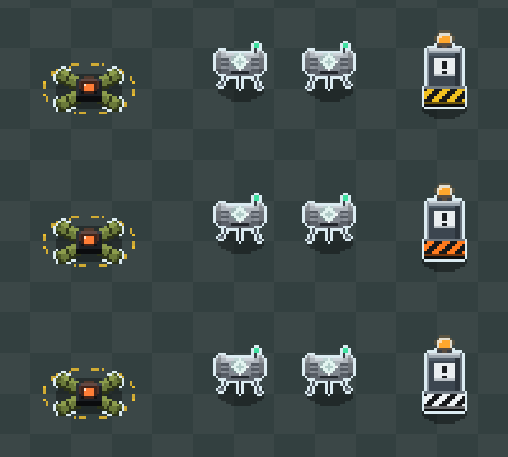
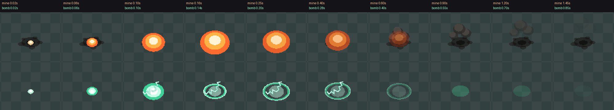
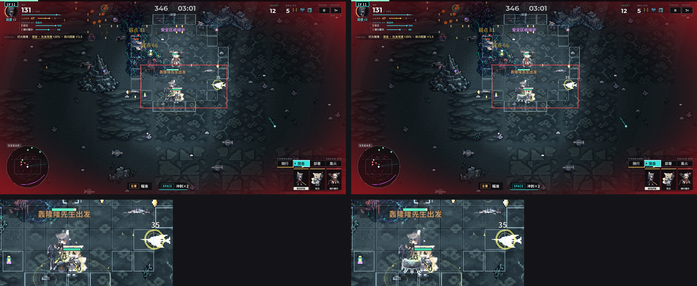
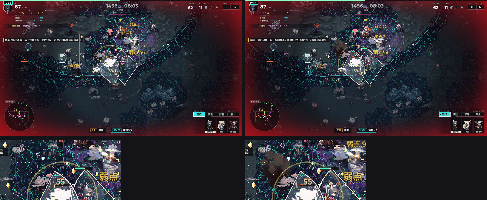

# 245 · 支援放置物重画：地雷 / 轰隆隆 / 防暴桩（11-05）

1. 三件装置（210 支援地雷组 / 211 支援轰隆隆 / 213 支援防暴桩）照原作装置造型，改成运行时代码逐像素画（1 美术像素 = 2 世界像素），挂在 `render/placeable_v2` 后面，**缺省 0 = 旧画法**。
2. 开关打开后：装置本体画在敌人之上，冷白描边 #dcecf2，各带一处呼吸亮点；爆炸分「蓄势 → 爆亮 → 余韵 → 散尽」四段，并在光学层挂一盏短命点光照亮地面，不再画外扩光环和碎火花。
3. 只改画面：同种子 TRACE 在开关关、开两种情况下都和基线逐行相同（无头 600 秒 ×2，xvfb 渲染 495 秒 ×2）。
4. 统计拆了伤害来源名：轰隆隆从「地雷」拆成「轰隆隆」。这只改统计（seed 3 德克萨斯 600 秒：两项相加 = 原来的「地雷」，53338，一分不差）。
5. 待用户定：防暴桩警示纹色板（`render/placeable_stake_pal` 0 现状黄 / 1 偏橙 / 2 偏白）；开关要不要转为缺省开。

分支 `claude/placeables-redraw`，基于 `origin/claude/integ-1105` e80a39eb2。没有放进任何原作素材：造型按协调人从本机客户端找出的参照，由代码重画。

## 1. 改了什么

| 文件 | 改动 |
|---|---|
| `game/scripts/render/placeable_draw.gd`（新） | 三件装置的贴图生成（Image 逐像素，首次用到时生成并缓存）、地面一遍、敌人之上一遍、爆炸四段 |
| `game/scripts/relic_fx.gd` | `draw()`：开关打开时三件旧画法不画，改调 `draw_ground`；新增 `draw_upper()`；地雷与轰隆隆爆炸在开关打开时改调 `boom()`（不再往 `g.fx` 放 explode 环和 spark）；轰隆隆伤害来源改成「轰隆隆」 |
| `game/scripts/render/world.gd` | `_draw_sorted_entities` 之后调用 `g.rfx.draw_upper()`（`--clutterdbg=nofriend` 时同样不画） |
| `game/scripts/game.gd` | `HIT_BASE` 增加「轰隆隆」，属性与「地雷」相同（藏品 / 远程 / 物理 / area + detonation） |
| `game/data/balance.json` | `render/placeable_v2` 0、`render/placeable_stake_pal` 0、`render/placeable_unlit` 1 |
| `tools/late_game_diag_shots.py` | 从 `origin/claude/late-game-diag` 取来，加 `--bal` 透传 |

## 2. 造型（尺寸是世界像素，含 1 美术像素描边）

| 装置 | 尺寸 | 要素 |
|---|---|---|
| 地雷 | 56×36（规格 ≥ 52×32） | 黑色方底座；四条 X 形装甲板臂，橄榄绿，朝上半边亮一档，有深色横缝、下沿厚度和端面；中心橙红芯 #ff6a2e。地面一圈黄色虚线警示纹（12 段，慢转），剩 2 秒时闪烁。**四臂尖连成的外框内不描边**，臂间空隙透出地面和影子，不会被描成白线 |
| 轰隆隆（11-05 第二稿） | 46×40（≥ 44×36） | 正面视角，造型像阔剑地雷：宽而扁的弧面装甲板（19×9 美术像素，正面略内凹、中段略暗，两端向后收成圆角并暗一档）；正面中央白色菱形徽记套一个灰蓝小菱形，下方一道深色横槽，两侧各 3 道散热横纹；底下三条细长支脚向外张开（中间一条在后、暗），两帧交替抬左 / 右脚；天线从顶部右侧伸出，顶端薄荷绿灯 #3fe0a0。不转侧面：行走时左右轻微晃动，上半身朝移动方向错 1 美术像素（贴图分上下两段画）。呼吸亮点在小菱形上。出发时跳一下，寿命剩 1.2 秒时急闪 |
| 防暴桩 | 36×60（≥ 32×56） | 底座斜向警示纹；金属框（顶梁 + 两根立柱）、方箱、白色标牌（感叹号）；顶上琥珀灯 #ff9a2a。放下时从上方落下，两侧扬起两团尘 |

- 呼吸亮点：地雷芯、天线灯、琥珀灯，按 sin 调亮度（保持本色），左上一格高光，外面一圈很淡的像素化光晕。
- 本色显示（`render/placeable_unlit` 1）：装置和爆炸乘 `look.op_unlit_mod`，和干员一样不吃环境暗色与灯火。离灯远时也不发暗发褐，这是后期看得见的主要原因之一。设 0 就和地面一样受光。
- 影子、警示圈、焦痕在敌人之下（原 `rfx.draw()` 的位置）；装置本体和爆炸在敌人之上、我方子弹 / 特效之下。

单件 3 倍放大（展示脚本、纯色地面）：从上到下是防暴桩三套色板 0 / 1 / 2；两只轰隆隆的支脚是不同帧。

## 3. 触发与爆炸

| | 蓄势 | 爆亮 | 余韵 | 散尽 | 点光 |
|---|---|---|---|---|---|
| 地雷（暖橙） | 0–0.05 秒白热团往里收 | 0.05–0.16 秒火球三层（白芯 / #ffb347 / #ff6a2e）长到半径 48 | 0.16–0.7 秒火球收缩、变暗红、上浮；0.18 秒起三团烟 | 到 1.5 秒烟上飘、变大、淡出；焦痕留 4 秒 | 半径 190、暖橙、0.5 秒 |
| 轰隆隆（薄荷白） | 寿命将尽时急闪；爆时 0.05 秒冷白团往里收 | 0.05–0.14 秒冷色圆盘长到 40 | 0.14–0.5 秒原地抖动的地面震荡带（不往外扩） | 到 0.9 秒一片淡薄荷色退掉 | 半径 160、薄荷、0.4 秒 |

- 轰隆隆另有两道静电折线（0.06–0.32 秒，隔帧闪）。
- 所有形状都按 2 像素网格逐行画实心块，不画外扩光环，不碎成火花。散布方向用爆点坐标哈希，不抽任何随机数。
- 点光走 `fx_grains.light`（docs/138 §8，光学开着才有，和别的光共用 12 盏的预算）。
- 屏幕震动、音效不变。
- 地雷没有「敌人靠近」的预兆：触发判定在玩法里，画面不去查询敌人，所以蓄势就是爆炸开头那 0.05 秒。

## 4. 只改画面的核对

- **TRACE**：基线是 e80a39eb2 的缓存（`tools/trace_base.py`，`--relics=210,211,213`）。
  - seed 3 德克萨斯 600 秒，开关关：601 行逐行相同。
  - seed 3 德克萨斯 600 秒，`--bal=render/placeable_v2=1`：601 行逐行相同。
  - 无头不跑绘制，所以另在 xvfb + opengl3 下跑了一组（会走绘制）：seed 11 德克萨斯 495 秒，关 / 开 / 开 + 色板 1，三组 496 行 TRACE 逐行相同。
- **绘制不改玩法状态**：绘制里只往 mines / bombs / stakes 字典写 `_v` 开头的键，玩法不读这些键。散布用位置哈希。开关打开时少放的 spark 原本用的就是 `g.vrng`，也就是画面随机流，不在 TRACE 里。
- **来源名拆分（只影响统计）**：BALANCE 的 `out` / `final_out` 多了一项「轰隆隆」，「地雷」相应变小，总伤害不变。拆分不跟开关走，关着时也生效，所以 BALANCE 行和旧基线不再逐字相同，TRACE 不受影响。
  - seed 3 德克萨斯 600 秒：原「地雷」53338（占 5.63%）→ 地雷 46616（4.92%）+ 轰隆隆 6722（0.71%）。
  - 结算页 / 遥测按来源名分组，会多出一行。

- **快检**：`python tools/check.py --auto --jobs 3`，169 项过 168 项。失败的 1 项是「EA 标题与 HUD」（leader growth / elite show hints Q）。在未改动的 e80a39eb2 上同样失败，和本改动无关。

## 5. 截图

开局直接给 210 / 211 / 213，seed 11，德克萨斯，xvfb + opengl3，1280×720。上排左关右开，下排是红框处 2 倍放大。

- 3:00（帧 2754，轰隆隆为第二稿）：旧画法轰隆隆是一团小灰圆，压在干员脚下的敌人里看不出来；新画法机身、天线灯和描边都看得清。

- 8:00（帧 7352）：这一帧有防暴桩（在队长身后，琥珀灯）和一处地雷爆点的烟。旧画法防暴桩完全被敌人和特效盖住。

注意：1280×720 的画面里镜头约缩到一半，装置在截图上大约是世界尺寸的 1/2。这和干员、敌人的比例相同。

复现：截图用 `--shots` 直接拍（每个目标时刻往后连拍 14 张，约 10 秒，取装置在画面里的一张）。单件图和爆炸逐帧图用一段假 g 的展示脚本，只调 `placeable_draw.gd` 的绘制，没有入库。批量对照可以用 `python tools/late_game_diag_shots.py shoot --ops texas --relics 210,211,213 --layers full --targets 180,480 --bal render/placeable_v2=1`。

## 6. 还没做 / 留给后面

- 防暴桩色板等用户选（三套都在单件图里）。
- 轰隆隆第一稿（侧面、四条短腿）用户看了说「像狗」，11-05 按原作正面造型重画（见 §2），其余两件没动。
- 开关转为缺省开之前，最好再看一局实机录像（手感和后期满屏遮挡）。帧时开销：每件装置一次贴图 + 2–3 个矩形；爆炸每帧几十个矩形。没有单独量。
