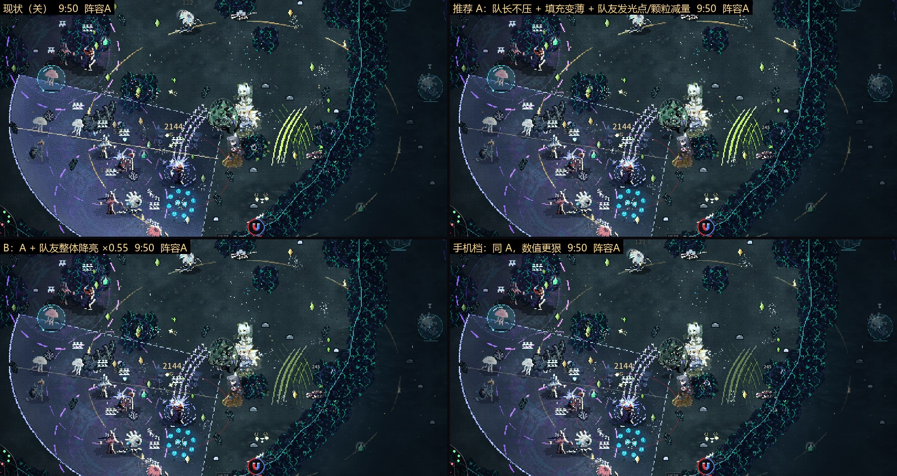
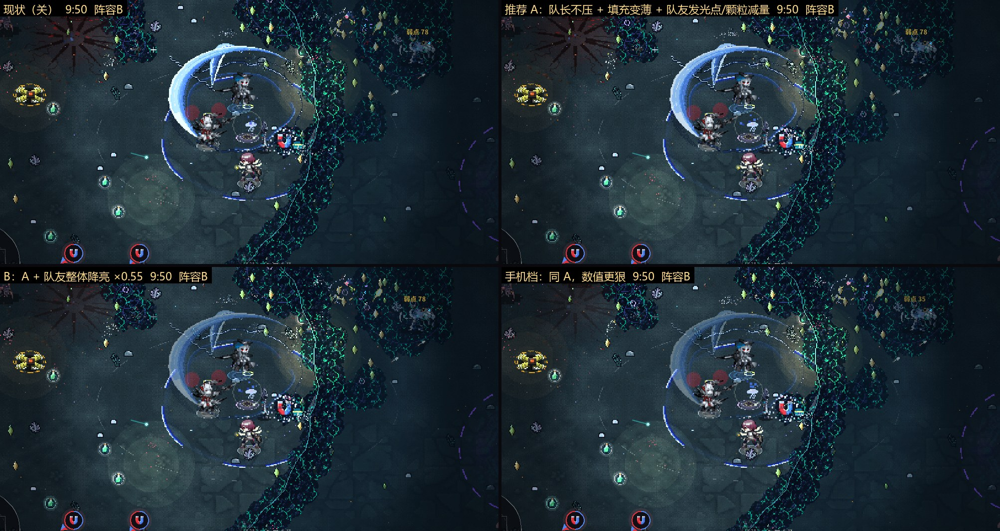

# 293 后期特效控制（后期画面减负）方案（11-06）

**结论**
1. 最糊的 3 帧都在 **7:49–9:50**：逻各斯队 7:49（我方特效占战场区 18.8%）、9:50（14.5%）、8:19（9.6%）。水月队最高 8.9%（8:19）。
2. **最占屏的单一来源是大面积半透明填充，不是颗粒**：逻各斯（队长）S3 咒域扇面一招就占战场区约 15%，罩住扇面里的怪（敌人像素 37–55% 同时被我方特效改了色）。第二是维什戴尔（队友）的红雾 + 炮弹爆点，水月队里占 4–7%，压在怪群上。第三是**转平面立起层**（斯卡蒂潮刃弧这类竖起来的大件），原来绕过拥挤降噪、也绕过诊断的按人静音，所以前一轮数字里没有它（本稿已修，§1.3）。
3. 现有控制有两处和用户口径相反或漏了：拥挤降噪 3 档（`render/declutter` = 3）在满屏时**把队长自己也压到 ×0.8**；转平面的发光点（emit → 辉光层）和照地光**不分队长 / 队友**，降噪压不到，一律按 0.8 进辉光，是「一团雾」的来源之一。
4. 方案按用户口径排了 8 项，挂在一个总开关 `render/late_fx` 下（缺省 0 = 关）。原型已做 6 项，开 / 关对照截图见 §4。用户 10-25 两次说过「队友特效不要降，想其它办法」，所以**队友整体降亮单列为 B 版、不进推荐**；推荐的 A 版只减量、变薄、不压队长。
5. **A 版对逻各斯队有效**（咒域扇面变薄，扇面里的怪看得清），**对水月队几乎没变化**：那一队最占屏的是斯卡蒂的潮刃大弧（队友立起层大件），A 版不碰队友亮度。要压它，要么用 B 版整体降队友，要么做 L8「只让队友的大件变薄」（未做，待用户定）。
6. 只改画面：开关前后同种子 TRACE 两局各 301 行逐行一致（§5）。

基准：main 9577f0831 + `claude/late-fx`（d4dfb7c19，代码整理会话与帧率会话的诊断 + 原型）。分支 `claude/late-fx-ctrl2`。

---

## 1. 诊断

### 1.1 方法
- 局：四人编队、全员精二、成长节点 `--prog=20`、`--nodeath`、种子 11、`--quality=high`、1280×720、`--fixed-fps 60`。
  - 阵容 A：逻各斯（队长）+ 德克萨斯、铃兰、艾雅法拉（同用户截图那一队 + 第 4 位）；
  - 阵容 B：水月（队长）+ 浊心斯卡蒂、维什戴尔、能天使。
- 截图时刻 7:49 / 8:00 / 8:10 / 8:19 / 9:50 / 10:00 / 10:09 / 10:19。
- 分层：同一局再用 `--clutterdbg=nofriend / nofoe / noenemy / nolead / nomates / noop_<id>` 各跑一遍（该层画成全透明，代码和随机数照跑），与完整画面逐像素比，差 > 0.06 的像素算该层掩码；只量中央战场区 (180,150)–(1100,560)（docs/243 §1.3 同口径）。脚本 `tools/gcp/render_jobs/late_fx_diag.sh`、`tools/late_fx_measure.py`。
- GCP：每阵容拆 3 台、每台 3 层（`LAYERS=`），e2-standard-8；上一轮 16 路挤一台 3 小时超时、截图全丢（lfd-d01a）。

### 1.2 前一轮的两个偏差（已修）
- **只进了 3 人**：`--squad=` 在第 4 位没解锁时第 4 人进不去（`run_setup.gd`），lfd-d01a 实际是队长 + 2 名队友。补跑加 `--slot4`，截图里指挥台是 1 大 3 小四个头像。
- **立起层漏量**：转平面立起层（`Pxp.draw_sorted`，按脚底 y 和单位一起排序的竖件）直接画在世界画布上，`nofriend / nolead / nomates` 都没把它隐藏。本稿补跑用的提交还没修这一点，所以下表的「我方特效」**不含立起层**；B 组 8:19 那张图里环绕小队的大蓝弧就是没被掩到的立起层。修在 `world._pxp_sorted`（只量测时生效）。

### 1.3 结果（战场区占比 %；「被盖」= 敌方像素里同时被我方特效改了色的比例，含照地光 / 辉光改色）

| 帧 | 我方特效 | 队长 | 队友 | 各队友 | 敌弹预警 | 敌人 | 敌弹预警被盖 | 敌人被盖 |
|---|---|---|---|---|---|---|---|---|
| A 7:49 | **18.8** | 17.9 | 3.3 | 德克萨斯 2.9 / 铃兰 2.4 / 艾雅法拉 0.6 | 2.5 | 4.3 | 55 | 37 |
| A 8:19 | 9.6 | 9.5 | 2.7 | 德 2.5 / 铃 2.6 / 艾 0.6 | 2.8 | 2.3 | 50 | 55 |
| A 9:50 | **14.5** | 14.1 | 2.6 | 德 1.4 / 铃 2.1 / 艾 0.8 | 1.8 | 5.7 | 49 | 24 |
| A 10:00 | 6.2 | 5.9 | 1.8 | 德 1.1 / 铃 1.3 / 艾 0.5 | 1.3 | 4.0 | 36 | 13 |
| B 7:49 | 6.0 | 2.5 | 4.6 | 斯卡蒂 1.2 / 维什戴尔 3.9 / 能天使 0.8 | 3.3 | 3.6 | 42 | 17 |
| B 8:00 | 6.5 | 1.9 | 5.8 | 斯 1.3 / 维 5.0 / 能 0.6 | 1.0 | 1.5 | 58 | 40 |
| B 8:19 | 8.9 | 2.4 | 7.6 | 斯 1.2 / 维 7.1 / 能 0.8 | 1.7 | 2.4 | 60 | 20 |
| B 10:19 | 3.9 | 1.4 | 2.8 | 斯 0.9 / 维 2.4 / 能 0.5 | 0.9 | 1.7 | 59 | 27 |

（其余 8 帧 ≤ 5%，全表在 `docs/assets/late_fx_ctrl/summary.md`。单人 0.5–0.9% 接近噪声底：GPU 光学颗粒不分人、每遍落点有微差，见记忆 visual-diff-clean-runs。）

- **最糊 3 帧**：A 7:49、A 9:50、A 8:19，三张都是逻各斯 S3 咒域开着：扇面填充（7 阶渐变、最浓 α 0.38）一整片盖在怪群上。图 `worst_A_7132.jpg` / `worst_A_8953.jpg` / `worst_A_7587.jpg`（左原图，右掩码：青 = 队长、黄 = 队友、橙 = 敌弹预警、品红 = 敌人）。
- **按人**：阵容 A 里队长占大头（咒域）；阵容 B 里维什戴尔一人占队友的 70–90%（红雾 + 炮弹爆点），图 `ov_B_7587.jpg`。
- **按条目数**（`--clutterlog`，前一轮 3 人局）：队友的干员粒子（pfx）每人 17–43 条、队长 15–23 条，队友约为队长 2 倍，铃兰 mote 最多；但条目数和占屏不成比例——条目多的是 2–4 像素的小颗粒，占屏的是少数大件（扇面、雾、立起弧）。
- 敌弹 / 预警本身只占 1–3%，但一半像素被我方特效改了色。这里大部分是照地光 / 辉光把底色提亮（不是盖住轮廓），预警轮廓线和敌弹本体画在敌方顶层、在我方特效之上（docs/247 §3）。所以「不压敌弹预警」主要靠**不再让我方的光往预警区里溢**，不是改绘制顺序。

---

## 2. 现有控制（哪些在生效、哪些没生效）

| 控制 | 缺省 | 作用 | 问题 |
|---|---|---|---|
| `render/declutter` 拥挤降噪（docs/226） | 3 | 满屏时友方特效 × 0.25–1、队友 × 0.5、**队长 × 0.8**、颗粒 / 火花 / 数字限量 | 队长也被压，和「队长优先清楚」相反；不管立起层、不管发光点 |
| `render/lead_emph` 突出队长（docs/139 §11） | 1 | 队长特效 × 1.35 | 和上一条相抵，满屏时队长净 ≈ 1.08 |
| `render/pfx_cap` 粒子上限（docs/50 §15） | 30 | 全队上层小粒子合计 > 30 时按人分摊砍最旧的 | 只砍小粒子，大件不管 |
| `render/late_read`（docs/247） | 1，只开 V1 受伤红边 | 受伤红边按承伤驱动 | 其余子项缺省关 |
| `fx/recipe_grains`（docs/245） | 160 | 配方颗粒全队上限 | 配方 `fx/recipe` 缺省关，现在大多数颗粒不走它 |
| 转平面 `EMIT_CAP`（fx_pxplane） | 360 / 帧 | 整队发光点上限 | 不分人；alpha 恒 `fx/px_plane_emit` 0.8 |
| 转平面立起层 | — | 和单位一起排序的竖件 | **绕过 declutter 和 mate_dim**（原型已接上，§3 L5） |
| 用户已定的观感 | — | 逻各斯咒域「改成渐变填充」（11-05）、维什戴尔红色体积雾（11-06） | 方案只在后期、只按比例变薄，不改形状和颜色 |

---

## 3. 方案（按用户口径排序；全部挂 `render/late_fx`，缺省 0）

时间：`late_fx_t0` 480 秒（8:00）起、`late_fx_ramp` 60 秒内爬满（9:00 满档）；之前完全不动。手机网页（`Cfg.mobile_web()`）读 `<键>_mobile`。

| # | 开关 | 效果 | 风险 | 帧时（估） |
|---|---|---|---|---|
| L1 队长优先 | `late_fx_lead` 1 | 后期拥挤降噪不再压队长（lead_dim → 1），队长 = 突出队长的 ×1.35 原样 | 队长大招本身就大时更显眼（见 L2） | 0 |
| L2 大面积填充变薄 | `late_fx_fill` 0.5（手机 0.4） | 整片半透明底（逻各斯咒域扇面）透明度 × 0.5，外亮边、咒文段、每跳亮边照画；队长队友都乘 | 用户 11-05 定的渐变填充后期变淡；原型只接了逻各斯，其余人的大面积底（艾雅法拉熔池、水月水域、维什戴尔红雾……）要逐人接 | ≈ 0 |
| L3 队友发光点减量 | `late_fx_emit` 0.4（手机 0.3） | 队友转平面热芯进辉光层的亮度 × 0.4（队长不动），辉光不再连成一片雾、不往预警区溢光 | 队友的「吃光」感变弱；已接 fx_pxplane / _ir / _lp / _sa / _su / _sz 的 emit，少数自定 alpha 的 4 处没接 | 辉光层少画约一半点，网页可省 0.1–0.3 ms（待量） |
| L4 队友颗粒减量 | `late_fx_grains` 0.5（手机 0.35） | 队友配方颗粒数 × 0.5（主形不动）——「同一招元素 ≤ 2–3 种、不碎」靠减颗粒，不减主形 | 只作用在配方颗粒（`fx/recipe` 开着时）；转平面自带颗粒要逐人接 | CPU 少画约一半颗粒 |
| L5 立起层接降噪 | `late_fx_up` 1 | 队友的转平面立起层改走带队友系数的画布，拥挤降噪对它生效 | 立起层每件多一次 set_mod；对象缓存一张画布 | ≈ +0.02 ms |
| L6 队友整体降亮（**B 版，不推荐缺省**） | `late_fx_mate` 0.55（手机 0.4） | 队友特效整体透明度再 × 0.55 | **和用户 10-25「队友特效不要降」冲突**，只给对照看 | ≈ 0 |
| L8 队友大件变薄（未做） | `late_fx_big`（拟）0.6 | 只给队友的大件（立起层潮刃弧 / 浪墙、范围底这类单件 > 64×64 世界像素）透明度 × 0.6，小件和主形照旧 | 比 B 版温和，但仍属「降队友」；要逐件给尺寸标记 | ≈ 0 |
| L7 预警区避让（未做） | `late_fx_tell`（拟） | 我方特效落在敌方预警 / 敌弹 48 px 内的部分再 × 0.5 | 要在每件绘制处判距离，GDScript 成本高；L3 先把溢光去掉后再看要不要 | 预计 0.3–0.8 ms，偏贵 |

推荐：**A 版 = L1 + L2 + L3 + L4 + L5**（不降队友整体亮度）。B 版 = A + L6。手机档 = 同 A，数值取 `_mobile`。

---

## 4. 对照截图

GCP `render-lfxab3`（提交 5b0576394，任务 `tools/gcp/render_jobs/late_fx_ab.sh`）：同一局（同 §1.1）、同一帧，四格 = 现状 / 推荐 A / B / 手机档（手机档在桌面上用 `_mobile` 数值模拟）。截取中央 1000×530 区域。8:19 时后期系数才爬到 1/3（8:00 起、9:00 满），9:50 是满档。

- `ab_A_8953.jpg`（逻各斯队 9:50）：A 版咒域扇面填充变薄一半，扇面里的怪、敌弹能看清；扇面外亮边、咒文段、每跳亮边照旧；队长本体和德克萨斯 / 铃兰的刀光主形不变。B 版铃兰的黄绿弧线、德克萨斯刀光整体发暗。手机档扇面更薄。
- `ab_A_7587.jpg`（逻各斯队 8:19，系数 1/3）：差别小，用来看「渐进」不突兀。
- `ab_B_8953.jpg`（水月队 9:50）：**A 版与现状几乎一样**——斯卡蒂潮刃大弧是队友立起层，A 版不降队友亮度；B 版 / 手机档大弧变成半透明，弧里的单位看得清。
- `ab_B_7587.jpg`（水月队 8:19）。

---

## 5. TRACE

GCP `trace_ab`，画面开着跑（windowed，画面代码也执行），A 组 `--bal=render/late_fx=0`，B 组 `--bal=render/late_fx=1 --bal=render/late_fx_t0=60 --bal=render/late_fx_ramp=30`（60 秒起就生效，覆盖更长），都加 `--slot4`、`--prog=20`：

| 局 | 行数 | 结果 |
|---|---|---|
| 逻各斯 + 德克萨斯 / 铃兰 / 艾雅法拉，种子 11，300 秒 | 301 / 301 | 逐行一致（cloud-results/render-lfxtrA3） |
| 水月 + 斯卡蒂 / 维什戴尔 / 能天使，种子 23，300 秒 | 301 / 301 | 逐行一致（cloud-results/render-lfxtrB3） |

帧时：本稿没量（本机全机 Godot ≤ 1，且无头批跑不画世界层）。各项都是乘系数、不加绘制，预计持平或略省；推进游戏前用 `tools/probes/perf_stack.py --optab` 同局轮换在 GCP 量一次。

---

## 6. 待用户定
1. 缺省用 A 版（不降队友）还是 B 版（队友整体 × 0.55）；或 A 版 + L8（只让队友大件变薄）。
2. L2 填充变薄要不要推到其余大面积底（艾雅法拉熔池、水月水域、维什戴尔红雾……逐人接）。
3. L7 预警区避让做不做（偏贵）。
4. 手机档数值是否再狠一档。

## 7. 文件
- 代码：`render/world.gd`（`_late_fx_k` / `late_fx_v` / `late_fill_k` / `late_emit_k` / `_pxp_sorted`）、`characters/squad.gd _op_dim`、`render/fx_pxplane*.gd` 发光点、`render/fx_recipe.gd _grains`；参数 balance.json `render/late_fx*`（`_late_fx_doc`）。
- 诊断：`tools/gcp/render_jobs/late_fx_diag.sh`（`LUS=` / `LAYERS=` 拆机，已加 `--slot4`）、`tools/late_fx_measure.py`；截图原件在 GCS `lfx4-*/shots/`（7 天）。
- 对照：`tools/gcp/render_jobs/late_fx_ab.sh`（`LU=A|B VARS="off A B M"`）。
