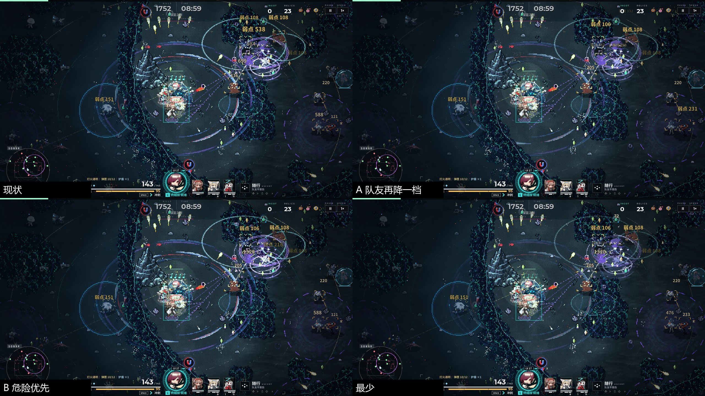
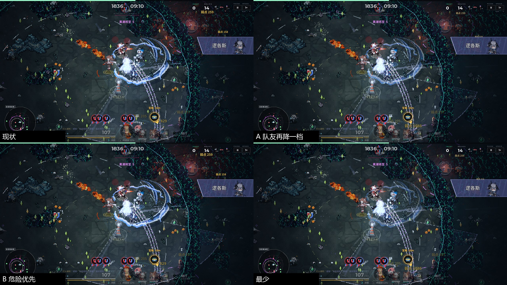
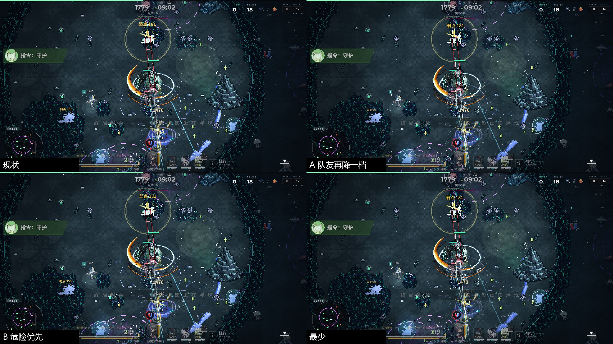
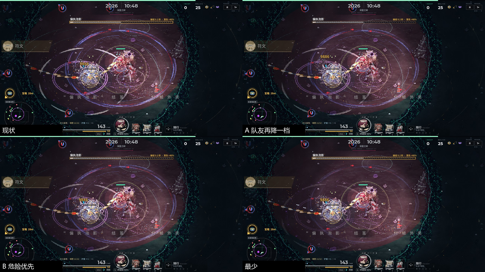

# 398 后期满队画面可读性（画面减负）：诊断与三个方案（11-19）

起因：B站玩家 11-19 留言「现在的视觉效果因为太多而容易看花眼，希望能修一下」。用户同意必须减负。
目标：后期满队时，一眼分得清自己、敌人和危险预警；割草的爽感不丢。
不动的东西：终结技整屏白 + 黑剪影冲击帧（故意保留）、敌方预警本身、队长特效。

## 1. 量法

- 工具：`tools/fx_read_diag.py`（包了 `tools/late_clutter.py` 的分层量测）。同种子（seed 11）、四人编队（`--slot4`）、全员满成长（`--prog=20`）、高画质、伤害数字开、专家机器人、不死。
- 时间点：本作 10:00 出最终 Boss，没有「15 分钟以后」。所以「后期」取 8:40 / 9:10 / 9:40 各连拍 3 张，「Boss」取最终 Boss 开场名牌消失以后（约 10:47–10:50）。
- 三套阵容：
  - A 三辅助：能天使（队长）+ 安洁莉娜 / 铃兰 / 浊心斯卡蒂
  - B 重法术：逻各斯（队长）+ 维什戴尔 / 艾雅法拉 / 斯卡蒂
  - C 近战 + 召唤：德克萨斯（队长）+ 乌尔比安 / 歌蕾蒂娅 / 凯尔希
- 分层：`--clutterdbg=<层>` 把某一层画成全透明，代码和随机数照跑，同一帧逐像素比。新加 `nospark` 层（命中 / 击杀火花）。
- 口径：
  - 占屏 %：和完整画面相比差值大于 8/255 的像素占战场区（去掉上下 HUD）的比例。
  - 实心 %：差值大于 76/255，即看得清的实心部分。
  - 亮度增量：这一层让整个战场平均亮了多少（0–255）。
  - 层像素亮度：这一层所在像素本身有多亮。
  - 噪声底：四个无关层（伤害数字 / 掉落物 / 溟痕 / 地面预警）同时有差的像素算噪声，从各层里扣掉，约占屏 1%。
- 局限：
  - B、C 两队打最终 Boss 太快，Boss 开场名牌一消失 Boss 就倒了。所以 Boss 组只有 A 队的 3 张干净截图。
  - 怪物密度是缺省 0.4，后期同屏怪约 25–40 只。

## 2. 诊断结果

### 2.1 前五名（按「占屏 × 亮度 × 实心」综合排）

1. **队友特效**：最吵，也是整屏变亮的主要来源。
   - 后期占屏 2.6–5.8%，实心 1.5–2.4%，让战场平均亮了 +1.1 到 +3.1。A、C 两队里，我方特效的亮度九成来自队友。
   - 最终 Boss 时（A 队）是 7.2% / 3.6% / +4.1。
   - 单人最重的是**浊心斯卡蒂**：后期 4.0% / 1.7% / +1.9，Boss 时 5.8% / 2.7% / +2.9。主要是绕着队伍的几圈大环（海嗣之歌）。她也在 docs/368 的超限名单里。
   - 其次：维什戴尔占屏 3.6%，但偏暗；艾雅法拉 2.4%，实心 1.4%；歌蕾蒂娅 1.6%，实心 0.9%；安洁莉娜 Boss 时 1.8%，实心 1.0%。
2. **最终 Boss 的大范围地面预警**：占屏约 45%，几乎全是半透明（实心 0.3%），把整片战场染成红紫。
   - 这属于「危险预警」，本单不动。
   - 但它正是用户不喜欢的「大面积半透明盘」，也压低了小弹幕的对比。建议另交 Boss 与怪物会话评估（§5）。
3. **地面残迹（溟痕）**：后期占屏 6.5–8.3%，偏暗（像素亮度 33–43），让画面整体暗了 0.7–1.1。
   - 这是玩法上的伤害区，要看得见，本单不动。
   - 它铺成碎纹理，是「花」的来源之一。
4. **队长特效**：逻各斯当队长时 6.2%（他的招式范围大），其他两队约 0.9%。队长优先，不压。
5. **敌人本体 / 掉落物**：敌人 1.8–2.8%，掉落物 1.2–1.9%（掉落物很亮，像素亮度 80–92）。都要看得见，不压。

命中 / 击杀火花（0.5–0.7%）和伤害数字（0.5–0.6%）在缺省怪物密度 0.4 下都不大。现有的降噪 3 档已经压住了它们。

### 2.2 分层明细（扣掉噪声底；Boss 组只有 A 队）

| 分组 | 阵容 | 层 | 占屏 % | 实心 % | 亮度增量 | 层像素亮度 |
|---|---|---|---|---|---|---|
| late | A | 地面残迹 | 6.5 | 0.4 | -0.7 | 41 |
| late | A | 我方特效合计 | 6.3 | 2.5 | +3.3 | 98 |
| late | A | 队友特效 | 5.8 | 2.4 | +3.1 | 97 |
| late | A | 敌人本体 | 2.8 | 0.5 | +0.1 | 55 |
| late | A | 掉落物 | 1.2 | 0.4 | +0.3 | 87 |
| late | A | 噪声底 | 1.0 | 0.0 | +0.0 | 100 |
| late | A | 队长特效 | 0.9 | 0.3 | +0.2 | 97 |
| late | A | 敌方弹幕+预警+敌方特效 | 0.8 | 0.2 | +0.0 | 80 |
| late | A | 地面预警圈 | 0.7 | 0.2 | +0.0 | 78 |
| late | A | 命中/击杀火花 | 0.7 | 0.2 | -0.0 | 77 |
| late | A | 伤害数字 | 0.5 | 0.2 | +0.2 | 91 |
| late | B | 我方特效合计 | 10.7 | 2.0 | +2.3 | 64 |
| late | B | 地面残迹 | 7.7 | 0.4 | -0.9 | 33 |
| late | B | 队长特效 | 6.2 | 0.5 | +1.1 | 73 |
| late | B | 队友特效 | 4.8 | 1.7 | +1.1 | 63 |
| late | B | 敌人本体 | 2.1 | 0.4 | +0.1 | 52 |
| late | B | 掉落物 | 1.9 | 0.7 | +0.6 | 80 |
| late | B | 噪声底 | 0.9 | 0.0 | +0.0 | 74 |
| late | B | 敌方弹幕+预警+敌方特效 | 0.7 | 0.2 | +0.0 | 68 |
| late | B | 命中/击杀火花 | 0.6 | 0.2 | +0.0 | 68 |
| late | B | 伤害数字 | 0.6 | 0.2 | +0.1 | 72 |
| late | B | 地面预警圈 | 0.6 | 0.2 | +0.0 | 65 |
| late | C | 地面残迹 | 8.3 | 0.5 | -1.1 | 43 |
| late | C | 我方特效合计 | 3.1 | 1.8 | +2.3 | 123 |
| late | C | 队友特效 | 2.6 | 1.5 | +2.0 | 120 |
| late | C | 敌人本体 | 1.8 | 0.5 | +0.3 | 79 |
| late | C | 掉落物 | 1.2 | 0.4 | +0.3 | 92 |
| late | C | 队长特效 | 0.9 | 0.4 | +0.3 | 108 |
| late | C | 噪声底 | 0.8 | 0.0 | +0.0 | 108 |
| late | C | 敌方弹幕+预警+敌方特效 | 0.7 | 0.3 | +0.1 | 90 |
| late | C | 伤害数字 | 0.6 | 0.2 | +0.0 | 91 |
| late | C | 地面预警圈 | 0.5 | 0.2 | -0.0 | 85 |
| late | C | 命中/击杀火花 | 0.5 | 0.2 | -0.0 | 85 |
| boss | A | 地面预警圈 | 44.9 | 0.3 | -0.1 | 55 |
| boss | A | 敌方弹幕+预警+敌方特效 | 42.7 | 0.3 | -3.9 | 58 |
| boss | A | 我方特效合计 | 7.5 | 3.6 | +4.3 | 104 |
| boss | A | 队友特效 | 7.2 | 3.6 | +4.1 | 103 |
| boss | A | 敌人本体 | 1.7 | 0.7 | +0.6 | 110 |
| boss | A | 掉落物 | 0.8 | 0.2 | +0.1 | 85 |
| boss | A | 地面残迹 | 0.8 | 0.2 | +0.0 | 82 |
| boss | A | 噪声底 | 0.7 | 0.0 | +0.0 | 122 |
| boss | A | 队长特效 | 0.6 | 0.2 | +0.2 | 113 |
| boss | A | 命中/击杀火花 | 0.5 | 0.2 | +0.2 | 104 |
| boss | A | 伤害数字 | 0.4 | 0.2 | +0.1 | 94 |

### 2.3 队友逐人（`--clutterdbg=noop_<id>`，占屏 % / 实心 % / 亮度增量）

| 分组 | 阵容 | 干员 | 占屏 % | 实心 % | 亮度增量 |
|---|---|---|---|---|---|
| late | A | angelina | 1.4 | 0.7 | +0.5 |
| late | A | suzuran | 1.1 | 0.3 | +0.2 |
| late | A | skalter | 4.0 | 1.7 | +1.9 |
| late | B | wisadel | 3.6 | 0.4 | -0.1 |
| late | B | eyjafjalla | 2.4 | 1.4 | +0.7 |
| late | B | skadi | 0.8 | 0.4 | +0.2 |
| late | C | ulpianus | 1.0 | 0.5 | +0.3 |
| late | C | gladiia | 1.6 | 0.9 | +1.0 |
| late | C | kaltsit | 1.1 | 0.4 | +0.3 |
| boss | A | angelina | 1.8 | 1.0 | +0.8 |
| boss | A | suzuran | 0.7 | 0.2 | +0.3 |
| boss | A | skalter | 5.8 | 2.7 | +2.9 |

## 3. 方案

三个版本都**不碰**以下内容：队长特效、敌人、敌方弹幕与预警、掉落物、溟痕、终结技冲击帧。下面的旋钮都只改画面，同种子对局状态不变。

### A「队友特效再降一档 + 伤害数字合并」

在 docs/293 A 版后期特效控制上再收一档，并提前开始：

- 起点从 8:00 提前到 5:00，2 分钟内渐入。
- 队友整体透明度 ×0.6。
- 大面积填充 0.5 → 0.35，发光点 0.4 → 0.25，装饰颗粒 0.5 → 0.3。
- 队友伤害数字改小号偏灰（`render/mate_numbers`）。
- 同一片数字的合并窗口 0.6 → 0.9 秒，半径 56 → 72。

效果：全程生效。后期我方实心面积少 15–30%，亮度增量少 20–30%；最终 Boss 时实心少 38%。

代价：队友的招式一直偏淡，平时也是。用户 10-25 说过「队友特效不要降」，11-06 接受了 A 版。

### B「层级优先：危险 > 自己 > 敌人 > 队友」

新加危险度（`render/danger_fade`）：

- 算法：视野里的敌弹数 + 地面预警 ×4 + 抛射物 ×2，从 6 起算、再 40 到顶；最终 Boss 在场时至少 0.5。
- 危险度高时，队友整体透明度最低到 ×0.45，发光点到 ×0.4。危险上来得快（约 0.3 秒），退得慢（约 1.5 秒）。
- 队长、敌人、预警不动。

效果：平时完全是现状（后期普通战斗敌弹少，截图里和现状逐像素一样）。只在弹幕和预警多的时候让位：最终 Boss 时实心少 44%，亮度增量少 33%。

代价：普通后期混战不变。如果玩家觉得「花」主要在普通战斗里，B 版单独用解决不了。

### 设置「特效显示：完整 / 精简 / 最少」

放在设置「画面」页，三档：

- 完整：现状。
- 精简：缺省档，用选定的 A 或 B，或者 A + B 一起。
- 最少：A 再加一档（队友 ×0.4、发光点 0.15、颗粒 0.15）+ B（危险时队友 ×0.35）+ 击杀火花与预算再减（火花 ×0.2，预算 50）。

「最少」效果：后期实心少 40–60%，最终 Boss 时实心少 87%、亮度增量少 65%。

实现方式：用 balance 预设表切一组 `render/*` 键（同 `Bal._preset`），切档后清降噪缓存，局中立即生效。

### 推荐

**精简 = A + B 叠加，并加设置三档**。理由：

- A 管普通后期，B 管 Boss 和弹幕密集时，两者互补。
- 想看满特效的玩家可以选「完整」。
- 另外，**浊心斯卡蒂的大环单独收**。A 队里她一人占队友特效约七成（后期 4.0 / 5.8，Boss 5.8 / 7.2），全局旋钮压不掉那几圈环。这一项和第 3 步的 docs/368 超限整改一起做。

### 实测（我方特效相对「我方全关」：占屏 / 实心 / 亮度增量，三连拍平均）

| 分组 | 阵容 | 版本 | 我方特效占屏 % | 实心 % | 我方亮度增量 |
|---|---|---|---|---|---|
| late | A | 现状 | 7.1 | 2.9 | +3.3 |
| late | A | A 队友再降一档 | 6.9 | 2.0 | +2.4 |
| late | A | B 危险优先 | 7.1 | 2.9 | +3.3 |
| late | A | 最少 | 6.6 | 1.2 | +1.9 |
| late | B | 现状 | 11.3 | 2.3 | +2.3 |
| late | B | A 队友再降一档 | 9.6 | 1.9 | +1.7 |
| late | B | B 危险优先 | 11.3 | 2.3 | +2.3 |
| late | B | 最少 | 8.9 | 1.3 | +1.5 |
| late | C | 现状 | 3.7 | 2.1 | +2.3 |
| late | C | A 队友再降一档 | 3.7 | 1.7 | +1.8 |
| late | C | B 危险优先 | 3.7 | 2.1 | +2.3 |
| late | C | 最少 | 3.6 | 1.3 | +1.6 |
| boss | A | 现状 | 8.1 | 3.9 | +4.3 |
| boss | A | A 队友再降一档 | 7.3 | 2.4 | +3.0 |
| boss | A | B 危险优先 | 7.3 | 2.2 | +2.9 |
| boss | A | 最少 | 6.3 | 0.5 | +1.5 |

## 4. 对照截图

同一时刻、同种子、1 倍正常镜头。每张图左上是现状，右上 A，左下 B，右下最少：

- 后期 8:59，A 队三辅助：
- 后期，B 队重法术：
- 后期，C 队近战召唤：
- 最终 Boss 10:48，A 队：

原尺寸 PNG 在 build/fx_read/shots/r1_{full,vA,vB,vM}/。

## 5. 待用户定 / 后续

- 选哪一版做缺省（推荐 A + B），以及要不要加设置三档。
- 定了以后的第 3 步：
  - 实现选定版本。
  - docs/368 超限干员整改，先浊心斯卡蒂、乌尔比安、逻各斯、歌蕾蒂娅、维什戴尔。
  - 跑快检 core / ui_smoke。
  - 帧时间用同局开 / 关轮换量净差。
- 建议另交 Boss 与怪物会话：最终 Boss「偏执泡影」的大范围预警填充占屏约 45%，是半透明大盘。可以考虑改成边缘 + 稀疏纹理。

